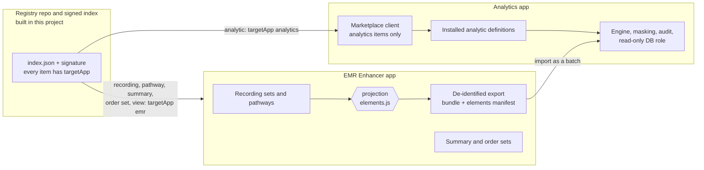
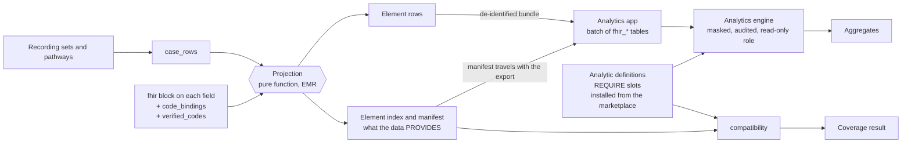

# EMR Enhancer: Final Plan (v6)

*20 Nov 2026 · EMR repo: github.com/avi33tbtt/Vibe-Rounds---EMR-Enhancer-App · Analytics repo: github.com/avi33tbtt/VibeRounds-Clinical-Analytics-App*

> **What this is.** The single plan for the EMR Enhancer, the Analytics app and the GitHub marketplace between them. It replaces the three older plan files. Do not paste it into a coding chat: paste only a Context block (section 12) and one task.
>
> **Where we are.** The repo has none of Phases V to Z built yet (section 11). **Next up: V0a.** The order after that is in 15.3.
>
> **How to read it.** Part I says what and why. Part II is the design. Part III is status, method and open decisions. Part IV is the build plan, in build order, one task per chat (it ends with the demo data, Phase D, and the marketplace library, Phase Z).

## Contents

**Part I: Direction**

- [1. Reason and idea](#1-reason-and-idea)
- [2. Separation rule: two apps, one registry](#2-separation-rule-two-apps-one-registry)
- [3. The final outcome: a complete EMR and a GitHub marketplace of composable items](#3-the-final-outcome-a-complete-emr-and-a-github-marketplace-of-composable-items)

**Part II: Design**

- [4. The approach: patient journey and four composable domains](#4-the-approach-patient-journey-and-four-composable-domains)
- [5. Role first: every element starts with its access](#5-role-first-every-element-starts-with-its-access)
- [6. The FHIR spine: recording to FHIR elements to analytics](#6-the-fhir-spine-recording-to-fhir-elements-to-analytics)
- [7. Analytics as a composable domain, in detail](#7-analytics-as-a-composable-domain-in-detail)
- [8. Summary and Orders, in detail](#8-summary-and-orders-in-detail)
- [9. The design in short](#9-the-design-in-short)

**Part III: Status, method and decisions**

- [10. What is built so far](#10-what-is-built-so-far)
- [11. What the repo check found](#11-what-the-repo-check-found)
- [12. How to work, and the Context blocks](#12-how-to-work-and-the-context-blocks)
- [13. Open decisions](#13-open-decisions)
- [14. Manual jobs (not tasks)](#14-manual-jobs-not-tasks)

**Part IV: Build plan**

- [15. Build order, gates and phase map](#15-build-order-gates-and-phase-map)
- [16. Phase V: EMR views become pathways (do first)](#16-phase-v-emr-views-become-pathways-do-first)
- [17. Phase R: role-based access for every element](#17-phase-r-role-based-access-for-every-element)
- [18. Phase F: the FHIR element spine (EMR)](#18-phase-f-the-fhir-element-spine-emr)
- [19. Phase 5 (rest): handover time](#19-phase-5-rest-handover-time)
- [20. Phase 6: content lifecycle and marketplace](#20-phase-6-content-lifecycle-and-marketplace)
- [21. Phase A: analytics in the Analytics app (separate repo)](#21-phase-a-analytics-in-the-analytics-app-separate-repo)
- [22. Phase M: the matching marketplace](#22-phase-m-the-matching-marketplace)
- [23. Phase S: Summary](#23-phase-s-summary)
- [24. Phase O: Orders engine (small, behind a review gate)](#24-phase-o-orders-engine-small-behind-a-review-gate)
- [25. Phase 7: operational components, rewritten as data](#25-phase-7-operational-components-rewritten-as-data)
- [26. Phase H: tests, security, deploy](#26-phase-h-tests-security-deploy)
- [27. Phase D: synthetic and longitudinal demo data (10 patients)](#27-phase-d-synthetic-and-longitudinal-demo-data-10-patients)
- [28. Phase P: free choice of coding, and profile labels](#28-phase-p-free-choice-of-coding-and-profile-labels)
- [29. Phase Z: ship the composable library (final phase)](#29-phase-z-ship-the-composable-library-final-phase)

---

# Part I: Direction

## 1. Reason and idea

**What went wrong.** The plan said every screen should come from the same engine: element sets (data) plus pathways (bundles of sets), like the disease pathways (DKA, snakebite, fever). Phase 5 chunks 37c and 37d then built the ward screens by hand: the I/O sum is code that names `care.intake_output`, `io_time`, `io_type` and `io_volume`; the ward board and the Handover tab are fixed screens with a fixed list of sections. Phase 7 (orders, MAR, allergies, ADT, charge summary) was about to repeat this with view types called `orders` and `mar` and special logic per component.

**What you want.** No hand-written clinical screens. The EMR views (ward board, handover, orders, MAR, allergies, schedule, I/O sum) are themselves **pathways**: seed content in the registry, versioned, forkable, tiered, installable from the marketplace, exactly like a disease pathway. The code only knows a small, generic vocabulary (how to show a latest value, a sum, a status board, a list of sections). The data says which set and which fields.

**The fix, in order.**
1. **Phase V (first):** define the vocabulary, validate it, build a generic renderer registry, then re-home what is already built (I/O sum, ward board, handover) as pathway data with identical output. Add a test that fails if hand-named sets or fields creep back into code.
2. Finish the rest of Phase 5 as planned.
3. Phase 6 gets two small additions (lint and tests for view data).
4. Phase 7 is rewritten so orders, MAR, allergies, ADT and charge summary are seed sets and view pathways plus a few generic view types, not special screens.

**Why this is better, not only tidier.** One mechanism to secure and test. Facilities can change a ward board or handover layout by editing data (a local draft pathway) with no new release. Marketplace packages can carry whole EMR layouts. A new ward screen costs one data file and, at most, one small generic renderer with a test.

## 2. Separation rule: two apps, one registry

*Owner's decision, 20 Nov 2026. It overrides anything below that says otherwise.*

**All analytics run in the Analytics app (VibeRounds Clinical Analytics). The EMR app contains no analytics engine, no analytic definitions and no analytics screens.** The marketplace is built in this project (the registry repo and the signed index) and serves **both** apps, but each app fetches and installs only its own kind of content.



| | EMR Enhancer | Analytics app | Registry (this project) |
|---|---|---|---|
| Does | record, summarise, order, export | all analytics, cohorts, research tools | host and sign packages |
| Fetches from the marketplace | recording, pathway, view, summary layout, order set | **analytic definitions** (and later, reference-list templates) | n/a |
| Never has | analytic engine, analytic definitions, `analytics.run`, `element_rows` table, masking code | recording forms, patient charting | patient data |
| Owns the element contract | yes (`elements.js`, projection, element index) | uses it through the **elements manifest** that travels with each export | stores `provides` / `requires` in the index |

**How the pieces meet**
1. The EMR projects case rows to element rows and exports a **de-identified FHIR bundle plus an elements manifest** (the list of element keys the data contains, no set or field ids). One route, one audited action (`analytics.export`).
2. The Analytics app imports the bundle as a **batch** through its existing import route (locked by the import password and the data-use confirmation, as today). Exporting again into the same batch name updates records by resource id, so the export uses stable ids per row.
3. The Analytics app fetches the signed index from the registry, verifies the signature with the pinned public key, and lists only items with `targetApp: "analytics"`. Install recomputes the hash, lints, and stores the definition read-only.
4. **Coverage** (definition vs what the data can provide) and **readiness** (definition vs what the data actually holds) are both computed in the Analytics app, from the manifest and from its existing data profile.
5. The EMR app lists and installs only `targetApp: "emr"` items. An analytic package offered to the EMR is refused by lint and by the install route, and the reverse.

**Why this is good for the project**
- The EMR server stays small: fewer routes, fewer actions, nothing that runs heavy queries next to the ward's charting.
- Analytics already has what a governed analytics system needs there: a SELECT-only database role, small-cell hiding (5 patients), audit with tamper evidence, import locks, readiness checks, the five modes.
- A research user and a ward nurse never share a screen or a role table.
- One registry and one signing key; two small clients.

**What this removes from the earlier plan (all later text follows it)**
- The in-app engine (old Route 2), the `element_rows` table, `analytics.run` and `analytics.patients` in the EMR, and masking code in the EMR are **not built**.
- Tasks 38a0 to 38a4, 38a5, 38b1, 38b2, 38b5 are not built in the EMR (the Analytics app has masking and patient-list audit already). 38b3 and 38b4 (de-identified exports) become F7.
- The hand-named `ana()` in `enhancer.html` is **retired** (task F9), which empties the V8a allow-list.
- Phase A is now a phase **in the Analytics repo** (section "PHASE A").

**Still open, see decisions 30 to 33:** roles in the Analytics app, whether the EMR shows any analytics information, whether the existing 14 analytics move into packages, and whether the export is pushed or pulled.

## 3. The final outcome: a complete EMR and a GitHub marketplace of composable items

### 3.1 The goal in one paragraph
Three things exist and work together. (1) A **complete EMR**: registration, recording, summary, orders, allergies, MAR, ADT, charge summary, handover, ward board, with login, roles, audit and conflict handling, built the way Parts II and IV describe. (2) A **GitHub registry** (the marketplace) holding signed, versioned, composable items for recording, summary, orders and analytics. (3) The **Analytics app**, which fetches analytic items from that registry and analyses data exported from the EMR. Nothing clinical is hard-coded in either app; all clinical content arrives as data. Both apps are built as **engines** that run content, the Analytics engine already exists and the EMR engine is the plan (3.7).

### 3.2 Definition of done (the final gate)

| # | The outcome is true when... | Checked by |
|---|---|---|
| 1 | A fresh install of the EMR, with an empty database, runs the whole patient journey on **synthetic data** with no hand-named clinical code left (guard tests pass) | V8, F8, Z8 |
| 2 | Every screen after login is a registered type plus data; the fixed frame is exactly the one in rule E7 | V8, manual review |
| 3 | Every element in both apps has an `access` block and the generated access matrix passes for all five EMR roles | R6, AA14 |
| 4 | The registry repo publishes a signed `index.json`; a changed byte, a bad signature, or a wrong `targetApp` is refused by both apps | 46a1c, AA3, AA4, Z7 |
| 5 | The first library (3.3) is installable: EMR items in the EMR, analytic items in the Analytics app, each with its coverage shown | Z6, Z7 |
| 6 | An export from the EMR imports into the Analytics app and the wave 1 analytics run on it, with small groups hidden and one audit row per run | F7, AA6, Z8 |
| 7 | A backup restores onto a clean database in both apps | 41b3 |
| 8 | The "Not for clinical use" banner is still there. Removing it needs the named-clinician sign-off in GOLIVE.md, not a release | 41c2 |
| 9 | The ten synthetic demo patients (Phase D) load on a fresh database and in Demo mode, exercise every domain, export to the Analytics app, and give the results `demo-expected.json` predicts | D5, D7 |
| 10 | A form author can pick any mix of SNOMED CT, LOINC, ICD, own local codes or no code per field; a form with no codes records, exports and shows coverage without error; a profile label is shown only with its checked-on date and never as "compliant" | P3, P12, P13 |

### 3.3 The first library (what the marketplace launches with)
Data only. No doses, thresholds, bands, rules or pre-filled codes in any item.

| Domain | Items in the first release | Installed in |
|---|---|---|
| Recording | vitals, intake/output, HbA1c monitoring, sliding-scale record, daily insulin grid, basic EMR template, the DKA, snakebite and fever pathways | EMR |
| EMR views | ward board, handover, MAR, schedule, charge summary | EMR |
| Orders and related sets | orders set with its engine block, allergies, MAR, ADT/schedule | EMR |
| Summary | derived cards are built in; first optional layouts | EMR |
| Analytics (wave 1, 7.3) | data completeness, demographic distributions, encounter utilisation, procedure volume, condition prevalence, medication utilisation, lab and vital summary (no abnormal share) | Analytics app |

Waves 2 and 3 of analytics (7.3) follow only when reference lists (class 3) exist and have named reviewers.

**Not part of the library:** the ten demo patients (Phase D). They are data, live in each repo's own demo files, and are never published as packages.

### 3.4 What "composable" means for an outside author
Someone who is not you can write a recording set, an order set, a summary layout or an analytic definition as one JSON package, run the lint locally, open a pull request to the registry, get it reviewed, and have it appear in the right app's marketplace with a "verified by peer review, not regulatory approval" label. Authors never need to touch app code. That is the test of the whole design.

### 3.5 What is not yet proven (read this before calling it solid)
- **It is a plan, not a system.** The repo has none of Phases V, R, F, A, M, S, O or Z yet (section 11, item 6). Nothing here has been run.
- **Closed vocabularies are the bet.** The role list, the analytic kinds and the view types must stay small and still be enough. The first real packages will test that; expect to revise the lists.
- **Matching can mislead.** A "covered" result means compatible data, not the right clinical meaning. The wording rule and manual binding reduce this; real users will still misread it.
- **Peer review needs people.** "Reviewer is never the author" and "two reviewers for rules" cannot be met by one developer. Until a second named reviewer exists, nothing can honestly be labelled marketplace-verified.
- **Two apps keep two copies of shared code** (`compatibility()`, `package-lint.js`). CI diff checks reduce drift but must exist from day one.
- **Regulation.** Health-data law, medical-device-software rules and terminology licences (SNOMED CT, LOINC) apply where this runs. Section 40c5 only lists what to confirm.
- **Scale and performance** of the projection, the export and the engine on real volumes are untested.
- **"Any system, any speciality" is a hypothesis.** It holds only while a small, closed set of view types is enough. Obstetrics partograms, oncology cycle grids, ICU device data and radiology reports will stress it; expect to add types.
- **Specialty content is data, new view types are code.** Informaticians can write templates alone; a developer must be available for the occasional new generic type (pure function, made-up-set test, validator entry). Clinical content also needs a clinician reviewer.
- **Layering has no merge rule yet.** Profile, disease template and local edit are layers; if two disagree (a required code versus "no code allowed"), the plan does not say which wins. Decision 43 must be settled before Phase P is built.
- **Customisation versus safety.** Every local edit is a place where verified content can drift. The tier labels (marketplace-verified, local-reviewed, local-draft) are what keep that visible; they must stay prominent.
- **Speed is untested.** Authoring a template as data should be fast; nothing has been measured, including projection, export and matching on real volumes.
- **Analytics sees SNOMED CT and LOINC only for now** (decision 42). Other codings are stored and exported but counted as uncoded there.
- **Early value is limited by the banner.** Until a named clinician signs off (GOLIVE.md), the "Not for clinical use" banner stays, so early use is training, demos, research on synthetic data and pilots.
- **Prior art exists.** openEHR archetypes, FHIR Questionnaires and CDS Hooks each cover part of this. The claim is the combination in one small app, not any single idea.

### 3.6 Why this could matter (the paradigm shift, if it works)

Most EMRs hard-code clinical content into screens, so every new specialty, disease pathway or national profile needs a software release, a vendor contract and months of waiting. This design flips that: the software is a small, stable engine, and clinical content is **data** that qualified people can write, review, sign, share and install.

What that would change, if the first build proves it:
- **Speed.** A new disease template is a reviewed data file, not a development project. An outbreak pathway could go from idea to installed in days.
- **Who builds the EMR.** Clinicians and informaticians author the content. Developers maintain the engine and add the occasional generic view type.
- **Sharing.** A pathway written in one hospital can be installed in another with its version, reviewer and hash visible: app-store logic for clinical content.
- **Standards as layers.** A national profile, a verified disease template and a local customisation are layers of the same mechanism, each labelled with what was checked (never "compliant", decision 41).
- **Analytics from day one.** Analytics reads the same element structure the recording uses, so data is analysable without later clean-up.
- **Reach and cost.** A small server and open content can serve a rural clinic and a large hospital with different data, which matters most where heavyweight EMRs are unaffordable.
- **Extensibility by experts.** Specialty depth (obstetrics, oncology and others) can be added later, one reviewed template at a time, at the pace reviewers allow, without touching the core.

**This is a vision, not a result.** Read it together with 3.5. The first real proof is Gate 1 (the I/O sum, ward board and handover become pure data), followed by one real specialty template built entirely as data (for example obstetrics). If that needs no new view types, the central claim has real evidence; if it needs one or two, the design still holds and you have learned where the vocabulary ends.

### 3.7 The core power: an EMR engine, built the way the analytics engine was

*Owner's framing, 20 Nov 2026. Checked against the public README of VibeRounds Clinical Analytics (19 commits at the time of reading); I read the README, not the code.*

**The idea in one paragraph.** The Analytics app is not a pile of fixed reports. It is an **engine** (`analytics.js`) that runs a catalogue of analytics in five modes over scoped data, with the safeguards built into the engine itself: a SELECT-only database role, small groups hidden on the server, an append-only audit log with a hash chain, import locks, and a readiness check that says what the data can support. The EMR Enhancer is meant to be the same kind of thing for care: a small, stable **EMR engine** (view types, element projection, access, audit, orders engine) that runs **content** (sets, pathways, summary layouts, order sets, profiles) which people write as data. In both apps the engine enforces safety and the content carries the clinical meaning.

**Why that helps clinicians and informaticians work together, at scale and at speed.**

| What the Analytics app already does | The same pattern in the EMR engine |
|---|---|
| An analytic is a definition run by one engine, so adding one does not mean a new screen | A recording, summary, order set or pathway is data run by generic renderers (Phase V, rule E1 to E3) |
| AI only **proposes** codes; a person approves, edits or rejects; source codes always win; the AI's own pick is kept so agreement can be measured | AI drafts of forms and rules stay drafts; a clinician or informatician approves; tiers show who reviewed what (Phase 6, section 44) |
| A readiness check says what the data can feed before anything is run | Coverage (definition level) and readiness (data level) in sections 6.2 and 7.4 |
| A deterministic synthetic generator makes the same data from the same seed | Phase D demo patients, same idea |
| Tamper-evident audit, roles table, one place for permissions | Phase R access blocks, `permissions.js`, audit rows in the same transaction |
| Reviewer decisions kept apart from derived values and the built-in dictionary | Class 3 reference lists (6.8) |

The division of work this gives:
- **Clinicians** say what must be recorded and shown, and review wording and content.
- **Informaticians** turn that into sets, pathways and profiles as data, lint them, and submit them for review.
- **Developers** keep the engine small, add a generic type only when data cannot express a need, and keep the guard tests green.
- **Nobody** has to wait for a release to change a form, a ward board or a handover layout, and every change is versioned, tiered and audited.

**Why this could scale.** Adding the tenth specialty costs the same kind of work as adding the second: content, lint, review. The engine does not grow with the content. The registry and the signed index let one reviewed item reach many sites.

**What this does not prove (read with 3.5).**
- The Analytics app is built and documented; the EMR engine is a plan with nothing built. "More powerful" is a claim about what the design can do, not about what exists.
- The two engines have different risk. Analytics reads exported, de-identified data. The EMR engine sits at the bedside, writes clinical records and carries orders, so its tests, access rules and review gates have to be stricter, not equal.
- Speed and scale are untested in both apps on real volumes (the Analytics README itself says a full smoke run takes minutes on 400 patients and import is about 25 seconds per 1,000 synthetic patients).
- Collaboration at scale needs people: a named clinician reviewer and an informatician reviewer who is not the author. One developer cannot satisfy that.

**Patterns worth copying from the Analytics app as they come up** (not new tasks; use them when writing the matching task): propose then review then approve with the proposer's pick kept; "source wins over enriched"; a "check everything" readiness job with plain reasons for each blocked cell; `--selftest` files that need no database; a cache key that includes the version of every input.

---

# Part II: Design

## 4. The approach: patient journey and four composable domains

*This is the owner's model. It sets the direction for everything below; the rest of the plan follows it. The status of each change is in 4.8.*

### 4.1 The idea in one paragraph
A patient moves through a journey: register, record, summarise, order, analyse. Registration is built into the software. The other four steps are **composable**: each is content that a user picks, mixes and installs, like the forms are today. The user **starts with Recording**, because the recorded data drives everything after it. Summary, Orders and Analytics are then offered, checked and shown against the chosen recording, and the user can also start from an order set or an analytic and work backwards.

### 4.2 The journey and what is fixed or composable

| Step | Approach | Fixed (hard-coded) part | Composable part |
|---|---|---|---|
| 1. Registration | Built in, by default | MRN, duplicate check, merge, one open encounter per bed, national id handling | none |
| 2. Recording | **Composable (anchor)** | version pinning, row rules, entered-in-error, audit | pathways, sets and templates, from the marketplace |
| 3. Summary | **Composable** | alert evaluation and acknowledgement | summary layouts; a default summary is derived from the recording |
| 4. Orders | **Composable, plus a small engine** | order status rules, roles, audit | order sets and catalogs |
| 5. Analytics | **Composable, in the Analytics app only** | the engine, masking of small counts, audit (all in the Analytics app) | analytics definitions, from the marketplace, installed in the Analytics app |

Always fixed, in every step: sign and amend notes, rule approval, alert acknowledgement, audit log, permissions, login, conflict handling, the "Not for clinical use" banner. These enforce safety. Composable content can change what is shown, never what is enforced.

### 4.3 Four composability domains
1. **Recording.** Pathways, sets and templates that capture patient data. This is what exists today. It is the anchor.
2. **Summary.** How the recorded data is brought together for a quick view. Default: each applied set gives its own card (latest value, age, count) from its own definition, so a new pathway needs no summary work. A summary layout only reorders or overrides.
3. **Orders.** Two parts. (a) Order sets: a list of what can be ordered, entered freely like a recording, with free-text instructions and no dose logic. (b) An order **engine**: statuses, which changes are allowed, whether a reason is required, who may do it. The engine is declared as data but enforced by the server. Other records refer to an order by its id. No other system is connected (FHIR is export only).
4. **Analytics.** (Lives only in the Analytics app, section 2. Detail in 7; built on FHIR elements, 6.) Closed kinds of analysis (for example count, distribution, time series, sum by key, time to event, data completeness) declared as data and run on the server with small-count masking. A definition never contains a free expression, a threshold or a target.

### 4.4 One contract: provides and requires
- A **recording** states what it **provides**: its fields, each with a structural role (the closed list of seven in 6.4) and, when a verified code is attached, a concept. Provides is **derived** from the set and its `fhir` blocks and `code_bindings`; nobody types it.
- A **summary, order set or analytic** states what it **requires**, as slots. It never names a set id.
- The software compares them and produces a **coverage result** per slot: met, partly met or unmet. It also shows the other direction: recording fields that nothing uses.
- Matching compares role, type and unit. It never converts units. A person can also bind a slot to a field by hand, and that choice is saved.
- Every match shows its basis ("matched on: number, mL") so a person can judge it.

### 4.5 The cross-matching marketplace
The marketplace for all four domains shares one index of what each item provides or requires. It works in both directions, with the recording as the main starting point.

1. **Pick a recording.** The marketplace lists:
   - every compatible **summary** layout,
   - every compatible **order set** (free choice, like recordings),
   - (EMR app: summaries and order sets only. Compatible **analytics** are shown in the Analytics app, from the elements manifest of an export; see section 2.)
   and for each one shows what is **covered** and what is **not covered**.
2. **Pick an order set or summary first (EMR), or an analytic (Analytics app).** It lists the recordings or data that can feed it, with the same covered and not-covered view.
3. **Pick several items.** The result can be read two ways:
   - **AND:** only items whose needs are all met by the selection.
   - **OR:** items with at least one need met, with the unmet needs flagged.
   The screen also shows **what remains**: slots still unmet and recording fields nothing uses.
4. **Go back and forth.** The user can change any selection and the other lists update.

"Covered" means the data is compatible. It never means the care was adequate. Wording on screen follows the same rule as the ward board: data as recorded, no judgement.

### 4.6 Two kinds of matching, built in this order
1. **Structural** (first). Role, type and unit, such as "a number with a unit and a time". Safe and checkable. The view blocks in Phase V already declare this.
2. **Concept** (later, optional). "A fever trend needs body temperature." The shared name is the **verified code already attached to the field** (`code_bindings`), so no new governed vocabulary is needed (6.4). Built only after the structural layer works.

### 4.7 Risks to design for
- **Vocabulary drift.** The list of roles must stay short and closed. A new role needs an informatician's approval.
- **False matches.** Same role, different meaning. Reduced by showing the match basis and allowing a manual binding.
- **Coverage read as quality.** Prevented by wording and a test.
- **Version drift.** Matches record the versions they were made against and are re-checked on update. A view that cannot match its set hides that part with a plain note and never shows a wrong number (fail visible, not silent).
- **A changed field breaks its users.** A "who uses this field?" check on set save warns before a field is removed or retyped.
- **Too many selections at once.** Start with one recording and one list per domain.
- **Analytics privacy.** Masking lives in the engine, not in any package.
- **Orders carry real risk.** The order engine is the first place where data needs enforcement. It stays small and goes behind a review gate.

### 4.8 What changed in the plan, and its status
- **Phase V (current):** the view vocabulary, I/O slice first. Stays, and gains the hand-named spots found in the audit (HbA1c due badge, dailygrid targets, BP pairing, default pins, sliding-scale echo, inline seed copy). *Unchanged.*
- **Capability contract = Phase F (F0 to F3).** Role vocabulary (6.4), element index, pure `compatibility()` with a coverage report, tests with made-up sets. No screen. *Written in v3.*
- **Matching marketplace = Phase M.** Provides and requires in the signed index, matching in the browser, then picker, reverse, AND/OR and manual binding. *Written in v3.*
- **Domains, in order:** Summary (Phase S), then Orders (Phase O: set plus engine), then Analytics (Phase A, closed kinds, server-run, masked). Phase A (now in the Analytics repo) replaces the 38a tasks; Phase O replaces the client-only status change of 48b1; the rest of Phase 7 continues after them. *Written in v3.*
- **Review gates:** after the I/O slice (V4), after F3, and before Orders (15.3).
- **Resolved by v3 (proposals; confirm in section 13):** the first list of roles (6.4, decision 24); who approves new roles (decision 25); how a manual binding is stored (decision 26); Summary layouts (decision 27).

## 5. Role first: every element starts with its access

**Rule.** Before an implementer builds or installs any element (a recording form, a summary layout, an order set, an analytic, a view pathway), the first decision is **who may do what with it**. Nothing is built until its access is written down. The server enforces it; the screen only mirrors it.

### 5.1 Access actions (a short, closed list)

| Action | Meaning |
|---|---|
| `view` | see its data or its output |
| `enter` | add rows or values |
| `amend` | correct a row (own or others', stated per element) |
| `approve` | approve, verify, enable or sign what it contains |
| `configure` | edit its definition, install it, switch it on or off |
| `export` | take its data out of the system (CSV, FHIR, de-identified) |

Roles are the existing five: viewer, nurse, doctor, informatician, admin. A new role is a decision, not a side effect.

### 5.2 What each domain must declare

| Domain | Typical questions the implementer answers first |
|---|---|
| Recording | who enters, who amends, who sees; may a nurse enter before a doctor has applied it? |
| Summary | who sees it; does it show anything beyond what the viewer may see in the recording? |
| Orders | who places, who changes status, who discontinues, who administers |
| Analytics | enforced in the **Analytics app** with its own roles (decision 30): who sees aggregates, who sees patient lists, who installs, who exports. The EMR only decides who may export data to it (`analytics.export`). |
| View pathways | who may switch them on (decision 11) |

### 5.3 How it works
- Each element carries an `access` block: for each action, the list of roles. Roles are taken only from the role table in `permissions.js`.
- **Default deny.** A new element with no `access` block is refused by lint. Existing seed sets get a block that reproduces today's behaviour exactly, so nothing changes silently.
- **Narrow, never widen.** An element can only restrict what a role already has in `permissions.js`. It cannot give a viewer the right to enter.
- **Every route checks it** on the server, together with the normal version check and audit row. Hidden buttons are only a mirror.
- **Matching respects access.** The marketplace only offers a viewer analytics and summaries that the viewer's role may see for the selected recording.
- **Marketplace packages carry a suggested `access`.** At install the admin sees it, confirms or narrows it, and the install uses the narrowest result. A package role that does not exist locally is refused.
- **Changing access is audited** (who, before, after) and, for reviewed content, creates a new version.
- **Tested as a matrix:** every element, every action, every role, generated from the data, like the existing role-by-route test.

### 5.4 Open questions (see decisions 18 to 20)
- Today roles are global. There is no restriction by ward or team. Is that enough?
- Who may change an element's access: admin only, or also informatician?
- Does analytics need its own role (for example analyst) that sees aggregates only and no patients?

"Perfect" cannot be promised in advance. What the plan can promise is that access is explicit, default-deny, enforced on the server and covered by a generated test for every element.

## 6. The FHIR spine: recording to FHIR elements to analytics

*Owner's rule: analytics is built on FHIR elements and on nothing else. The same rule already runs the sister project (VibeRounds Clinical Analytics, github.com/avi33tbtt/VibeRounds-Clinical-Analytics-App), which reads only `fhir_*` tables. This section makes the EMR side match it.*

### 6.1 The rule in one line
An analytic never reads a set id, a field id or a case row. It reads **element rows**: one recorded value described in FHIR terms. Exactly one piece of code knows both worlds, the **projection** (6.5). Everything before it is recording and lives in the EMR. Everything after it is analytics and lives in the Analytics app; the export is the only bridge (section 2).



### 6.2 Words used from here on (one meaning each)

| Word | Meaning in this project |
|---|---|
| **Element** | A field of a set that is bound to FHIR: a resource, a value type, a unit, and optionally a verified code. The unit of everything below. |
| **Element key** | Text that identifies an element for matching: `Resource.path \| role \| unit \| system:code` (see 6.4). |
| **Element row** | One recorded value of one element: patient, encounter, time, key, value, status. Produced by the projection. Never stored by hand. |
| **Provides** | What a recording offers: its list of element keys. Derived from the set, never typed by hand. |
| **Requires** | What a summary, order set or analytic needs: a list of **slots**. A slot is a wished-for element key with parts left open (for example any code, unit mL). |
| **Coverage** | A *definition-level* check, before any patient data exists: does recording A provide what analytic B requires? met, partly met, unmet. Lives in the marketplace and on set save. |
| **Readiness** | A *data-level* check, after data exists: is the data actually filled in, coded and dated enough for this analytic to return something? Modelled on the "Analytics readiness" screen of the analytics app. |
| **Projection** | The pure function `projectCase(...)` that turns case rows into element rows. |
| **Reference list** | Clinical lists an analytic may need that must never sit in its definition: first-line drugs, risky pairs, abnormal limits, goals. See 6.8. |

Coverage and readiness are different questions. Coverage says "this recording *can* feed this analytic". Readiness says "this ward's data *does* feed it today". Both are shown, never merged into one score, and neither is a statement about quality of care.

### 6.3 What already exists in the repo, and what is missing

*Checked on the public repo clone (commit `eacd1bd`). I read code and migrations; I did not run `npm test`.*

| Piece | Where | State |
|---|---|---|
| Field to FHIR binding | `fhir:{resource, valueType}` on a field in `element-sets.js` (for example `temp`, `io_volume`) | exists on numeric fields; absent on time, select and text fields |
| Verified codes, field bindings | tables `verified_codes (system, code, display)` and `code_bindings (set_id, field_id, system, code, display)` in `001_core.sql` | exists; nothing is pre-filled (rule: a person adds a code verified in the official browser) |
| Recorded values | `case_rows (case_id, set_id, group_id, row jsonb, row_time, status, entered_by)`; `status` is `active` or `entered_in_error` | exists; `row` is `{fieldId: value}` as typed |
| Who and when | `cases.patient_id`, `cases.encounter_id`, `patients.mergedInto` | exists |
| Export to FHIR | `buildBundle` in `enhancer.html` | exists; client side, identified export for one case |
| Role of a field (time, number, category...) | nothing | **missing**: derived from `field.type` in F2 |
| Unit as UCUM | `unit` is a display string (`mL`, `°C`) | **missing**: matching compares the string as typed, never converts |
| A way to list "what does this recording provide?" | nothing | **missing**: F2 |
| Diagnoses as an element | only `diagnosis:{text, snomed}` on the case seed | **missing**: no `Condition` recording set (see decision 28) |
| Procedures | no set | **missing** (analytics 12 cannot run until one exists) |
| Registration demographics as elements | `patients` table and encounters exist | **to check** in F0: which of gender, birth date, race, ethnicity are captured |

### 6.4 Roles and the element key

A **role** says what kind of value a field holds, in terms matching can compare. The list is **short and closed**; a new role needs an informatician's proposal and an admin's approval (decision 25). First list, each tied to a FHIR type so the meaning is not invented here:

| Role | FHIR type | Set field type it comes from | Matching compares |
|---|---|---|---|
| `time` | dateTime / effectiveDateTime | `datetime` | role only |
| `quantity` | Quantity | `number` (with or without `unit`) | role + unit string (unitless is `-`) |
| `category` | CodeableConcept | `select` | role (+ option list, shown, not required) |
| `status` | code | `select` flagged as status in the view block | role |
| `text` | string | `text` | role |
| `actor` | Reference(Practitioner) | session user | role |
| `link` | Reference | text holding another row's id (decision 14) | role |

**Element key** format, one line, human readable:

```text
Observation.value | quantity | mL  | -                      (I/O volume, no code attached)
Observation.value | quantity | Cel | <system>:<verified>    (a temperature with a verified code)
```

Two levels of matching, built in this order (this is 4.6, now concrete):
1. **Structural.** Compare resource, role and unit. Works with zero codes. This is what ships first.
2. **Concept.** Also compare `system:code`. This needs no new governed list: the concept is the **verified code already attached through `code_bindings`**. A facility that has attached a verified code gets concept matching on that field; one that has not still gets structural matching plus manual binding. No code is ever filled in by the software.

**Coding is a free choice (Phase P).** A field may carry several codings (any code system, a local system, or none), so the key's last part becomes a list of `system:code` pairs; with none it is `-`. Matching on a code system is optional: a slot says `codeSystem: any` unless an author asks for one.

Rules that keep matching honest: no unit conversion; every match shows its basis ("matched on: quantity, mL"); a same-role-different-unit pair is shown as "unit differs" with a manual bind button; a manual bind is stored locally and audited (decision 26).

### 6.5 The projection (the one place both worlds meet)

`projectCase(caseRows, sets, bindings)` is a **pure function** in a root file `elements.js` (browser and Node, same pattern as `views.js`). Rules:

1. One element row per active row per bound field. Rows with `status = entered_in_error` are skipped.
2. Time comes from the row's `row_time`. If it is null the element row is kept with no time and counted by the completeness analytic; it still counts for V1/V2, not for V4.
3. Value as recorded. Units are never converted, doses are never parsed, free text stays text.
4. A code appears on an element row only if `code_bindings` holds it for that field. Unverified codes never appear.
5. Patients are resolved through `mergedInto` by the caller; the function receives the final patient id.
6. Viewing and projecting write nothing (rule E6).

Element row shape:

```json
{"patientId":"<uuid>","encounterId":"<uuid>","caseId":"<uuid>","rowId":"<uuid>",
 "resource":"Observation","role":"quantity","unit":"mL","system":null,"code":null,
 "valueNumber":250,"valueText":null,"time":"2026-11-20T08:30:00Z","status":"active",
 "source":{"setId":"care.intake_output","setVersion":2,"fieldId":"io_volume"}}
```

`source` is kept only so a person can trace a number back and so a "who uses this field?" check works. **No analytic definition may read `source`** (rule E9).

*Why a pure function first and not a SQL view:* case rows are `jsonb` keyed by field id, and the field list lives in set definitions, so a generic SQL view has to know the sets. A pure function is testable with made-up sets (rule E3). The function is the single source of truth for the export (F7); the EMR keeps no analytics table.

### 6.6 How element rows reach the analytics (one route)

The EMR does not run analytics. It **exports**; the Analytics app **imports and analyses**.

| Step | Where | What |
|---|---|---|
| 1 | EMR | `projectCase` makes element rows (6.5) |
| 2 | EMR | the export route (F7) writes a de-identified FHIR R4 bundle and an **elements manifest**: the element keys present, with counts, and no set or field ids |
| 3 | Analytics app | imports the bundle as a batch through `POST /api/import-fhir` (import password and data-use confirmation stay); stores the manifest with the batch |
| 4 | Analytics app | installed analytic definitions are checked against the manifest (coverage) and the data profile (readiness), then run on the scoped views |

Same batch name on re-export updates by resource id, so the export gives each element row a stable id. Whether the export is **pushed** by an admin or **pulled** by the Analytics app on a schedule is decision 33 (default: pushed by an admin, because it keeps the EMR free of outbound calls).

**Which app does what, so they do not blur:**

| | EMR Enhancer | VibeRounds Clinical Analytics |
|---|---|---|
| Purpose | recording at the bed, summary, orders, export | all analytics and research |
| Analytics engine, definitions, masking | **none** | all |
| Free SQL, AI-written queries, knowledge graph | none | yes, behind a SELECT-only role and a query guard |
| Marketplace items it installs | recording, pathway, view, summary, order set | analytic definitions |
| Roles | viewer, nurse, doctor, informatician, admin | viewer, analyst, admin (decision 30) |
| Input | live case rows | imported FHIR bundles in batches |

**Where EMR element rows land in the analytics app's tables:**

| EMR element source | FHIR resource | Analytics app table | Notes |
|---|---|---|---|
| vitals, labs, I/O, any numeric result | Observation | `fhir_observation` | code needed for V2/V4 |
| diagnoses (new set, decision 28) | Condition | `fhir_diagnosis` | |
| medication orders | MedicationRequest | `fhir_medication` | order text is free text, so V1 only until a code is attached |
| allergies | AllergyIntolerance | `fhir_allergy` | |
| ADT, schedule | Encounter | `fhir_encounter` | |
| procedures (no set yet) | Procedure | `fhir_procedure` | |
| MAR, non-medication orders | MedicationAdministration, ServiceRequest | **no table** | not exported to analytics at first (decision 29) |

*One honest limit:* I read the Analytics app's README, not the code of `analytics.js`. Task AA0 is a no-code assessment of what the engine really assumes before anything is added to it.

### 6.7 Modes and readiness, in terms of what a recording carries

The analytics app has five modes. In EMR terms, a mode is simply "what must an element carry?":

| Mode | Element must carry | If a recording lacks it |
|---|---|---|
| V1 text | text value | still usable; weakest |
| V2 codes | a verified code (`code_bindings`) | the element is invisible to V2; coverage shows "needs a code" |
| V3 enriched | V2, plus approved enrichment for uncoded text | enrichment is done in the analytics app (strings coded once, a person approves) |
| V4 codes + time | verified code and a time | rows with no `row_time` are flagged by the completeness analytic |
| V5 enriched + time | V3 plus time | enrichment adds codes, never dates |

So a recording author can see, before any patient is entered: "this form supports V1 and V4 for temperature; I/O volume is V1 only until a code is attached." That is the practical payoff of putting FHIR elements first.

### 6.8 Reference lists: where clinical lists may live

Many of the 14 analytics need a clinical list: first-line drugs for a condition, risky drug pairs, chronic-condition lists, abnormal lab limits, control goals (the Disease module uses HbA1c 7 and systolic BP 140 as goals). The EMR plan forbids these in definitions (rule E4, and 4.3: no threshold or target). Three classes resolve the clash:

| Class | What | Where it lives | Example |
|---|---|---|---|
| 1. Definition | slots, kind, grouping, access | the package; reviewed; hash-pinned | "count patients per code of this slot, by year" |
| 2. Run parameter | a number or choice typed when running | not stored in any package; echoed on the result and in the audit row | "goal: [typed], look-back: 12 months" |
| 3. Reference list | a clinical list with a named owner | local only; created by a person, approved by an informatician (two reviewers if it holds limits); arrives `enabled:false` if it ever comes in a package | first-line drug list, risky pairs |

This is the same pattern the analytics app already uses for `concept_overrides` (reviewer decision, then data-derived value, then built-in dictionary) and the same "needs local enable" step as marketplace rules (46c5). **First wave of analytics uses only class 1 and class 2**, so nothing in a package can carry a clinical judgement.

### 6.9 Privacy and access, where each rule lives

| Rule | Where it lives |
|---|---|
| Small groups hidden (under 5 patients, `PATHWAY_MIN_CELL`) | Analytics app, server side, already built |
| SELECT-only database role for every analytic | Analytics app (`db-readonly.sql`), already built |
| Patient lists audited as PHI reads | Analytics app, already built; new definition lists follow it (AA10) |
| Who may install or run a definition | Analytics app roles (decision 30) and the definition's `access` block |
| De-identification of the export (no name, MRN, phone, national id; pseudonymous ids; dates as days since encounter start, decision 22) | **EMR** export route (F7), audited as `analytics.export` with the filter used |
| Who may export | EMR, doctor and admin (action `analytics.export`) |
| Import lock and data-use confirmation | Analytics app, already built |

The EMR therefore carries **one** analytics-related permission, `analytics.export`.

## 7. Analytics as a composable domain, in detail

### 7.1 What an analytic definition is
*(Installed and run in the Analytics app only.)* A small JSON document: a **kind** from a closed list, **slots** it requires, how to group and window, who may use it. It contains no query text, no expression, no threshold, no target, no drug or code list.

```json
{"setId":"analytic.vitals_completeness","kind":"analytic","contexts":["analytics"],"version":1,
 "title":"Data completeness of a numeric recording",
 "analyticKind":"completeness",
 "requires":[
   {"slot":"value","resource":"Observation","role":"quantity","unit":"any"},
   {"slot":"when","role":"time","sameRowAs":"value"}],
 "groupBy":["encounter.ward","month"],
 "params":[{"name":"months","type":"integer","min":1,"max":36,"default":6}],
 "modes":["v1","v2","v4"],
 "output":{"table":true,"chart":"bars"},
 "access":{"view":["analyst","admin"],"configure":["admin"]},
 "rules":[]}
```

Things the validator (AA1) refuses: a key named `sql`, `where`, `expr`, `eval`, `function`, `threshold`, `target`, `limit`, `band`, `dose`; a slot that names a set id or field id; a missing `access` block; a `requires` slot with an unknown role; more than one `analyticKind`.

### 7.2 The closed list of analytic kinds
The first six are in your plan (4.3). Two more are needed to cover the existing 14 analytics and are marked "propose" (adding a kind needs a pure function, a test with a made-up set, a validator entry and a line in the docs, rule E3).

| Kind | Answers | Source in the analytics app |
|---|---|---|
| `count` | how many patients or rows per group | prevalence, utilisation, volumes |
| `distribution` | spread across categories or bands of one slot | demographic distributions |
| `timeseries` | a measure per month or year | yearly trends |
| `sumByKey` | plain sum of a quantity per key and window (the I/O idea, at ward level) | volume per type |
| `timeToEvent` | days from event A to event B, with "within N days" shares | diagnosis to first prescription, readmission |
| `completeness` | share of rows filled, coded, dated | Data quality and completeness |
| `summaryStats` (propose) | mean, median, IQR of a quantity; no "abnormal" without a class 3 list | Lab and vital summary |
| `pairs` (propose) | two slots occurring together, or B within N days after A | Comorbidity patterns, co-prescription |

### 7.3 The 14 existing analytics, mapped

Taken from the analytics app's README table. "Reference" says which class from 6.8 the analytic needs beyond its definition. **Wave 1 = needs nothing beyond class 1 and 2**, so it can ship as a marketplace package with no clinical list in it.

| # | Analytic | Kind(s) | Slots required | Reference needed | Wave |
|---|---|---|---|---|---|
| 14 | Data quality and completeness | `completeness` | any element and its time | none | **1 (first)** |
| 1 | Demographic distributions | `distribution` | registration gender and birth date; optional Condition code | none (age bands are display bands typed as a param) | **1** |
| 7 | Encounter utilisation | `count`, `timeseries` | Encounter class, period | none | **1** |
| 12 | Procedure volume | `count`, `timeseries` | Procedure code, time | none; needs a Procedure recording set | **1** (after set exists) |
| 2 | Condition prevalence and incidence | `count`, `timeseries` | Condition code, onset | none; needs a Condition set | **1** (after set exists) |
| 3 | Medication utilisation | `count`, `timeseries` | MedicationRequest code, time | none; V1 only until orders carry codes | **1** |
| 4 | Lab and vital summary | `summaryStats`, `timeseries` | Observation quantity, code, time | % abnormal needs class 3 | 1 (without % abnormal) |
| 5 | Comorbidity patterns | `pairs` | two Condition slots | none | 2 |
| 11 | Allergy profile and conflicts | `count`, `pairs` | AllergyIntolerance code, severity | conflicts need class 3 | 2 |
| 8 | Chronic disease control | `summaryStats` | Observation, time | goal as class 2 param or class 3 list | 2 |
| 9 | Preventive screening and care gaps | `count`, `timeToEvent` | Procedure, interval | interval as class 2 param | 2 |
| 6 | Treatment patterns | `timeToEvent` | Condition, MedicationRequest | first-line list, class 3 | 3 |
| 10 | Polypharmacy and risky pairs | `pairs` | MedicationRequest codes | risky-pair list, class 3 | 3 |
| 13 | Multimorbidity burden | `count`, `distribution` | Condition codes | chronic list, class 3 | 3 |

The richer analytics of the analytics app (Disease module, Inpatient trajectory, Kaplan-Meier, care pathways, knowledge graph) stay there. They need free-form logic or reference data that closed kinds cannot hold. The bridge (Route 1) is how a researcher uses them on EMR data.

### 7.4 One run, step by step (in the Analytics app)
1. A user whose role is in the definition's `access.view` picks the definition and a **scope** (population or batch, cohort, date range; the analytics app's existing scope rules).
2. The app computes **coverage** from the batch's elements manifest and **readiness** from the data profile, and shows both before running.
3. The app runs the kind's function over the scoped views on the read-only connection.
4. Groups under the minimum are hidden.
5. The result carries: scope used, definition version, parameters typed, the mode that ran, readiness counts (rows uncoded or undated), the "as of" time of the export, and a plain "data as recorded, no judgement" line.
6. One audit row is written (who, definition id and version, scope, params; never results or patient data). A patient list is a separate action with its own audit row.

## 8. Summary and Orders, in detail

### 8.1 Summary (derived by default)
Every applied recording gets a **card** with no layout work. The card is produced from the set's elements by role:

| Role of the main field | Card shows |
|---|---|
| `quantity` | latest value, unit, age of the reading, count in the last window |
| `category` or `status` | latest value and its age |
| `text` | latest entry, shortened, with its time |
| groups with a `time` and a `statusboard` | count per status group |

A **summary layout** (a data document, `contexts:['summary']`) only does three things: orders the cards, hides cards, or overrides a card's window. It requires slots, never set ids. A layout whose slot is unmet hides that part with a plain note, never a wrong number (fail visible, 4.7). Whether layouts are marketplace items or built in is decision 27; default: derived cards built in, layouts as marketplace items later.

### 8.2 Orders: a set plus a small engine
- The **order set** is an ordinary recording (`care.orders`, 48a1) with free text. It is the only place order content lives.
- The **engine** is a data block next to the set that says which status changes are allowed, which need a reason and who may do them. The **server enforces it**; the screen only mirrors it (this is what 4.3 means by "declared as data, enforced by the server").

```json
{"engine":{"statusField":"ord_status",
  "transitions":[
   {"from":"Draft","to":"Active","roles":["doctor","admin"]},
   {"from":"Active","to":"Completed","roles":["doctor","nurse","admin"]},
   {"from":"Draft","to":"Discontinued","roles":["doctor","admin"],"reasonField":"ord_reason","reasonRequired":true},
   {"from":"Active","to":"Discontinued","roles":["doctor","admin"],"reasonField":"ord_reason","reasonRequired":true}],
  "never":["delete","reopenFrom:Discontinued"]}}
```

Rules: a change that is not listed is refused with 422 and a plain sentence; a refused change writes nothing; an allowed change uses the normal row patch (version sent, 409 on conflict, one audit row in the same transaction); a discontinued row is kept. The role lists can only narrow what `access` already allows. Doses stay free text and are never calculated or summed. This replaces the client-only `actions` idea in 48b1 for the status change itself; `actions` stays as the button layer that calls the engine.

## 9. The design in short

Three layers. Only the third is new.

| Layer | What it is | Status |
|---|---|---|
| Sets | Fields, repeat groups, units (`care.vitals`, `care.intake_output`) | unchanged |
| View blocks | Optional declarative blocks inside a set: how its rows are shown | `view.type` flowsheet / fever / dailygrid exist; new optional keys added in Phase V and 7 |
| EMR view pathways | A pathway (`kind:'pathway'`, `contexts:['emr']`) with a `surface` (where it appears) and optional `sections` (what it lists) | new |

**View block keys (all refer to field ids declared in the same set; none holds a dose, threshold, band or rule):**

| Key | Does | First used by |
|---|---|---|
| `summary:[{type:'sumBy', timeField, keyField, valueField, windowsHours, label}]` | plain sum of entered rows per key in a window; never compared to anything | I/O (V4) |
| `board:{show:'latest'}` | what a ward-board cell shows (default latest value and its age) | V5 |
| `banner:{chipField}` | active (not entered-in-error) values as a chip in the patient banner | allergies (49) |
| `statusboard:{statusField, groups:[{label, values}]}` | read-only grouping of rows by status | orders (48) |
| `actions:[{label, field, to, reasonField?, reasonRequired?}]` | one-click row patch of one field, through the existing row route | orders (48) |
| `crosscheck:{against:{setId, field}, textField, message}` | non-blocking note when two typed texts match | MAR (49) |
| `drives:{...}` | informational only, see decision 15 | ADT (50) |

**Surface types (closed list; adding one means a generic renderer plus a test):**

| Surface | Where | Sections / content |
|---|---|---|
| `case_tab` | an extra tab in a patient's chart | `sections[]` (see below) |
| `patients_columns` | columns on the Patients ward board | members, or `columnsFrom:'pinned'` |
| `patients_panel` | a panel on the Patients screen | one member set with an `upcoming` view |
| `banner_chips` | chips in the patient banner | members with a `banner` block |
| `export_section` | a sub-view in Export | sections for the charge summary |

**Section types for `case_tab`:** `narrative`, `activePathways`, `latestValues` (scope applied), `ackedAlerts` (hours), `newRows` (since `lastHandover`), `setTable` (a member set as a table), `statusboard`, `linkedgrid` (MAR).

**Worked examples (data only, no clinical values):**

```json
{"setId":"care.intake_output", "view":{"type":"flowsheet","timeField":"io_time",
 "summary":[{"type":"sumBy","timeField":"io_time","keyField":"io_type","valueField":"io_volume",
             "windowsHours":[8,12,24],"label":"sum of entered rows"}]}}

{"setId":"pathway.emr.ward_board","kind":"pathway","contexts":["emr"],"members":[],"rules":[],
 "surface":{"type":"patients_columns","columnsFrom":"pinned"}}

{"setId":"pathway.emr.handover","kind":"pathway","contexts":["emr"],"members":[],"rules":[],
 "surface":{"type":"case_tab","id":"ho","label":"Handover","print":true},
 "sections":[{"type":"narrative"},{"type":"activePathways"},{"type":"latestValues","scope":"applied"},
             {"type":"ackedAlerts","hours":24},{"type":"newRows","since":"lastHandover"}]}
```

**Engine rules (the "nothing hand-written" test):**

- **E1.** Code (`enhancer.html`, `store.js`, `api.js`) never names a clinical set id, field id or option text. Only seed data and tests do.
- **E2.** Every screen is a registered view, section or surface type plus data.
- **E3.** A new type needs: one pure function, a test that uses a **made-up set** (proves it is generic), a validator entry, one line in `VIEWS.md`.
- **E4.** View data holds ids, labels and display windows only. No doses, thresholds, bands or rules. Pathways stay `rules:[]` in seed.
- **E5.** View pathways are ordinary content: versioned, tiered, forkable, read-only when from the marketplace.
- **E6.** Viewing writes nothing. Writes use the existing row routes with the existing permissions, versions (409) and audit.
- **E8.** Every element (set, view pathway, order set, analytic) starts with an `access` block (section 5). No block, no seed, no install.
- **E9.** The EMR contains no analytics (section 2). Analytic definitions, engine and screens live only in the Analytics app. Definitions read the data only through slots (resource, role, unit, optional code), never a set id or field id; `source` on an element row is for tracing, never for logic. `elements.js` names no seed ids. Guarded by F8 in the EMR and by AA14 in the Analytics app.
- **E7.** The fixed frame stays fixed: patient banner, Summary, Flowsheets, Notes, Pathway, Alerts, Export, Settings and Tools. Safety-critical screens (alerts, notes signing, audit) are not data-driven.

---

# Part III: Status, method and decisions

## 10. What is built so far

*Source: the three old plan files. **Test count, measured 20 Nov 2026:** `npm test` on GitHub commit `86d8259` (PostgreSQL 16, clean clone) gives **285 tests, 285 pass, 0 fail**. This does not include the five orphan test files (`sum-by-type`, `board-no-reading`, `handover-data`, `handover-view`, `handover-print`); V0a adds them, so write the new total here after V0a. If your local copy is newer than `86d8259`, re-run `npm test` and replace the number.*

**Prototype, chunks 1-25G (single file `enhancer.html`, localStorage).** Skeleton, AI schema generation, dynamic forms, code validation, FHIR bundle, analytics, DKA demo; element-set registry and trajectories; direct elements (quick bar, fever chart, daily insulin grid, vitals flowsheet, HbA1c due badge); pathways (`pathway.dka`, `.snakebite`, `.fever_monitoring`, member lists only); rules and AI-drafted rules (approved by a clinician, never auto); EMR shell (banner, Summary, Flowsheets, Notes with sign and amend, Pathway, Alerts, Export, Patients list, shortcuts).

**Server, chunks 26-28.** Express + PostgreSQL 16 in the repo root, numbered migrations (`001_core.sql` to `008_changes.sql`), REST API in `api.js` with strict validation, `seed.js` loading `element-sets.js` as read-only seed rows, `API.md`. Repeat readings live in `case_rows` (append, patch with version, entered-in-error with a reason, max 500 per group).

**Client store, chunks 29-31.** `store.js` (`window.Store`): cache-first reads, ordered write queue, per-entity versions, save-status text, Demo mode. Reference data (sets with versions, rules, protocols, usage, codes) through the API. Import from this browser (dry run, report, all-or-nothing). Conflict screen (three-way compare, never overwrites an entered-in-error row or a signed note).

**Login and roles, chunk 32.** scrypt passwords, cookie sessions (idle 30 min, absolute 12 h), lockout after 5 failures, CSRF token, roles (viewer, nurse, doctor, informatician, admin) in one table `permissions.js`, role-by-route matrix test, first-admin script, login screen, role-hidden controls, users screen, forced password change, last-admin protection.

**Audit, chunk 33.** Append-only `audit_log`, audit screen and CSV (formula-safe, export itself audited), version history per row and value, history drawer, view-audit rows (once per user per case per 10 min), sign-in events.

**Patients, chunk 34.** Patients and encounters on the server (MRN with check digit, duplicate check, merge via `mergedInto`, one open encounter per ward and bed, no deletes), `Store.patients`, find/register dialog, encounter start and case link, banner and Patients list on real data (`patientView(c)`), one-time demo-patient migration, real FHIR Patient and Encounter in an audited export.

**Rules on the server, chunk 35.** Server-stamped approval (a typed approver is ignored; edit resets approval), alert acknowledgements as records (`alert_acks`), "Rules in force" screen and CSV.

**AI on the server, chunk 36.** `llm.js`, off by default, admin switch, de-identification, a confirm dialog showing the exact text sent, per-user limit, audit row per call with no content.

**Wards, chunk 37.**
- 37a: `GET /cases/:id/changes` and live refresh by polling (10-15 s, paused when the tab is hidden, never overwrites a field being typed).
- 37b: seed set `care.intake_output`; "Entered by" initials in flowsheets.
- 37c1-c2: shift sum on the I/O flowsheet (`sumByType`, `ioSum`). **Hand-coded; re-homed in V4.**
- 37c3-c5: ward board (`boardRow`, ward filter, "No reading for N min" only from an approved `minutes_since_gt` rule). **Fixed screen; re-homed in V5.**
- 37d1-d3: handover data, view and A4 print layout (`handoverData`, Handover tab). **Fixed section list; re-homed in V6.**

**Not built yet:** everything in Part IV: Phases V, R, F, 5 (rest), 6, A, M, S, O, 7, H and Z. Section 11 lists what the repo check found.

## 11. What the repo check found

*Re-checked on 20 Nov 2026 against the public repo (commit `79bc8c8`, "5th commit"). I read the code; I did not run `npm test` or open the app.*

1. **Hand-named code (the reason for Phase V).**
   - `enhancer.html` around lines 1507-1511: `sumByType` reads `r.io_time`, `r.io_volume`, `r.io_type`; `ioSum` returns nothing unless `s.setId=='care.intake_output'`.
   - Around line 1853: `boardRow`; line 1860: `handoverData` (fixed list of five sections); line 1893: `renderPatients` builds the board; line 187 and 459: the Handover button and pane are fixed HTML; line 981: the tab dispatcher calls `handoverRender()` by name.
   - Around lines 2418-2435: `ana()` reads `r.temp` directly (analytics, handled in 38 and decision 16).
2. **Five test files are not in `npm test`:** `sum-by-type.test.js`, `board-no-reading.test.js`, `handover-data.test.js`, `handover-view.test.js`, `handover-print.test.js`. They exist but the `test` script in `package.json` does not run them. Fixed in V0a.
3. `env.example` is already gone; only `.env.example` remains.
4. This plan is in the repo root as `emr-enhancer-final-plan.md`. The three old plan files now sit in a `plan/` folder (optional: `git rm -r plan`). Nothing in code reads them. `plan/` is a folder in a repo whose rule is "no folders", so deleting it is tidier.
5. Seed pathways are member lists only with `rules:[]`; seed sets have zero rules and thresholds. This is the pattern Phase V keeps.
6. **Re-check for v3 (clone at commit `eacd1bd`, "5th commit").** `views.js`, `VIEWS.md`, `elements.js` and any Phase V code do **not** exist yet, so nothing in V, R, F, A, M, S or O is built. Section 6.3 lists what the repo already has for the FHIR spine (`fhir` blocks on numeric fields, `verified_codes`, `code_bindings`, `case_rows` with `row_time` and `status`, `buildBundle`). Because analytics now live in the Analytics app, `ana()` (about lines 2418-2435) is retired by F9 instead of being ported. Section 11 item 1 line numbers come from the earlier commit `79bc8c8`; re-run the V0b grep before relying on them.

## 12. How to work, and the Context blocks

**Why chats ran out before.** Your limit is spent on what you paste, what Claude writes back, and how long the chat runs. So every task is one file and one concern, usually 30-90 new lines.

1. New chat. 2. Paste the **Context block** once. 3. Paste the task prompt and only the code on its **Paste** line (`grep -n "name" file` then `sed -n 'A,Bp' file`). 4. Apply edits, `npm test`, commit. 5. Tick the box here. One task per chat; stop when it is done.

Ask for **edits only**: "exact old text to find, new text". Never ask for a whole `enhancer.html`.

**Task size rule (audit, 20 Nov 2026).** A task is micro when it has one file, one concern, one prompt of about 60 words or fewer and at most 90 new lines. If a prompt has "and" joining two jobs, or two files, or a route plus a screen plus tests, split it. In v5 the 24 oversized tasks were split, so ids with a letter suffix (F3a, F7b, AA12c) are parts of one old task; in the text above a bare id such as F7 means all its parts. Exceptions that stay as they are: no-code inventory tasks (V0b, F0, D0, AA0), doc-only tasks, and pure data seeds.

**Handover line** (if a chat ran out): `Task <id> partly done. Done: <1 line>. Left: <1 line>. Files changed: <names>.`

```text
Project: EMR Enhancer. Node + Express + PostgreSQL 16, all files in repo root (no folders), single-file client enhancer.html, element-sets.js, cds-rules.js, store.js (window.Store, cache-first), api.js, permissions.js (can(user, action), ROUTE_ACTIONS), audit.js, numbered migrations, node:test + supertest. Demo mode (localStorage) must keep working.
Safety: no pre-filled doses/thresholds/bands; doses are free text, never calculated or summed; AI drafts only; unapproved rules never fire; data shown as recorded, no judgement of care; every write carries the version last seen (409 on conflict) and writes one audit row in the same transaction; follow mergedInto for patients; keep the "Not for clinical use" banner; new routes need an action in permissions.js and an entry in the audit-coverage test.
No hand-written clinical screens: code never names a clinical set id, field id or option text. Every EMR screen is a registered view/section/surface type plus data in a seed set or an EMR view pathway (contexts ['emr'], surface, sections). A new generic type needs a pure function, a test that uses a made-up set, a validator entry and a line in VIEWS.md. View data holds ids, labels and display windows only.
No analytics in the EMR: analytics run only in the Analytics app; the EMR only projects case rows to element rows (elements.js) and exports a de-identified bundle plus an elements manifest (action analytics.export). The EMR installs only marketplace items with targetApp "emr".
Access first: every element declares an access block (view, enter, amend, approve, configure, export; roles from permissions.js; default deny; may narrow, never widen) before anything else; the server enforces it with canElement.
Coding is free: a field may carry any mix of standard systems (SNOMED CT, LOINC, ICD), a facility's own local system, or no code; the software never fills a code in; a profile label says "checked against X vN on synthetic data", never "compliant".
Demo data: synthetic only, deterministic, generated from persona data (the generator names no set or field), loaded through the real create and append paths, refused in production, never put in a package.
Reply format: edits only (exact old text to find + new text), never whole files. Under ~90 new lines. If more is needed, stop and list what is left.
```

**Context block B (paste in Analytics-app chats, Phase A)**
```text
Project: VibeRounds Clinical Analytics. Node + Express + PostgreSQL, all files in repo root (no folders), single-file UI index.html, server.js, analytics.js (engine), security.js (sign-in, audit, sqlGuard, ROLES), evidence.js, knowledge.js, pathways.js, population.js. Tests are self-tests: node <file> --selftest, run by npm test; no database needed.
Rules: all analytics read the scoped FHIR views on the SELECT-only connection; groups under PATHWAY_MIN_CELL (5) are hidden on the server; every data-changing request and every patient-list read is audited; imports stay locked by the import password and data-use confirmation; tables are created at startup with CREATE TABLE IF NOT EXISTS; never store request bodies or patient data in new tables.
Marketplace: this app fetches only items with targetApp "analytics" from the signed index (ed25519, pinned public key, one allow-listed host); install recomputes the SHA-256 of canonical JSON and runs validateAnalytic; installed definitions are read-only. A definition holds slots, a closed analyticKind, params, access and rules [] only: no query text, expression, threshold, target, dose or clinical list. Reference lists are local reviewed records, never in a package by default.
Coverage (definition vs the elements manifest) and readiness (definition vs the data profile) are shown separately and never as quality of care. Reply format: edits only (exact old text to find + new text), under ~90 new lines; if more is needed, stop and list what is left.
```

## 13. Open decisions

Answer before the task that needs it, or accept the default.

| # | Default | Needed by |
|---|---|---|
| 1 | Locked-account sign-in attempts are not logged | 40b |
| 2 | Admin may chart, approve and sign | 39 |
| 3 | Informatician cannot open patients | 44, 46 |
| 6 | Patient searches not audited; opening a record is | 40c |
| 8 | Audit CSV omits before/after contents | 40c |
| 9 | Reference-data conflicts offer only "Reload the app" | done |
| 10 | Two reviewers for packages with rules | 44a2d |
| **11** | **Who turns EMR view pathways on:** admin picks the facility's active view pathways in Settings (stored in `app_settings`, audited); everyone sees them. Not a per-case "apply", so the rule "a nurse cannot apply pathways" is not in the way. | V7 |
| **12** | **Orders entry:** set `access` (section 5): `care.orders` enter by doctor and admin, `care.mar` enter open to nurses. | R3, R4 |
| **13** | **Which version of a view block a case uses:** the version recorded on the case (same as fields). Only synthetic data exists today, so after a seed bump, re-apply the set on test cases. Revisit before real patients. | V4b |
| **14** | **MAR link:** the MAR row stores a copy of the order text plus the order row id in a plain text field, no new field type. | 49b |
| **15** | **ADT vs Encounter:** the server's encounter record owns ward and bed (one open encounter per bed). ADT rows are informational and never change it silently; a button "Apply to encounter" calls the existing encounter route. | 50a |
| **16** | **Analytics cards:** stay as they are for now; their hand-named lines sit on the allow-list until 38a4. Make them data-declared later only if you want. | 38a4 |
| **17** | **Fixed frame:** Summary, Flowsheets, Notes, Pathway, Alerts, Export stay fixed (E7). Say if you want more of them made data-driven. | V7 |
| **18** | **Scope:** roles stay global (no ward or team restriction) for now. Say if a nurse must see only her own ward. | R3 |
| **19** | **Who changes an element's access:** admin only. | R7 |
| **20** | **Analytics role:** superseded by decision 30 (analytics are in the Analytics app). | AA11 |
| **21** | **SETTLED by owner:** all analytics run in the Analytics app; the EMR only exports (section 2). No in-app engine. | F7, AA0 |
| **22** | **Dates in the bridge and in exports:** days since the encounter start (matches 38b3). Yearly trends (V4) then need a year field; say if a constant per-site date shift is preferred. Inside the app (Route 2) real dates are used under roles and audit. | F7 |
| **23** | **Reference lists (class 3):** local only, informatician approves, two reviewers when limits are held, never in a package by default. Wave 1 analytics use none. | AA13 |
| **24** | **First role list:** the seven in 6.4 (time, quantity, category, status, text, actor, link). | F2 |
| **25** | **Who approves a new role:** informatician proposes, admin approves, with a test and a doc line. | F1 |
| **26** | **Manual binding:** stored locally in `field_bindings`, audited, never in a package; set and analytic versions recorded; flagged for re-check on any version change. Set by admin or informatician. | M6 |
| **27** | **Summary layouts:** derived cards are built in; layouts become marketplace items later. | S3 |
| **28** | **Diagnoses and procedures as elements:** add a data-only `care.diagnoses` (Condition) and a `care.procedures` (Procedure) recording set before analytics 2 and 12 are offered. Say if diagnoses stay on the case only. | F4, AA7 |
| **29** | **Export coverage:** only Observation, Condition, MedicationRequest, AllergyIntolerance, Encounter and Procedure feed analytics at first; MAR and non-medication orders do not. | F7, AA7 to AA9 |
| **30** | **Roles in the Analytics app:** viewer, analyst, admin. Analyst runs enabled definitions and sees aggregates; only admin installs, imports and sees patient lists. (Replaces decision 20 for analytics.) | AA11 |
| **31** | **EMR Demo mode analytics:** none; the Analytics tab shows export only. Say if the synthetic-case chart buttons should survive in Demo mode. | F9 |
| **32** | **The existing 14 analytics:** stay built in to the Analytics app; marketplace definitions are an additional layer. Moving them into packages is a later choice. | AA7 |
| **33** | **Export pushed or pulled:** pushed by an admin from the EMR (default); a scheduled pull by the Analytics app is a later option. | F7 |
| **34** | **Seed vs marketplace:** core seed sets stay built in (tier seed) so the EMR works offline from day one; the same content is also published as packages (same ids and versions, same hash) so updates and new items come through the marketplace. Say if the EMR should ship empty and install everything from the registry. | Z1 |
| **35** | **Demo patient identity:** ten patients named "Demo Patient 01" to "10", a clearly synthetic MRN pattern and a synthetic marker; times as offsets from one anchor date (default: a fixed date so tests are stable). Say if you want different names or a different count. | D1, D2 |
| **36** | **Demo seeding:** only on a throwaway database, refused in production (patients are never deleted). | D3 |
| **37** | **Demo volume:** the Analytics app's own generator supplies volume; the EMR builds no second generator. | D8 |
| **38** | **Coding choice per field:** author ticks which systems the field may carry (SNOMED CT, LOINC, ICD-10, ICD-11, local, none); several allowed; "none" is always allowed and is the default. | P2, P3 |
| **39** | **Code systems are data:** a `code_systems` table (id, URI, name, standard or local). Seeded with the common systems and no codes; a facility adds its own local system. ICD-10, a national ICD-10 modification and ICD-11 are separate systems. | P1 |
| **40** | **Profiles are data, none built in:** a profile is a package (a list of required elements, optional required code systems) written by anyone. No national profile ships with the app. | P6 |
| **41** | **Profile wording:** "built for profile X vN, checked on synthetic data on date D with validator V". Never "compliant" or "certified". A profile that needs a code the user did not enter makes the export readiness list say so; the software never invents a code. | P11, P12 |
| **42** | **Analytics app codes (settled by owner, 20 Nov 2026):** the Analytics app reads SNOMED CT and LOINC only for now. ICD, local codes and others are exported by the EMR and stored, but analytics treats them as uncoded (V1 text mode). Supporting more systems there is a future phase; the EMR side is already ready for it. | P5b |
| **43** | **Layer merge rule (open):** when a profile, a disease template and a local edit disagree, which wins? Proposed default: a profile may add requirements but never removes a field; a local edit may narrow but never widen; a conflict is shown to the author and nothing is merged silently. Needs an answer before P6. | P6, P9 |

## 14. Manual jobs (not tasks)

- [ ] Force a conflict on one row in two browsers; confirm the side-by-side screen.
- [ ] Idle a session out with an unsent reading; sign in again; confirm it is sent.
- [ ] As admin run Settings > Import from this browser; confirm a doctor does not see it.
- [x] `env.example` removed (only `.env.example` remains).
- [ ] Optional: `git rm -r plan` (the three old plan files).
- [ ] After F7: export a de-identified bundle from synthetic EMR data, import it into VibeRounds Analytics as a batch (data-use box ticked, import password set), and run **Data quality and completeness** in V1, V2 and V4. Note which analytics return rows and which say "needs a code".
- [ ] After F3: read the coverage report for each seed set against the example analytic in 7.1 and confirm every line shows its basis.
- [ ] After D5: open each demo patient on the ward board, handover and flowsheets and read D-09's history drawer; confirm everything is plainly marked synthetic.
- [ ] Optional, for the code demonstration: verify codes for a few demo elements in the official SNOMED CT and LOINC browsers and attach them on the demo database only; note which analytics change from "needs a code" to ready.
- [ ] After P5b: export a form coded in ICD and one coded in SNOMED CT; confirm the Analytics app shows the ICD one as uncoded and the SNOMED one as coded.
- [ ] After Gate 1: build one real specialty template (for example obstetrics) entirely as data; note every place it needed a new view type. That list is the evidence for or against the "any speciality" claim.
- [ ] At each gate in 15.3: read the wording on screen once and confirm nothing reads as a judgement of care.

---

# Part IV: Build plan

## 15. Build order, gates and phase map

### 15.1 The journey and who builds what

| Step | Fixed code | Composable content | Phase |
|---|---|---|---|
| 1. Registration | MRN, duplicates, merge, one encounter per bed (done, chunk 34) | none; **provides** a fixed `core.registration` element list (F6) | done, F6 |
| 2. Recording | version pin, row rules, audit (done) | sets, pathways, templates | V, R, F |
| 3. Summary | alerts and acknowledgement (done) | derived cards, layouts | S |
| 4. Orders | status rules on the server | order sets, engine data | O |
| 5. Analytics | the **Analytics app**: engine, masking, audit | analytic definitions, installed there | F (export), A (in the Analytics repo), M |

### 15.2 Phase map

| Phase | What | Repo | Needs first |
|---|---|---|---|
| V (16) | EMR views become pathways | EMR | nothing |
| R (17) | role-based access for every element | EMR | V1a |
| F (18) | FHIR element spine: roles, coverage, projection, export | EMR | V4 for F0 to F3; Phase V for the rest |
| 5 rest (19) | last-handover time | EMR | V6 |
| 6 (20) | package format, tiers, signed index, marketplace client for the EMR | EMR and registry | F3, R9 |
| A (21) | analytics: marketplace client, definitions, closed kinds, roles | **Analytics app** | F7, M1, registry signing (45c1) |
| M (22) | matching marketplace: index provides/requires, pickers | EMR and registry | F3, Phase 6 |
| S (23) | Summary: derived cards, layouts | EMR | F3, F4 |
| O (24) | Orders engine | EMR | S, Gate 3 |
| 7 (25) | allergies, MAR, ADT, charge summary | EMR | V8, O |
| H (26) | tests, security, deploy | both | as each phase lands |
| D (27) | ten synthetic demo patients with longitudinal records, loaders, expected results | EMR (and one check in the Analytics app) | V for D0 to D5; Phase 7 and O for D6; F7 and A for D7 |
| P (28) | free coding choice per field, local code lists, profile labels and filter, export readiness | EMR and registry | P1 to P5 after F3; P6 to P13 after Phase M and F7 |
| Z (29) | publish the composable library, clean-install tests, acceptance | registry and both apps | everything above |

### 15.3 Suggested order of work (one task per chat, as in section 12)

| # | Do | Why here | Gate after |
|---|---|---|---|
| 1 | V0, V1, R1 | doc and inventory first |  |
| 2 | V2 to V4 | prove the vocabulary on the I/O slice | **Gate 1:** I/O looks identical, no hand names left |
| 3 | F0 to F3 | roles, element index, `compatibility()`; pure, no screen | **Gate 2:** the coverage report is right on made-up sets and on real seed sets |
| 4 | V5 to V8, R2 to R9, 37d4 and 37d5 | finish EMR views, access, handover time | **Phase V gate** |
| 5 | D0 to D5 (Phase D) | demo patients: generator, loaders, longitudinal and data-quality checks | **Gate D:** ten demo patients match `demo-expected.json` |
| 6 | F4 to F9 | projection, export with manifest, guard test, retire `ana()` | the export imports into the Analytics app and its data-quality analytic runs |
| 7 | Phase 6 (42 to 47) | package format, tiers, signed index |  |
| 8 | Phase A (AA0 to AA14, Analytics repo) | analytics in the Analytics app | **Gate 3a:** wave 1 definitions run there, masked and audited |
| 9 | D7 (Phase D) | export the demo patients to the Analytics app and compare with expected results |  |
| 10 | Phase M (M1 to M7) | matching for recordings, summaries, order sets (analytics matching is AA5 and AA12) |  |
| 11 | Phase S, then Phase O | summary, then orders | **Gate 3:** review before Orders |
| 12 | Phase 7 (49 to 52) | allergies, MAR, ADT, charge summary |  |
| 13 | D6 (Phase D) | add D-10 and orders, allergy, MAR, ADT rows to the demo patients |  |
| 14 | Phase H (39 to 41) | tests, security, deploy | release gates |
| 15 | Phase Z (Z1 to Z10) | publish the library, clean-install tests, acceptance | **Gate Z:** every row of 3.2 is true |

**Phase P placement.** P0 to P5 right after Gate 2 (they extend F2 and F3 while those are fresh). P6 to P9 after Phase M. P10 to P13 after F7 and Phase 6. Phase Z waits for P13.

Gates are stop points: run `npm test`, do the manual checks listed with the phase, and only then continue.

### 15.4 Retired and moved tasks

| Old item | What happened |
|---|---|
| 38a0 to 38a5, 38b1, 38b2, 38b5 (analytics in the EMR) | not built; analytics live in the Analytics app (Phase A) |
| 38b3, 38b4 (de-identified exports) | became F7 |
| `ana()` in `enhancer.html` | retired by F9 |
| 48a0 (`entryRoles`) | replaced by the `access` block (Phase R) |
| 48b1 status change as client-only `actions` | status rules now enforced on the server (Phase O); `actions` stays as the button layer |
| `emr-enhancer-build-plan.html`, `emr-enhancer-remaining-plan.md`, `emr-enhancer-micro-plan.md` | replaced by this file |


## 16. Phase V: EMR views become pathways (do first)

Goal: what 37c and 37d built by hand becomes seed data plus generic renderers, with **identical output**. Nothing new for the user to see except that Settings can switch view pathways on or off. Order matters: V0 to V8, one task per chat.

### V0. Housekeeping and inventory

#### [ ] V0a. Put the five orphan tests into `npm test`
**File:** package.json | **Paste:** the `"test"` line only
```text
Add sum-by-type.test.js, board-no-reading.test.js, handover-data.test.js, handover-view.test.js and handover-print.test.js to the test script. Change nothing else. Tell me if any of them fail (do not fix them in this task).
```
**Done when:** `npm test` runs them; write the new total in section 10.

#### [ ] V0b. Hand-code inventory (no code)
**Run yourself, paste the output:**
```text
grep -n "care\.intake_output\|io_time\|io_type\|io_volume" enhancer.html store.js api.js
grep -n "handoverRender\|boardRow\|sumByType\|ioSum\|data-shell-t=\"ho\"\|id=\"ho\"" enhancer.html
```
```text
Do not change code. From this output list every place that names a clinical set, field or option in code. For each, say which Phase V task removes it (V4, V5, V6, V7) or that it must stay (seed data, tests). Reply as a table.
```
**Done when:** the table is pasted under V8a as the allow-list starting point.

### V1. Write the vocabulary down

#### [ ] V1a. VIEWS.md (doc only)
**File:** new `VIEWS.md` | **Paste:** section 9 of this plan
```text
Write VIEWS.md in the repo root from this text: layers, view block keys, surface types, section types, the three JSON examples, engine rules E1-E7. Add one "How to add a new type" checklist: step 0 access block (see R1), then pure function, made-up-set test, validator entry, doc line. No code.
```
**Done when:** VIEWS.md exists and matches section 9.

### V2. Validate view data (no screens)

#### [ ] V2a. `views.js`: validateView(set)
**File:** new root `views.js` (browser + Node, ends with `if(typeof module!=='undefined')module.exports=...`) | **Paste:** VIEWS.md key table, one seed set (care.intake_output)
```text
Create views.js with validateView(set) returning {errors, warnings}. Errors: unknown view key or type; a referenced field id missing from the set; summary timeField not a datetime, valueField not number/integer, keyField not text/select; windowsHours not positive integers (max 8 entries); any key named eval or function; any key named threshold, band, dose, limit, target or default. Plus views.test.js: one passing case from the I/O example and one failing case per error, using a made-up set, not a seed set.
```

#### [ ] V2b. Validate on seed and on save
**Files:** seed.js, api.js (element-sets create route) | **Paste:** the seed loop, the set create/update route
```text
Call validateView in seed.js (a seed with a bad view stops seeding with the set id in the message) and in the set create and update routes (422 with the error list). Test: a set with a bad view is refused; the real element-sets.js still seeds.
```

#### [ ] V2c. `validatePathwayViews(pathway)`
**File:** views.js | **Paste:** the two pathway examples in VIEWS.md
```text
Add validatePathwayViews(p) for pathways whose contexts include "emr": surface.type must be in the closed list; case_tab needs id, label; every section type must be in the closed list; hours/windows positive integers; rules must be []; members must exist as set ids (checked by the caller). Tests: one failing case per error, one passing for ward_board and handover examples. Call it from seed.js and the set routes beside validateView.
```

### V3. Generic client engine (no change in behaviour)

#### [ ] V3a. View registry and one dispatcher (part 1: registry only)
**File:** enhancer.html | **Paste:** the view-type dispatcher (about line 1052: fever, dailygrid, flowsheet branches)
```text
Add VIEWS={} and registerView(type, fn). Register the existing fever, dailygrid and flowsheet renderers unchanged (wrap them, do not edit them). Do not touch the if-chain yet.
```

#### [ ] V3a2. Switch the dispatcher to the registry
**File:** enhancer.html | **Paste:** the if-chain (about line 1052) and the registry from V3a
```text
Replace the if-chain with one function renderSetView(set, group, rows) that looks up VIEWS[set.view.type] and falls back to the old "could not be drawn" text. Output must be byte-identical.
```
**Done when:** `npm test` passes; open a fever chart, daily grid and flowsheet by hand and compare.

#### [ ] V3b. Pure helpers
**File:** views.js (browser + Node) | **Paste:** `rowT`, `fnum` and how `__status` is read
```text
Add pure helpers rowsInWindow(rows, timeField, fromMs, toMs) (skips entered_in_error and unreadable times) and fieldsById(set). Tests with a made-up set: window edges, entered_in_error, bad time.
```

### V4. I/O sum becomes data

#### [ ] V4a. `sumBy(rows, spec, fromMs, toMs)`
**Files:** views.js, sum-by-type.test.js | **Paste:** sumByType, sum-by-type.test.js
```text
Add sumBy(rows, spec, fromMs, toMs) with spec {timeField, keyField, valueField}: same behaviour as sumByType (plain numbers per key, entered_in_error skipped, '(no type)' key). Port the 5 cases in sum-by-type.test.js to call sumBy with the I/O field names passed in the test, and add one case with a different made-up set. Do not touch enhancer.html yet.
```

#### [ ] V4b. Put the summary in the I/O seed (data only)
**Files:** element-sets.js, io-set.test.js | **Paste:** the care.intake_output entry, view example from section 9
```text
Add the "summary" block from the I/O example to care.intake_output's view and bump its version to 2. Do not change fields. Update io-set.test.js: validateView passes; the set still has zero rules, thresholds, limits and defaults.
```

#### [ ] V4c. Render summaries from the view block
**File:** enhancer.html | **Paste:** ioSum, IOW state, where ioSum is called
```text
Replace ioSum with renderSummaries(set, rows): for each entry of set.view.summary of type sumBy, show the window choice from windowsHours and one line per key using sumBy. Label from the data ("sum of entered rows"). Keep the window choice state per set id. Delete sumByType and every mention of care.intake_output and io_ from enhancer.html. Same text and layout as before. Server mode only as before.
```
**Done when:** `grep -n "intake_output\|io_" enhancer.html` finds nothing; I/O flowsheet looks the same on a case that has the set re-applied (decision 13).

#### [ ] V4d. Proof test: a made-up set gets a sum with no code change
**File:** new `views-generic.test.js` | **Paste:** how an existing jsdom or vm test loads functions from enhancer.html
```text
Test: define a made-up set "test.fluids" with different field ids and a sumBy block; renderSummaries shows its sums; remove the block and nothing is shown. No code change outside the test.
```

### V5. Ward board becomes a pathway

#### [ ] V5a. Seed `pathway.emr.ward_board` (data only)
**Files:** element-sets.js, new `emr-views.test.js` | **Paste:** the ward_board example from section 9, one seed pathway
```text
Add pathway.emr.ward_board to the seed pathways exactly as in section 9 (members [], rules [], surface patients_columns, columnsFrom pinned). Test: it validates with validatePathwayViews and seeds read-only.
```

#### [ ] V5b. Board columns come from the active surface
**File:** enhancer.html | **Paste:** `boardRow`, the board part of `renderPatients`, `pinListFor`
```text
Add emrSurfaces(type) returning the active EMR view pathways whose surface.type matches (until V7, treat pathway.emr.ward_board as active when found). boardRow takes its column list from the surface: "pinned" uses pinListFor, otherwise the pathway's members. Output unchanged; update board tests.
```

#### [ ] V5c. Cell content from the set's `board` block
**File:** enhancer.html | **Paste:** boardRow, the 37c5 no-reading code
```text
A cell shows what set.view.board says; default {show:'latest'} gives latest value and age as now. Leave the "No reading for N min" logic (approved minutes_since_gt rule only) untouched. board-no-reading tests must still pass; with no rule no such text appears anywhere.
```

### V6. Handover becomes a pathway

#### [ ] V6a. Seed `pathway.emr.handover` (data only)
**File:** element-sets.js, emr-views.test.js | **Paste:** the handover example from section 9
```text
Add pathway.emr.handover as in section 9. Test: validates; rules []; seeds read-only.
```

#### [ ] V6b1. Section registry: narrative, activePathways, ackedAlerts
**File:** enhancer.html | **Paste:** handoverData
```text
Add SECTIONS={} and move three parts of handoverData into pure functions (case, spec, ctx): narrative, activePathways, ackedAlerts (hours from spec). handoverData still works, calling them. handover-data.test.js passes unchanged.
```

#### [ ] V6b2. Section registry: latestValues, newRows, sectionsData
**File:** enhancer.html | **Paste:** handoverData (current), the SECTIONS block from V6b1
```text
Move latestValues and newRows into SECTIONS the same way. Add sectionsData(c, sections, ctx). handoverData(c, sinceMs) becomes sectionsData with the seed pathway's sections and returns the same object. handover-data.test.js passes unchanged.
```

#### [ ] V6c. Render by section type
**File:** enhancer.html | **Paste:** handoverHtml and handoverRender
```text
Render each section by type from a SECTION_HTML registry in the order the pathway lists. No colours, flags or judgement text. Print CSS from 37d3 stays. Add a made-up pathway in a test with only two sections and check only those two show. handover-view.test.js passes.
```

### V7. Surfaces: tabs and columns come from active pathways

#### [ ] V7a1. Active view pathways: read (server)
**Files:** api.js | **Paste:** the app_settings read code for the AI switch (36a), the /me route
```text
Add key emr_views (list of pathway ids, default ["pathway.emr.ward_board","pathway.emr.handover"]) to app_settings reads. GET /emr-views (existing read action, all roles) and the same list in /me. Test: default list returned; /me carries it.
```

#### [ ] V7a2. Active view pathways: write (server)
**Files:** api.js, permissions.js | **Paste:** the AI switch PUT route (36a), the audit-coverage list
```text
PUT /emr-views: admin only, new action views.admin; checks each id is an existing pathway with contexts "emr"; carries the version (409); one audit row in the same transaction. Add the role-matrix and audit-coverage entries. Tests: nurse refused, bad id refused, audit row exists.
```

#### [ ] V7b. Client reads the list
**Files:** store.js, enhancer.html | **Paste:** how `/me` AI flag is read in Store
```text
Store.emrViews() returns the active ids (server mode from /me; Demo mode uses the default list). emrSurfaces(type) uses it instead of the temporary rule from V5b.
```

#### [ ] V7c1. Build extra tab buttons and panes from surfaces
**File:** enhancer.html | **Paste:** the tab button row (line ~187), the shell tab switch code
```text
After the fixed tabs, add buttons and empty panes from emrSurfaces('case_tab') (id, label from the data). Leave the old fixed Handover button and pane in place for now. Keep keyboard shortcuts for the fixed tabs.
```

#### [ ] V7c2. Dispatch and remove the fixed Handover markup
**File:** enhancer.html | **Paste:** the Handover pane (~459), the dispatcher line (~981), handoverRender
```text
The dispatcher draws a surface tab by calling the section renderer for its pathway. Delete the fixed Handover button, pane and the handoverRender() call by name. If the pathway is switched off the tab is absent.
```

#### [ ] V7d. Settings: choose view pathways
**File:** enhancer.html | **Paste:** the Settings AI switch block
```text
Admin-only list in Settings: every EMR view pathway with a checkbox and its description; Save calls the V7a route with the version; plain error text. Non-admins see the list read-only.
```

### V8. Keep it that way

#### [ ] V8a. No-hand-code guard test
**File:** new `no-handcode.test.js` | **Paste:** the V0b table
```text
Test: read element-sets.js, collect every seed set id and every seed field id (skip generic ids shorter than 4 characters). Scan enhancer.html, store.js and api.js for those strings as quoted words or property names (r.<id>). Fail on any hit not on ALLOW (an array of "file:line-pattern" strings). Start ALLOW from the V0b table (ana() lines only). The test prints the ALLOW size so it can only shrink.
```
**Done when:** the test passes and ALLOW holds only analytics lines.

#### [ ] V8b. Safety tests for view data
**File:** safety.test.js (new if missing) | **Paste:** nothing
```text
Add tests: every seed view block passes validateView; no view block or surface has a threshold, band, dose, limit, target or default key; every seed pathway with contexts "emr" has rules [] and passes validatePathwayViews; seed view pathways have tier seed and are read-only; removing the whole `summary` key leaves the set usable.
```

#### [ ] V8c. Docs
**Files:** VIEWS.md, API.md | **Paste:** the new routes from V7a
```text
Update API.md with the emr_views routes and VIEWS.md with the final key and section lists. Replace the Context block in the repo README with the one in this plan (section 12).
```
**Release gate for Phase V:** I/O sum, ward board and handover look the same as before; no clinical set or field name remains in code except on the V8a allow-list; switching the Handover pathway off removes its tab.

## 17. Phase R: role-based access for every element

*See section 5. Do R1 right after V1a, then continue Phase V. R2 to R7 follow V8. This phase replaces the `entryRoles` idea in 48a0.*

#### [ ] R1. Access vocabulary and the "step 0" checklist (doc only)
**File:** VIEWS.md | **Paste:** section 5 of this plan
```text
Add to VIEWS.md: the access block {view, enter, amend, approve, configure, export}, each a list of roles from permissions.js; default deny; narrow-never-widen; and a "Step 0" line at the top of "How to add a new type": write the access block first. No code.
```

#### [ ] R2. `validateAccess(element)` (pure)
**File:** views.js | **Paste:** VIEWS.md access section, the role list from permissions.js
```text
Add validateAccess(el, roles) returning {errors}: block present; only the six action names; each value a non-empty list of known roles; no duplicates. Tests with a made-up set: one failing case per error and one passing.
```

#### [ ] R3. `canElement(user, el, action)` on the server
**File:** permissions.js | **Paste:** can(), the role table
```text
Add canElement(user, el, action): true only if the element's access lists the user's role for that action AND the matching base action in the role table is allowed (narrow, never widen). Missing block means deny. Tests: viewer cannot gain enter; nurse listed for enter and allowed by the base table can; unlisted role cannot.
```

#### [ ] R4. Enforce on row and value routes
**File:** api.js | **Paste:** the rows append and patch routes, the values route
```text
Call canElement on the set for enter and amend in these routes (403 with a plain sentence and the action name). Rows are still versioned and audited as before. Tests: nurse refused where the set does not list nurse; doctor allowed; audit row unchanged.
```

#### [ ] R5. Seed access blocks that reproduce today
**Files:** element-sets.js, seed.js | **Paste:** the role rules for care sets and disease sets from permissions.js
```text
Add an access block to every seed set and EMR view pathway so behaviour equals today's rules. seed.js fails if a seed has none. Test: for every seed set and role, canElement equals the old can() result for enter and amend.
```

#### [ ] R6. Generated access matrix test
**File:** new `access-matrix.test.js` | **Paste:** how permissions.test.js builds the role-by-route matrix
```text
Generate cases from the data: for every seed element, every action, every role, assert the result of canElement and that the matching route answers 403 or not 403 to match. Print the number of cases.
```

#### [ ] R7. Access changes: route and audit
**Files:** api.js, permissions.js, audit | **Paste:** the set update route
```text
Changing an element's access block uses its own action access.configure (admin; add informatician only if decision 19 says so), carries the version, writes one audit row with before and after, and on a reviewed set creates a new version. Tests: nurse refused, audit row present, version conflict gives 409.
```

#### [ ] R8. Show access in the UI (mirror only)
**File:** enhancer.html | **Paste:** the set card renderer, Store.can
```text
Show each element's access as a small plain-language line ("Entered by: doctor, nurse. Seen by: everyone") and hide controls the role cannot use. The server stays the control.
```

#### [ ] R9. Package lint and install confirmation (Phase 6 hook)
*Add to 42a3: a package with no access block is an error; roles must exist locally. Add to 46a2b: install shows the suggested access to the admin, who confirms or narrows it; the narrowest result is stored.*

## 18. Phase F: the FHIR element spine (EMR)

*Sections 6 and 2. F0 to F3 come right after V4 (Gate 1). They are pure functions with tests and no screen. F4 to F9 follow Phase V. This phase is the whole of the EMR's analytics work. Every task is one file and one concern.*

#### [ ] F0. Element inventory (no code)
**Run yourself, paste the output:**
```text
grep -c '"fhir"' element-sets.js
grep -n '"type":"\(datetime\|select\|text\)"' element-sets.js | head -60
grep -n "code_bindings\|verified_codes" api.js | head -20
grep -n "gender\|birth\|race\|ethnic" patients.js 005_patients.sql | head -20
```
```text
Do not change code. From this output make three lists: (1) every seed field with its type, unit, whether it has a fhir block, and the role it would get from the table in section 6.4; (2) fields that have no fhir block but should have one to be an element (time and select fields count as elements only when their row feeds an exported value); (3) which patient demographics registration really captures. Reply as tables.
```
**Done when:** the tables are pasted under F2 as the starting data for tests.

#### [ ] F1. ELEMENTS.md (doc only)
**File:** new `ELEMENTS.md` | **Paste:** sections 6.2 to 6.5 of this plan
```text
Write ELEMENTS.md in the repo root from this text: the glossary, the closed role list, the element key format, the projection rules and the element row shape. End with a "How to add a role" checklist: informatician proposal, admin approval, validator entry, made-up-set test, one line here. No code.
```

#### [ ] F2. `elements.js`: roles, element keys, provides (pure)
**File:** new root `elements.js` (browser + Node, ends with `if(typeof module!=='undefined')module.exports=...`) | **Paste:** ELEMENTS.md role table, one seed set (care.intake_output), one `code_bindings` row shape
```text
Create elements.js with roleOf(field), elementKey(set, field, binding) and providesOf(set, bindings) returning [{fieldId, group, role, resource, unit, system, code, key}]. Role comes only from field.type and the optional fhir block (table 6.4); a field with no fhir block still gets a role but resource null. A code appears only from the bindings passed in. Never convert units. Plus elements.test.js using a made-up set (different field ids and units than any seed set): one case per role, one with a binding, one with no fhir block.
```

#### [ ] F3a. `compatibility()`: slot matching (pure)
**File:** elements.js | **Paste:** ELEMENTS.md, the slot example in section 7.1
```text
Add compatibility(requires, provides) returning {slots:[{slot, status:'met'|'unmet', matched:[{fieldId, basis}]}]}. A slot is met when resource, role and unit string all match (unit "any" matches every unit; no conversion). Every match carries a basis such as "matched on: quantity, mL". Tests with made-up sets: met, unmet, unit "any". Nothing else.
```

#### [ ] F3b. `compatibility()`: partly, manual binding, unused fields (pure)
**File:** elements.js | **Paste:** compatibility() from F3a
```text
Extend compatibility(requires, provides, manualBindings): status 'partly' when role matches but unit or code differs (say which); a manual binding {slot, fieldId} is honoured with basis "bound by hand"; add unusedFields (provided fields no slot matched). Tests with made-up sets: partly (unit differs), manual binding, unused field, and one test proving the function never mentions a set id or field id from element-sets.js.
```
**Done when (Gate 2):** run it by hand over every seed set against the slot example in 7.1 and read the report; it must say what you expect, with a basis on every line.

#### [ ] F4. `projectCase(...)`: element rows (pure)
**File:** elements.js | **Paste:** the `case_rows` columns (section 6.3), providesOf from F2
```text
Add projectCase({rows, sets, bindings, patientId, encounterId, caseId}) returning element rows in the shape of 6.5. Rules: skip entered_in_error; keep rows with null row_time but time null; one element row per bound field with a value; value as typed; no unit conversion; code only from bindings. Tests with a made-up set: skipped error row, null time, unbound field absent, a bound code appears, a value typed with a comma is kept as text and not guessed.
```

#### [ ] F5. Read routes for the element index and a case's element rows (server)
**Files:** api.js, permissions.js | **Paste:** one GET route, ROUTE_ACTIONS, the audit-coverage list
```text
Add GET /elements/index (provides list for all active sets and the registration core; existing ref.read action) and GET /cases/:id/elements (existing case.read; same follow-mergedInto and view-audit behaviour as the case read). Both read only. Add the role-matrix and audit-coverage entries. Tests: nurse reads, viewer reads, no write happens.
```

#### [ ] F6. `core.registration` provides list (data only)
**File:** element-sets.js (or a new `core-elements.js`) | **Paste:** the F0 answer on demographics
```text
Add a read-only, non-editable list of what registration provides as elements: only fields that registration really captures (from F0), each with resource, role and a key. It is not a recording set: no one enters data into it. providesOf includes it so analytics can require it. Test: validates; contains no field that registration does not capture.
```

#### [ ] F7a. `deidentify(elementRows, opts)` (pure)
**File:** new root `export-bundle.js` (browser + Node) | **Paste:** the 38b3 text in 15.4 and decision 22, the element row shape (6.5)
```text
Create export-bundle.js with deidentify(elementRows, {salt, encounterStarts}): stable pseudonym per patient id (salted hash), dates replaced by days since the encounter start, patient ids and encounter ids never leaked, no name, MRN, phone or national id fields ever copied. Tests with made-up rows: same input gives same pseudonym, no original id string appears in the output, a row with null time stays null, a merged patient (caller passes the final id) appears once. No FHIR yet.
```

#### [ ] F7b. `buildExportBundle(deidRows)` and `buildManifest(deidRows)` (pure)
**File:** export-bundle.js | **Paste:** buildBundle (first 40 lines), F7a
```text
Add buildExportBundle(rows) returning a FHIR R4 bundle: one resource per element row, resource type from the row's resource, a stable id taken from the row id so a re-export updates by id, codes only if the row carries one. Add buildManifest(rows) returning element keys present with counts and no set or field ids. Tests with made-up rows: stable ids on repeat, unverified code absent, manifest lists no set or field id.
```

#### [ ] F7c. `GET /analytics/export` route (server)
**Files:** api.js, audit.js, permissions.js | **Paste:** one GET route, ROUTE_ACTIONS, the audit-coverage list, projectCase (F4)
```text
Add GET /analytics/export?ward=&from=&to= (doctor, admin; new action analytics.export; the only analytics route in the EMR). It loads cases for the filter, calls projectCase, deidentify and buildExportBundle/buildManifest, and returns both. One audit row with the filter used. Add the role-matrix and audit-coverage entries. Tests: nurse refused; audit row written; no identifier string appears in the response.
```
**Done when:** the bundle imports into the Analytics app as a batch and its Data quality analytic runs on it (manual job, section 14).

#### [ ] F8. Guard test: no analytics in the EMR, and elements.js names no sets (rule E9)
**File:** extend `no-handcode.test.js` (V8a) | **Paste:** that test
```text
Add two checks: (1) elements.js must not contain a seed set id or seed field id as a word or property name (tests excepted); (2) no EMR file may contain an analytics engine: fail if api.js, store.js, enhancer.html or permissions.js define actions or routes named analytics.run, analytics.patients or /analytics/run, or the strings maskCounts or element_rows. Only analytics.export and /analytics/export are allowed.
```

#### [ ] F9a. Retire `ana()`
**File:** enhancer.html | **Paste:** ana() and the card renderers it uses
```text
Remove ana() and every card renderer only it uses. Leave the Analytics tab button and pane in place, empty. Delete the ana() lines from the V8a allow-list so it becomes empty. Test: no r.temp style property access remains in enhancer.html.
```

#### [ ] F9b. "Export for analytics" screen
**File:** enhancer.html | **Paste:** the empty Analytics pane, Store request helper
```text
The Analytics tab becomes an "Export for analytics" screen (doctor and admin): choose ward and dates, press Export, download the bundle and manifest from F7c, with plain text saying analytics are run in the Analytics app (decision 31 for Demo mode).
```

## 19. Phase 5 (rest): handover time

### 37d (rest). Handover: last-handover time

*Do after V6. The handover view already has a `newRows` section with `since:'lastHandover'`; these two tasks supply that time.*

#### [ ] 37d4. Last-handover time (server)
**Files:** api.js + one migration only if needed | **Paste:** the user_prefs routes
```text
Store a per-user "last handover" time per case in user_prefs (set by a POST that uses server time, read by GET). Add the action to permissions.js and the audit-coverage test.
```

#### [ ] 37d5. "Mark handover done" button (generic)
**Files:** enhancer.html, store.js | **Paste:** Store prefs methods, the section renderer for newRows
```text
In a case_tab whose sections include newRows with since 'lastHandover', show "Mark handover done" using the 37d4 route. ctx.sinceMs comes from it (default: start of the encounter). The button appears because of the section, not because of a tab name.
```

*Section 38 (shared analytics) is not built in the EMR; see 15.4.*

## 20. Phase 6: content lifecycle and marketplace

Facts every Phase 6 chat needs: marketplace content is read-only and hash-pinned; hash = SHA-256 of canonical JSON of `content` (keys sorted, no whitespace); tiers are marketplace-verified, local-reviewed, local-draft; the server enforces read-only (the UI only mirrors it); reviewer is never the author; packages contain definitions only, never patient data.

### 42a. package-lint.js (new root file, browser + Node, ends with `if(typeof module!=='undefined')module.exports=...`)

#### [ ] 42a1. canonicalJson and sha256Hex + tests
```text
Create package-lint.js with canonicalJson(obj) and async sha256Hex(text) (crypto.subtle or node:crypto), and package-lint.test.js: same hash when keys are in a different order. Nothing else.
```
#### [ ] 42a2. lintPackage skeleton: manifest, semver, id pattern
**Paste:** the manifest shape (package file, 6 lines)
```text
Add lintPackage(pkg) returning {errors, warnings} with errors: bad manifest, bad semver, bad id pattern. One failing test per error plus one passing package.
```
#### [ ] 42a3. Errors: unknown field type, content over 1 MB, key named eval or function, any view block or EMR surface that fails `validateView` / `validatePathwayViews` (from V2)
#### [ ] 42a3b. (v3.1) Every package declares `targetApp` ("emr" or "analytics") and its kind must match it. `analytic` packages are linted with `validateAnalytic` (copy of AA1, CI-checked); summary layouts and order sets with the view validators; a definition with a clinical list, threshold or free expression is an error; `provides` and `requires` must be derivable (M1)
#### [ ] 42a4. Errors: rule op not whitelisted, threshold not a finite number
**Paste:** whitelisted operators from cds-rules.js
#### [ ] 42a5. Errors: band/rule/dose-like text without a references entry
#### [ ] 42a6. Errors: patient-like strings (phone, long digit runs, "MRN", "patient name") with the path
#### [ ] 42a7. Warnings: coding not in verified table, empty rationale, duplicate field ids
```text
(for 42a3-42a7, same prompt each time) Extend lintPackage with ONLY the listed checks and one failing test per check. Earlier tests must still pass.
```

### 42b. Tier badges and read-only
*Note (v2): EMR view pathways (Phase V) are ordinary pathways, so they get the same tier, badge, read-only and fork rules. Nothing extra to build; V8b tests that seed view pathways load as tier seed.*

#### [ ] 42b1. Registry fields with defaults
**Paste:** where registry entries are created/loaded
```text
Add source, readOnly, tier, forkedFrom, package to registry entries; old entries default to source seed/local, tier local-draft. No UI.
```
#### [ ] 42b2. tierBadge(entry) helper and badge on set cards
#### [ ] 42b3. Badge on the Pathway tab and '+ Add' list
#### [ ] 42b4. readOnly sets render without edit controls (applying and entering values still allowed)
**Paste:** set card renderer / editor entry points
#### [ ] 42b5. Guard the save functions for readOnly sets (not only the UI)
**Paste:** the set save functions
#### [ ] 42b6. Server refuses PATCH/DELETE on read_only element_sets (403)
**Paste:** element_sets routes; add test
#### [ ] 42b7. Fork to local copy
```text
New setId local.<slug>, version 1, tier local-draft, forkedFrom {setId, version, contentHash}; never changes the original. Editing a local-reviewed set makes a new draft version.
```

### 42c. Import package file and Provenance

#### [ ] 42c1. Tools > Import package file: read JSON, run lintPackage, show errors/warnings
#### [ ] 42c2. On success: recompute hash locally, store as marketplace, readOnly, tier marketplace-verified (Demo mode only)
#### [ ] 42c3. buildBundle Provenance lists package id, version, contentHash, tier per applied set

### 43. Request a feature

#### [ ] 43a1. "Request a feature" box and output choice (UI only)
#### [ ] 43a2. Send the sentence plus registry ids/titles/field ids/units to the chunk-36 route; validate output (ids exist, operators whitelisted, thresholds appear in sentence, no doses, codes empty)
#### [ ] 43a3. Save a valid draft as local-draft with provenance {requestText, model, at}; "My drafts" list
#### [ ] 43b1. Run lintPackage live on a draft; plain-language errors
#### [ ] 43b2. Block applying any unapproved draft to a real case (in code, with message); "Try it" only on Demo/synthetic
#### [ ] 43b3. review_requests migration and submit route (status submitted, validated body)
#### [ ] 43b4. "Submit for review" button (zero lint errors only); editing a submitted version creates a new version and withdraws the request
#### [ ] 43b5. Tests: invalid AI output saves nothing; draft cannot be applied to a real case; submit refused with lint errors

### 44. Review (informatician)

#### [ ] 44a1a. permissions.js for informatician (review and approve content, install packages, no charting) + role tests
#### [ ] 44a1b. Queue route (submitted, in_review, changes_requested) + tests
#### [ ] 44a1c. Get-one route re-running lintPackage on the server + tests
#### [ ] 44a2a. Approve route: reviewer from session, freeze version as local-reviewed, review_events and audit_log in one transaction
#### [ ] 44a2b. Rules/bands/dose-like text need two distinct approving reviewers (configurable, default 2)
#### [ ] 44a2c. Request-changes and reject routes (comment required)
#### [ ] 44a2d. Tests: author cannot review (403); one approval not enough; missing comment refused; rollback leaves no half rows
#### [ ] 44b1. Tools > Review: queue list
#### [ ] 44b2. Review page: request text, AI provenance, fields and rules in plain language, server lint result
#### [ ] 44b3. Diff against previous version
#### [ ] 44b4. Checklist (schemaValid automatic, others ticked, codesVerified vs verified_codes) and Approve / Request changes / Reject buttons
#### [ ] 44c1. Tests: approved version immutable; edit after approval makes a draft; every action writes review_events and audit_log; informatician cannot chart

### 45. Registry repo (separate repo: emr-enhancer-registry; needs neither server nor app)

*v3.1: the registry serves both apps. Every package carries `targetApp` ("emr" or "analytics"); CI lints each package with the validator of its target app and fails on a mismatch; one signing key is pinned in both apps.*

#### [ ] 45a1. Layout: packages/<id>/<version>/package.json, README, CONTRIBUTING, LICENSE (MIT), CONTENT-LICENSE placeholder
#### [ ] 45a2. CODEOWNERS, PULL_REQUEST_TEMPLATE (review checklist), three ISSUE_TEMPLATE files, GOVERNANCE stub
#### [ ] 45b1. scripts/build-index.js
#### [ ] 45b2. scripts/verify.js (+ tiny test): recompute hash and compare; refuse edits to merged version folders
#### [ ] 45b3. .github/workflows/ci.yml (lint changed packages, check package-lint.js matches the app copy, rebuild index in a check job)
#### [ ] 45c1. release.yml: ed25519 signing from secrets (node:crypto), publish index.json and index.json.sig, never commit a private key
#### [ ] 45c2. withdrawn.json by PR with reason, shown in the index
#### [ ] 45c3. Protection checklist (CODEOWNERS review, no force-push, no tag deletion, signed commits; check GitHub's current docs) and key rotation/loss notes in GOVERNANCE.md

### 46. Marketplace

#### [ ] 46a1a. GET /api/market: fetch index and signature from one allow-listed base URL (env), admin/informatician only
#### [ ] 46a1b. Verify signature with the pinned public key; refuse if invalid
#### [ ] 46a1c. ETag cache; tests: wrong signature, unlisted host, tampered index refused
#### [ ] 46a2a. POST /api/market/install: fetch package, recompute hash vs signed index, run lintPackage, check requires/minAppVersion, **refuse any package whose targetApp is not "emr"** (analytic packages are installed only by the Analytics app, AA4)
#### [ ] 46a2b. Store in element_sets (source marketplace, read_only, tier marketplace-verified) plus installed_packages in one transaction with audit; rules and bands arrive enabled:false
#### [ ] 46a2c. Tests: tampered package, hash mismatch, failed lint all store nothing; read-only rows refuse PATCH/DELETE
#### [ ] 46b1. Marketplace screen: list, search, filter by kind
#### [ ] 46b2. Preview panel (members, fields, rule count, reviewers, license, short hash, versions, withdrawn flag)
#### [ ] 46b3. Install button, installed badge, loading and error states
#### [ ] 46c1. Update side by side; existing cases keep their version
#### [ ] 46c2. Withdrawn banner on Summary and Pathway tab with reason; block new use; delete nothing
#### [ ] 46c3. Install from file (no internet) with identical checks
#### [ ] 46c4. Uninstall only if no case uses it, else mark retired
#### [ ] 46c5. "Needs local enable" for rules and bands; doctor/admin enables (server stamps user and time, audited)
#### [ ] 46d1. Build composite pathway with pinned members, one nested level, cycle check
#### [ ] 46d2. Composite tier = weakest member (marketplace-verified only if all are); member badges; tests

### 47. Governance

#### [ ] 47a1. Safety tests: marketplace content cannot be edited by any route; fork leaves original unchanged; changed byte fails hash; bad signature refused
#### [ ] 47a2. Safety tests: patient-like strings fail lint; package rules never fire until enabled; withdrawn warns and blocks; Provenance lists id/version/hash/tier; case keeps its version after update; reviewer is not author
#### [ ] 47b1. GOVERNANCE.md: what "verified" means (peer review, not regulatory approval), reviewers, conflict of interest, two-reviewer rule, recall process
#### [ ] 47b2. GOVERNANCE.md: content license, pre-release checklist (SNOMED/LOINC licence, device-software rules, privacy, disclaimer), top 10 risks

## 21. Phase A: analytics in the Analytics app (separate repo)

*See section 2 (separation rule). This phase is built in github.com/avi33tbtt/VibeRounds-Clinical-Analytics-App, not in the EMR repo. Use **Context block B** (section 12) in these chats. Prerequisites in the EMR repo: F2, F3, F4, F7 (the export and its manifest). Prerequisites in the registry: M1 (index carries `targetApp`, `provides`, `requires`) and the signing from tasks 45c1. Each task is one file and one concern.*

#### [ ] AA0. Engine assessment (no code)
**Run yourself, paste the output:**
```text
grep -n "fhir_.*_\${\|CREATE .*VIEW\|population\|cohort" analytics.js | head -60
grep -n "^function run\|async function run\|FN =" analytics.js
grep -n "ROLES\|ROUTE_PERMISSIONS" security.js | head -20
```
```text
Do not change code. From this output and one analytic of the catalog, list (1) how a run gets its scoped views (p, dx, ob, rx, pr, en, al, im, ref), (2) where a new "definition runner" section fits in analytics.js, (3) which helpers are pure and reusable (masking at PATHWAY_MIN_CELL, readiness profile), (4) what a new role needs in security.js. Say what you could not see. Reply as a short table.
```

#### [ ] AA1. `validateAnalytic(def)` and the closed kind list
**File:** new root `defs.js` (section `validate`; `node defs.js --selftest`; added to `npm test`) | **Paste:** the definition example in 7.1, the kind table
```text
Create defs.js with validateAnalytic(def) returning {errors, warnings}. Errors: unknown analyticKind; more than one kind; slot with unknown role; slot naming a set id or field id; any key named sql, where, expr, eval, function, threshold, target, limit, band, dose; params without type, min and max; missing or invalid access block; rules not []. Add a --selftest with one passing definition and one failing case per error. Follow the file style of security.js (sections, selftest).
```

#### [ ] AA2a. Table for installed definitions
**File:** server.js or analytics.js (`SCHEMA_SQL` style) | **Paste:** where cohorts and app_settings are created
```text
Create at startup (CREATE TABLE IF NOT EXISTS) analytic_defs (id, version, title, kind, content jsonb, content_hash, source, read_only, enabled, installed_by, installed_at). No patient data. The SELECT-only role cannot read or write it (check db-readonly.sql). Selftest: created twice without error.
```

#### [ ] AA2b. Table for manual bindings
**File:** same as AA2a | **Paste:** the AA2a code
```text
Create field_bindings (def_id, def_version, slot, resource, code, unit, created_by, created_at) the same way. No patient data; not readable by the SELECT-only role. Selftest: created twice without error.
```

#### [ ] AA3a. Fetch the index from one allowed host
**File:** new root `market.js` (section `index`) | **Paste:** how security.js reads env settings, the registry's index format (M1)
```text
Add GET /api/market (admin only; audited as market.fetch): fetch index.json and index.json.sig from the one base URL in env MARKET_BASE_URL (refuse any other host) and return only items with targetApp "analytics". No signature check yet. Selftest: unlisted host refused; only analytics items returned.
```

#### [ ] AA3b. Verify the signature, cache by ETag
**File:** market.js | **Paste:** AA3a
```text
Verify the ed25519 signature with the public key pinned in env MARKET_PUBKEY (node:crypto) before returning anything; refuse if invalid. Add ETag caching. Selftest: wrong signature and tampered index refused.
```

#### [ ] AA4a. Install
**File:** market.js | **Paste:** AA3b, validateAnalytic, canonical JSON and hash rules (section 20 facts)
```text
Add POST /api/market/install (admin; audited as market.install): fetch the package, recompute SHA-256 of canonical JSON and compare with the signed index, refuse targetApp other than "analytics", run validateAnalytic, store read_only with source marketplace in one transaction. Reference lists named by a definition arrive disabled. Selftest: tampered package, hash mismatch, an emr package and failed lint all store nothing; PUT/DELETE on a read_only definition refused.
```

#### [ ] AA4b. Update and uninstall
**File:** market.js | **Paste:** AA4a
```text
Add update (a new version row; older runs keep their version) and uninstall (refused if any saved run output uses it, else marked retired), both audited. Selftest: update keeps the old row; uninstall refused when in use.
```

#### [ ] AA5a. Coverage from the elements manifest
**File:** defs.js (section `coverage`) | **Paste:** compatibility() from F3a/F3b (copied byte for byte; CI diff check), the manifest format from F7b
```text
Add coverageOf(def, manifestProvides) using the same compatibility() as the EMR (one copy, checked identical in CI). Return per slot: met / partly / unmet and the basis. Never say adequate. Selftest with made-up manifests.
```

#### [ ] AA5b. Readiness from the data profile
**File:** defs.js (section `coverage`) | **Paste:** the readiness profile code, AA5a
```text
Add readinessOf(def, profile) returning per slot the share filled, coded and dated for the scope, shown separately from coverage and never combined into one score. Selftest with made-up profiles.
```

#### [ ] AA6a. `runCompleteness` (pure over scoped rows)
**File:** defs.js (section `run`) | **Paste:** AA1, how an existing analytic reads scoped views
```text
Implement runCompleteness(def, rows, params) returning share filled, coded and dated per group. Pure: rows are passed in. Selftest with a made-up definition and made-up rows.
```

#### [ ] AA6b. `POST /api/defs/run`: access, masking, audit
**Files:** analytics.js (register route), defs.js | **Paste:** AA6a, masking helper, the audit helper
```text
Add POST /api/defs/run: definition must be enabled and the user's role in its access.view; compute coverage; run on the read-only connection; hide cells under PATHWAY_MIN_CELL; write one audit row (user, definition id and version, scope, params; no results). Result carries scope, version, params typed, mode and "Data as recorded. No judgement of care." Selftest: role refused, small cell hidden, audit row written.
```

#### [ ] AA7a. Kind `count`
#### [ ] AA7b. Kind `distribution`
#### [ ] AA8a. Kind `timeseries`
#### [ ] AA8b. Kind `summaryStats` (no abnormal share)
#### [ ] AA9a. Kind `timeToEvent`
#### [ ] AA9b. Kind `pairs`
```text
(one kind per chat, same pattern as AA6a) Add only the listed kind as a pure function over scoped rows with a validator entry, a selftest, small-cell hiding through the AA6b route, and one line in the docs. Add no clinical list.
```


#### [ ] AA10. Patient lists from a definition
**File:** defs.js | **Paste:** how the pathways patient list is audited (`phi.pathway_patients`)
```text
Add POST /api/defs/patients: only for a visible, unhidden group, max 200, audited as a PHI list read with the group id. Never offered for a hidden group. Selftest: hidden group refused; audit row written.
```

#### [ ] AA11. Roles in the Analytics app
**File:** security.js | **Paste:** the ROLES table and ROUTE_PERMISSIONS
```text
Add roles viewer, analyst and admin to ROLES (decision 30). analyst may run enabled definitions and see aggregates; only admin installs, enables, imports and sees patient lists. Definitions' access.view lists roles from this table; unknown roles refused at install. Selftest: role-by-route cases for the new routes.
```

#### [ ] AA12a. Marketplace tab
**File:** index.html | **Paste:** one existing tab renderer
```text
Add a Marketplace tab: list, search, preview with requires, short hash, license, withdrawn flag; Install, Update, Uninstall for admin only.
```

#### [ ] AA12b. Definitions tab: list, scope, coverage
**File:** index.html | **Paste:** the Marketplace tab, the scope picker code
```text
Add a Definitions tab: installed list, pick one and a scope, show coverage per slot with its basis. No Run button yet. Wording: "data compatible", never "adequate".
```

#### [ ] AA12c. Definitions tab: run and result
**File:** index.html | **Paste:** the Definitions tab, one existing chart output
```text
Add Run: masked result as chart and table like other outputs, readiness counts, "as of" export time.
```

#### [ ] AA12d. "Which analytics can my EMR data feed?"
**File:** index.html | **Paste:** coverageOf response shape
```text
Add a view that starts from a batch's manifest and lists compatible installed definitions with coverage.
```

#### [ ] AA13. Reference lists (class 3)
**Files:** evidence.js (overrides section) | **Paste:** the concept_overrides routes
```text
Let a definition name a reference list by kind in params. Lists are saved reviewer decisions (existing overrides) with the review rules of 44a2; an unapproved list is refused with a plain message. Never carried by a package by default.
```

#### [ ] AA14. Safety tests
**Files:** defs.js selftest, e2e script | **Paste:** nothing
```text
Tests: every installed definition passes validateAnalytic; no definition holds a clinical list or number outside params; cells under the minimum never appear; results contain no patient ids; read-only role cannot write the definition tables; an emr-targeted package is refused; withdrawn definitions warn and block new runs.
```

*What the EMR repo does for analytics, in full: F2 to F5 (elements, coverage function, projection, index), F7 (export), F9 (retire `ana()`). Nothing else.*

## 22. Phase M: the matching marketplace

*See sections 4.5 and 2. One registry and one index serve both apps. Matching of **recordings against summaries and order sets** runs in the EMR; matching of **analytics against data** runs in the Analytics app (tasks AA5 and AA12). Both use the same `compatibility()` code, one copy checked identical in CI.*

#### [ ] M1. Index records carry `targetApp`, provides and requires
**File:** registry repo `scripts/build-index.js` | **Paste:** build-index.js, one recording package, one analytic package
```text
Every index entry gets targetApp ("emr" or "analytics"), and: for recordings, `provides` (output of providesOf, keys only); for summary layouts, order sets and analytic definitions, `requires` (slots). The build computes provides with the same elements.js the app uses (one copy, CI checks it). A package whose kind does not match its targetApp fails the build. Test: changing a field's unit changes its provides and its hash.
```

#### [ ] M2. Shared matching module
**File:** new `market-match.js` (browser + Node), copied byte for byte into the Analytics app | **Paste:** compatibility() from F3
```text
Wrap compatibility() for list use: given one selected item and the index, return compatible items grouped by domain with met / partly / unmet and the basis. Pure; made-up index in tests. CI in both repos fails if the two copies differ.
```

#### [ ] M3. EMR picker: recording first (summaries and order sets only)
**File:** enhancer.html | **Paste:** the marketplace list screen (46b1)
```text
Pick a recording; show two lists, compatible summaries and compatible order sets, each with what is covered and what is not. Only items with targetApp "emr" and only what the user's role may see. Wording: "data compatible", never "adequate". Analytics do not appear here.
```

#### [ ] M4. EMR reverse direction: order set or summary first
**File:** enhancer.html | **Paste:** M2, M3
```text
Pick an order set or summary layout; list the recordings that can feed it with the same covered / not-covered view. Changing the selection updates the lists.
```

#### [ ] M5. EMR several selections: AND, OR and "what remains"
**File:** enhancer.html | **Paste:** M3, M4
```text
Select several items. AND shows only items whose needs are all met by the selection; OR shows items with at least one need met and flags the unmet ones. Always show what remains: unmet slots and recording fields nothing uses. Start with one recording and one list per domain.
```

#### [ ] M6a. `field_bindings` table and routes (EMR)
**Files:** migration, api.js, permissions.js | **Paste:** the code_bindings routes
```text
Table field_bindings (owner_id, owner_version, slot, set_id, set_version, field_id, created_by, created_at); create and list routes, admin and informatician, audited, never in a package. Tests: role matrix, audit row.
```

#### [ ] M6b. Feed bindings into `compatibility()`
**Files:** api.js or client | **Paste:** M6a, compatibility() from F3b
```text
Pass stored bindings as manualBindings; flag a binding for re-check when either version changes. Tests: a binding makes a slot met with basis "bound by hand"; a version change flags it. (The Analytics app has its own bindings table, AA2b.)
```

#### [ ] M7. EMR "Who uses this field?" on set save
**Files:** api.js, enhancer.html | **Paste:** the set update route
```text
Before a field is removed or its type or unit changed, list installed EMR items whose slots matched it and ask for confirmation. Never blocks; audited when confirmed. For analytics, the Analytics app shows the same warning when a new manifest no longer provides a slot (AA12).
```

## 23. Phase S: Summary

#### [ ] S1. `cardFor(set, elements)` (pure)
**File:** views.js or elements.js | **Paste:** the table in 8.1
```text
Pure function returning a card description (label, latest value, unit, age, count) chosen by the role of the set's main field. Tests with made-up sets for each role; no set ids in the function.
```
#### [ ] S2. Summary renders cards for every applied set
**File:** enhancer.html | **Paste:** the Summary tab renderer
```text
Use cardFor for each applied set; no per-set code. Output must match the present Summary for the seed sets (compare by hand).
```
#### [ ] S3. Layout data type
**Files:** views.js, enhancer.html | **Paste:** VIEWS.md surface list
```text
Add contexts ['summary'] definitions that order, hide or override the window of cards by slot, validated with validatePathwayViews rules (no thresholds). An unmet slot hides that part with a plain note.
```
**Gate 3 (before Orders):** you read the Summary, the coverage reports and the analytics output on synthetic data and agree the wording shows no judgement.

## 24. Phase O: Orders engine (small, behind a review gate)

#### [ ] O1. Engine block validator (pure)
**File:** views.js | **Paste:** the engine example in 8.2
```text
Add validateEngine(set): statusField must be a select; every from and to must be an option; roles must exist and be allowed by the set's access; reasonField must exist; `never` only from a closed list (delete, reopenFrom:<status>). Tests with a made-up set.
```
#### [ ] O2. Enforce transitions on the server
**Files:** api.js | **Paste:** the row patch route
```text
When a set has an engine block and a patch changes the statusField, require a listed transition for the user's role (422 with a plain sentence otherwise), require the reason when declared, never allow delete. Same version check and one audit row. Tests: an unlisted change writes nothing; nurse refused where not listed; reason required; discontinued row kept.
```
#### [ ] O3. Buttons call the engine
**File:** enhancer.html | **Paste:** 48b1a actions code
```text
Row actions show only the transitions the role may do (mirror) and send the patch; a 422 shows the server's sentence. Test with a made-up set.
```
#### [ ] O4. Safety tests
```text
Tests only: orders seed has no doses, thresholds or rules; engine data is the only place transitions live; the server, not the screen, refuses an unlisted change.
```
*Then continue with Phase 7 (49 allergies and MAR, 50 ADT, 51 charge summary). 48a0 and 48b1b stay as written; 48b1a becomes O3.*

## 25. Phase 7: operational components, rewritten as data

Orders, allergies, MAR, ADT and charge summary are **seed sets plus EMR view pathways plus a few generic view types**, using the Phase V engine. No `orders` or `mar` screen exists in code. Each generic type is proven with a made-up set (rule E3).

Rules for every Phase 7 chat: zero pre-filled doses, thresholds or rules; discontinuing never hard-deletes; doses free text only; unverified billing codes omitted; Context block from section 12 applies.

Prerequisite: Phase V finished (V8 gate).

### 48. Orders

#### [ ] 48a1a. `care.orders` seed: fields (data only)
**File:** element-sets.js | **Paste:** one care set from element-sets.js, the orders group from the list below
```text
Add care.orders (kind care, direct true, quick order 6 short 'Orders', access: enter and approve [doctor, admin], view all roles). Repeat group "orders": ord_time datetime, ord_category select (Medication, Lab, Imaging, Nursing, Consult, Diet), ord_item text, ord_instructions text (free text), ord_priority select (Routine, Urgent, STAT), ord_status select (Draft, Active, Completed, Discontinued), ord_reason text, ord_by session user. No view block yet, no doses, no rules.
```

#### [ ] 48a1b. `care.orders` view block (data only)
**File:** element-sets.js | **Paste:** the care.orders entry from 48a1a
```text
Add the view block: {"type":"flowsheet","timeField":"ord_time","statusboard":{"statusField":"ord_status","groups":[{"label":"Active","values":["Draft","Active"]},{"label":"Closed","values":["Completed","Discontinued"]}]},"actions":[{"label":"Complete","field":"ord_status","to":"Completed"},{"label":"Discontinue","field":"ord_status","to":"Discontinued","reasonField":"ord_reason","reasonRequired":true}]}. Bump the version.
```

#### [ ] 48a2. Generic `statusboard` view (read only)
**Files:** views.js (validator), enhancer.html | **Paste:** the registry from V3a, the orders block above
```text
Register a statusboard renderer: rows grouped by the status field into the groups from the data, newest first, each row as its typed values. Add statusboard to validateView (statusField must be a select; group values must exist among its options). Test with a made-up set, not care.orders.
```

#### [ ] 48b1a. Generic row `actions`: buttons and patch
**File:** enhancer.html | **Paste:** the row patch code in Store, the statusboard renderer
```text
Render each action as a button on a row. Click patches only the named field through the existing row patch route (version sent). Never delete. Test with a made-up set: status changed, row kept.
```

#### [ ] 48b1b. Reason required
**File:** enhancer.html | **Paste:** the 48b1a click handler
```text
If an action has reasonRequired, ask for a reason and send it in reasonField; no reason, no change, plain message. Test: no reason means no patch; a version conflict shows the usual conflict path.
```

#### [ ] 48b2. FHIR mapping from the set's data
**Files:** enhancer.html (buildBundle) | **Paste:** buildBundle, the orders `fhir` block below
```text
Add a "fhir" block to care.orders: {"resource":"ServiceRequest","variants":[{"whenField":"ord_category","equals":"Medication","resource":"MedicationRequest"}],"statusMap":{"Draft":"draft","Active":"active","Completed":"completed","Discontinued":"revoked"},"textField":"ord_instructions"}. buildBundle gets one generic function that maps rows by such a block (instructions text exactly as typed). Test: a made-up set with a different block maps correctly; orders export keeps typed text unchanged.
```

### 49. Allergies and MAR

#### [ ] 49a1. `care.allergies` seed (data only)
**File:** element-sets.js | **Paste:** one care set
```text
Add care.allergies, repeat group "allergies": substance text, reaction text, severity select (Mild, Moderate, Severe), recorded_at datetime. View block: {"type":"flowsheet","timeField":"recorded_at","banner":{"chipField":"substance"}}. No entries, no rules.
```

#### [ ] 49a2. Generic `banner` chips
**Files:** views.js, enhancer.html | **Paste:** the patient banner renderer, patientView
```text
After validating the banner key, the banner shows one chip per active row's chipField from every applied set that has a banner block (skip entered_in_error; text escaped). Display only. Test with a made-up set.
```

#### [ ] 49b1. `care.mar` seed (data only)
**File:** element-sets.js | **Paste:** one care set
```text
Add care.mar, group "admin": mar_time datetime, mar_item text, mar_order_id text, mar_result select (Given, Held, Refused), mar_reason text, dose_given text (free text), mar_by session user, mar_note text. View block: {"type":"flowsheet","timeField":"mar_time","crosscheck":{"against":{"setId":"care.allergies","field":"substance"},"textField":"mar_item","message":"Review allergy list before administering"}}. No dose values, no rules.
```

#### [ ] 49b2a. `linkedgrid`: validator and list of source rows (pure)
**File:** views.js | **Paste:** the section list in VIEWS.md
```text
Add the section {"type":"linkedgrid","source":{"setId","field","filterField","filterValue","statusField","statusValues"},"into":{"setId","itemField","idField"}} to validatePathwayViews, and a pure function linkedRows(caseRows, source) returning active source rows (skip entered_in_error). Tests with two made-up sets.
```

#### [ ] 49b2b. `linkedgrid`: render and add row
**File:** enhancer.html | **Paste:** linkedRows, rows append in Store, the section renderer registry
```text
Render the source rows with an "Add entry" button that opens a new row in the target set with the item text copied and the source row id in the id field (decision 14). Doses are never calculated, converted, summed or auto-filled. Test with two made-up sets.
```

#### [ ] 49b3. Generic `crosscheck` (non-blocking note)
**File:** enhancer.html | **Paste:** the form for adding a row
```text
When a typed text in textField contains (case-insensitive) a value from the against set's active rows, show the message from the data under the field. Never blocks saving. Test with a made-up set.
```

#### [ ] 49b4. Seed `pathway.emr.mar` (data only)
**Files:** element-sets.js, emr-views.test.js | **Paste:** the handover example
```text
Add pathway.emr.mar: members care.orders, care.allergies, care.mar (not optional), surface case_tab {id "mar", label "MAR"}, sections [{"type":"linkedgrid",...as in 49b2...},{"type":"setTable","setId":"care.mar"}]. Add to the optional list in V7a (not on by default). Tests: validates; rules [].
```

### 50. ADT and schedule

#### [ ] 50a1. `care.adt_schedule` seed (data only)
**File:** element-sets.js | **Paste:** one care set
```text
Add care.adt_schedule, group "adt": adt_time datetime, adt_event select (Admission, Ward Transfer, Discharge, Outpatient Visit, Follow-up Scheduled), adt_ward text, adt_bed text, adt_clinician text, adt_status select (Scheduled, Arrived, Completed, Cancelled). View block: {"type":"flowsheet","timeField":"adt_time"}. No rows, no rules.
```

#### [ ] 50a2. "Apply to encounter" (decision 15)
**Files:** enhancer.html | **Paste:** Store.patients.updateEncounter signature, the bed_occupied message code
```text
In the ADT table, for a latest Admission or Ward Transfer row whose ward/bed differs from the open encounter, show a button "Apply to encounter" calling the existing encounter route (the server keeps one open encounter per bed; show bed_occupied in plain words). The banner and board keep reading the encounter record. Nothing changes silently. Server mode only.
```

#### [ ] 50b1. Generic `upcoming` view and `patients_panel` surface
**Files:** views.js, enhancer.html | **Paste:** the Patients screen render function
```text
Add view type "upcoming": rows of one set whose time is in the future and whose event field is in a listed set of values, ordered by date. Add the patients_panel surface that shows it across the ward's patients. Test with a made-up set.
```

#### [ ] 50b2. Seed `pathway.emr.schedule` and FHIR Encounter from ADT
**Files:** element-sets.js, enhancer.html | **Paste:** buildBundle Encounter part
```text
Add pathway.emr.schedule (surface patients_panel, member care.adt_schedule, upcoming view with events Follow-up Scheduled and Outpatient Visit). buildBundle Encounter status (planned, in-progress, finished) and location come from a "fhir" block on care.adt_schedule; a Discharge row changes the exported status without deleting data.
```

### 51. Charge capture

#### [ ] 51a1. Migration: allow icd10 and cpt in verified_codes
**Paste:** the verified_codes check constraint
#### [ ] 51a2. Codes tool and validation for icd10 and cpt; unverified codes stay out of every export; tests
#### [ ] 51b1. Charge summary aggregate (server): verified Condition codes, completed orders, stay length from ADT, read from the bindings in `pathway.emr.charge_summary`
#### [ ] 51b2. Seed `pathway.emr.charge_summary` (surface export_section, sections verifiedConditions, completedItems, stayLength) and its renderer from the section registry
#### [ ] 51b3. JSON and CSV export, audited, formula-safe; billing never touches notes or alerts
```text
(one file per task) Data and generic code only; no billing code is pre-filled; unverified codes omitted. Return edits only.
```

### 52. Tests

#### [ ] 52a. care.orders seed has no doses/thresholds/rules; actions need a reason where declared; row kept after Discontinue
#### [ ] 52b. MAR never sums doses; mar_by from session; allergies seed empty; crosscheck never blocks
#### [ ] 52c. ADT seed empty; Discharge changes exported Encounter status without deleting data; no silent encounter change
#### [ ] 52d. Unverified ICD-10/CPT omitted; export audited; CSV formula-safe
```text
Tests only. Return only the new test blocks, not the whole file. Paste only the test helpers and the code under test.
```

## 26. Phase H: tests, security, deploy

*Hardening before any real use. The release gates here are the ones in 3.2 rows 7 and 8.*

### 39. Tests

#### [ ] 39a1. Permission matrix gaps
**Paste:** file names of existing tests only
```text
No code changes. Tell me what role x route cases the existing matrix test might miss and give only the new test blocks needed.
```

#### [ ] 39a2. Concurrency tests
**Paste:** the rows append route
```text
Tests: 10 parallel row appends all succeed; two edits with the same version give exactly one 409.
```

#### [ ] 39a3. Audit coverage gaps
**Paste:** the audit-coverage test list
```text
List write routes missing from the audit-coverage test and add them. Tests only.
```

#### [ ] 39a4. npm scripts
**File:** package.json | **Paste:** package.json
```text
Add scripts test:server and test:safety (pattern match on file names). Do not move files.
```

#### [ ] 39b1. Safety: seed sets
**Paste:** a loader snippet for element-sets.js
```text
New safety.test.js block: every seed set has zero rules, thresholds, bands, defaults and limits.
```

#### [ ] 39b2. Safety: rules that never fire
**Paste:** evalRules, how tests load cds-rules.js
```text
Add tests: unapproved rule never fires; unit-mismatched rule never fires; disabled never fires.
```

#### [ ] 39b3. Safety: bundle contents
**Paste:** buildBundle (first 30 lines)
```text
Add tests: bundle has no protocol bands, no fever thresholds, no rule text.
```

#### [ ] 39b4. Safety: doses and errors
```text
Add tests: no function sums or converts dose text (search the code for banned patterns in a test); entered_in_error rows are hidden in the UI data but present in the database.
```

#### [ ] 39b5. Migration test
**Paste:** migration runner
```text
migration.test.js: fresh database runs all migrations; upgrade from the previous migration works.
```

#### [ ] 39c1. Playwright: install and login
```text
Add Playwright as a dev dependency and one test: open app, log in as a seeded test user, see the banner.
```

#### [ ] 39c2. Playwright: new patient and a vitals row
**Paste:** element ids from the New patient dialog and vitals entry
```text
Extend: register a patient, start an encounter, add a vitals row, see it in the table.
```

#### [ ] 39c3. Playwright: conflict
```text
Extend: two browser contexts edit one row; second save shows the conflict screen.
```

#### [ ] 39c4. CI workflow
**Paste:** package.json scripts
```text
Add .github/workflows/ci.yml: PostgreSQL service, npm ci, test:server, test:safety, Playwright. Add script test:all.
```

### 40. Security

#### [ ] 40a1. Find every unescaped insertion (list only)
**Paste:** output of `grep -n "innerHTML" enhancer.html`
```text
Do not fix anything. From these lines, list which insert a user-controlled string (narrative, notes, set titles, rule text, patient names, error messages) without escaping. Group them in three batches.
```

#### [ ] 40a2. esc() helper and batch 1
**Paste:** the batch 1 lines
```text
Add one esc() helper (if missing) and fix batch 1.
```

#### [ ] 40a3. Batch 2 (same prompt, batch 2 lines)
#### [ ] 40a4. Batch 3 (same prompt, batch 3 lines)

#### [ ] 40a5. XSS test
```text
Add a test or checklist: put  into every free-text field and confirm it is inert.
```

#### [ ] 40a6. CSP plan (no code)
**Paste:** server.js static serving
```text
Do not change code. Recommend nonces vs moving inline script/style to files for this repo, with the exact steps and risks.
```

#### [ ] 40a7. CSP implement
**Paste:** server.js static serving, the chosen plan
```text
Implement the chosen CSP approach in the smallest change. Say what I must test by hand.
```

#### [ ] 40b1. Headers, HSTS, body limits
**File:** server.js | **Paste:** server.js middleware section
```text
Add security headers, HSTS (behind proxy), body size limits. No other change.
```

#### [ ] 40b2. SQL review (one file per chat: api.js / patients.js / auth.js)
**Paste:** that one file
```text
Review every query for parameterisation. List problems with line numbers and the fix.
```
Files: [ ] api.js  [ ] patients.js  [ ] auth.js  [ ] other

#### [ ] 40b3. DB roles migration
**Paste:** migration runner, existing role setup
```text
Migration + notes: migration role with DDL, app role without DDL, audit_log without UPDATE/DELETE for the app role.
```

#### [ ] 40b4. Cookies and session fixation
**Paste:** session code in auth.js
```text
Check cookie flags and that a new session id is issued at login. Fix only what is wrong.
```

#### [ ] 40b5. npm audit
```text
I paste `npm audit` output; list which findings matter and the safest upgrade for each.
```

#### [ ] 40c1. Retention note (doc only)
```text
Write RETENTION.md: retention setting suggestions; no automatic deletion of clinical data.
```

#### [ ] 40c2. Subject-access export (server)
**Paste:** patients routes list, audit.js
```text
Admin-only route returning one patient's data as JSON, audited, following mergedInto. Action + test.
```

#### [ ] 40c3. Consent field (server)
**Paste:** patients table, create/update routes
```text
Optional consent fields on patients (migration + API + test). Not required unless a setting says so.
```

#### [ ] 40c4. Consent field (screen)
**Paste:** the Find or register dialog form
```text
Show the consent fields only when the setting is on.
```

#### [ ] 40c5. Regulatory checklist (doc only)
```text
Write REGULATORY-CHECKLIST.md: what I must confirm for health-data law, medical-device-software and national digital health rules where this runs, and the top 10 risks. No legal conclusions.
```

### 41. Deploy

#### [ ] 41a1. Dockerfile
**Paste:** package.json, server.js start lines
#### [ ] 41a2. docker-compose.prod.yml
#### [ ] 41a3. TLS reverse proxy config (Caddy or nginx)
#### [ ] 41a4. `.env.example` list and MIGRATING.md steps
```text
(one file per task) Produce only this file, root level, minimal. No clinical changes.
```

#### [ ] 41b1. backup.sh (pg_dump, encrypt, retention)
#### [ ] 41b2. restore.sh
#### [ ] 41b3. RESTORE-TEST.md (restore to clean DB, run test:safety, compare row counts)
#### [ ] 41b4. Health check, uptime alert idea, log rotation
**Done when (release gate):** a backup restores onto a clean database and the app reads it.

#### [ ] 41c1. DOWNTIME.md (paper forms; back-entry records original time and entry time)
#### [ ] 41c2. GOLIVE.md (named clinician review, training, synthetic pilot, limited real use, banner removed only after sign-off)

## 27. Phase D: synthetic and longitudinal demo data (10 patients)

*Why: every gate in 15.3 needs real-looking data to look at, and the analytics need time spread over months, not one afternoon. This phase builds **ten synthetic demo patients with longitudinal records**, loaded through the app's own recording sets, plus a pointer to the Analytics app's own generator for volume. Demo data is **data, never a package**: the registry lint rejects patient-like content (47a2) and nothing here is ever published there.*

### 27.1 Rules for all demo data
- **Synthetic only.** Fixed fake names ("Demo Patient 01" and so on), a clearly synthetic MRN pattern, no real person, no real number. Every demo record can be told apart from a real one at a glance (decision 35).
- **Deterministic.** Same seed and same anchor date give the same data. Tests rely on it.
- **Generated from data, not hand-written code.** Each patient is a persona file (`demo-personas.json`): which sets, which fields, how often, what generation range. The generator code names no set or field (rule E1). Generation ranges are only there to make plausible-looking numbers; they are **not** clinical ranges, bands or targets and nothing compares against them.
- **Goes through the real paths.** Rows are written with the same functions as normal charting, so versions, audit rows, `entered_by`, entered-in-error reasons and `row_time` behave exactly as in use.
- **No rules fire.** Seeds hold no rules; demo data adds none. Screens show data as recorded.
- **Codes are a manual job.** The software never fills in a code. Demo elements are uncoded until the owner verifies codes in the official browsers and attaches them (section 14). Until then coverage shows "needs a code", which is itself a useful demonstration.
- **Throwaway databases only.** Patients and encounters are never deleted in this system, so demo seeding is refused in production and is meant for a database you can drop (decision 36).
- **One expected-results file.** `demo-expected.json` states what each persona must produce (row counts, error rows, rows without time, readmissions, merged records). Tests and the analytics acceptance run check against it.

### 27.2 The ten patients

Time is stored as offsets from one **anchor date**, so the data can be moved to "ending today" without changing it.

| # | Persona (synthetic) | Span | What it exercises | Needs |
|---|---|---|---|---|
| D-01 | Ward patient, I/O and vitals | one 3-day stay | flowsheets, I/O sums per window, ward board, handover, shift view | Phase V |
| D-02 | Diabetic emergency pathway | one 5-day stay | DKA pathway sets, daily insulin grid, sliding-scale free text, HbA1c, "no rule fires" | Phase V |
| D-03 | Snake envenomation pathway | one 2-day stay | second disease pathway, notes with sign and amend | Phase V |
| D-04 | Fever monitoring | one 4-day stay | fever chart, vitals trend, daily grid | Phase V |
| D-05 | Chronic diabetes follow-up | **18 months**, about 6 visits | long time series, HbA1c every few months, summary cards over time, V4 time series | Phase V, F4 |
| D-06 | Chronic blood-pressure follow-up | **24 months**, about 8 visits | long series, missed visits, two yearly points for trends | Phase V, F4 |
| D-07 | Readmission | two stays **about 3 weeks apart** | encounter utilisation, time to event, ADT transfers, one open encounter per bed | Phase 7 (ADT) |
| D-08 | Duplicate registration, merged | two records merged | `mergedInto`, rows on both records counted once in the projection and the export | Phase 5, F4 |
| D-09 | Data-quality case | 6 weeks | rows with a missing or invalid time, entered-in-error rows with reasons, amended rows (history drawer), text-only elements (V1 only), a recorded conflict | Phase V, F4 |
| D-10 | Orders, allergy and MAR case | one 4-day stay | order set with engine statuses, discontinued row kept, allergy chips, MAR with cross-check note, free-text doses never summed | Phase 7, Phase O |

*The two chronic patients are the longitudinal core. The three stays and the readmission give time-to-event data. D-09 is what makes the completeness analytic show something real. D-10 can only be built after Phase O.*

**Volume is not made here.** For hundreds of patients and the five analytics modes, use the Analytics app's own deterministic generator (`synthetic.js`, same seed and end date give the same bundle; options for inpatient detail and uncoded text). Documenting which seeds and options to use is task D8; no second generator is built in the EMR.

### 27.3 Tasks

#### [ ] D0. Inventory of existing demo and synthetic code (no code)
**Run yourself, paste the output:**
```text
grep -n "demo\|synthetic\|Demo" enhancer.html store.js | head -60
grep -n "createPatient\|createEncounter\|mergedInto" patients.js | head -20
sed -n 1,45p seed.js
```
```text
Do not change code. From this output list: (1) what Demo mode already generates (synthetic-case buttons, demo patients), (2) the smallest set of existing functions that create a patient, an encounter, a case, apply a set and append a row with a time, (3) whether patients can carry a "synthetic" marker today or need a column. Reply as a short table.
```

#### [ ] D1. DEMO-DATA.md and persona schema (doc only)
**File:** new `DEMO-DATA.md` | **Paste:** 27.1 and 27.2 of this plan
```text
Write DEMO-DATA.md from this text: the rules, the ten personas, the anchor-date idea, the persona file schema (sets, fields, schedule, generation spec, entered-in-error and missing-time rules, merge links) and the expected-results file. No code.
```

#### [ ] D2a. `demo-data.js`: deterministic generator (pure)
**Files:** new root `demo-data.js`, `demo-data.test.js` | **Paste:** DEMO-DATA.md schema, one seed set
```text
Create demo-data.js with generateDemo({seed, anchor, personas}) returning patients, encounters, cases and rows with timestamps, entered_by placeholders, status and error reasons, all derived from the persona data. The code must not name any set or field id. Seeded random numbers only. Tests with a made-up persona file: determinism (same seed and anchor, identical output), offsets applied to the anchor, a missing-time row, an entered-in-error row, a merge link.
```

#### [ ] D2b. `demo-personas.json`: D-01 to D-04 (data only)
**File:** new `demo-personas.json` | **Paste:** DEMO-DATA.md schema, the pathway member lists for DKA, snakebite, fever
```text
Add personas D-01 to D-04 (the four short stays) as data only, using the schema. Generation ranges only make plausible-looking numbers; no clinical range, band or target. Test: the file validates against the schema and generateDemo runs on it.
```

#### [ ] D2c. `demo-personas.json`: D-05 to D-09 (data only)
**File:** demo-personas.json | **Paste:** the file from D2b, DEMO-DATA.md schema
```text
Add personas D-05 to D-09: two long follow-ups (18 and 24 months, with missed visits), the readmission shell, the merged duplicate pair, the data-quality case. Data only. Test: validates and generateDemo runs on it. D-10 comes in D6.
```

#### [ ] D3a. `seed-demo.js`: write through the real paths
**File:** new root `seed-demo.js` | **Paste:** the D0 functions, create-admin.js (as a script model)
```text
Add a script that writes generateDemo output through the existing create and append paths (so version and audit rows are written) and prints a summary. Nothing else yet.
```

#### [ ] D3b. Guards and idempotency for `seed-demo.js`
**Files:** seed-demo.js, test | **Paste:** seed-demo.js, the test database setup
```text
Refuse unless ALLOW_DEMO_SEED=true and NODE_ENV is not production; skip patients whose synthetic MRN already exists. Test on the test database: counts equal demo-expected.json; running twice adds nothing; production refused.
```

#### [ ] D4. Demo mode loader (browser, localStorage)
**Files:** store.js, enhancer.html | **Paste:** the Demo mode demo-patient migration code
```text
Add "Load 10 demo patients" in Demo mode, using the same generateDemo output with a fixed anchor, so Demo mode and the server show the same data. Server mode never shows this button. Test: Demo mode count equals demo-expected.json.
```

#### [ ] D5a. Longitudinal checks
**File:** `demo-data.test.js` | **Paste:** the persona schema only
```text
Tests on the real generated data: timestamps increase within a group; D-05 and D-06 span at least their stated months; D-07 has two encounters with the stated gap; counts equal demo-expected.json.
```

#### [ ] D5b. Merge and data-quality checks
**File:** `demo-data.test.js` | **Paste:** projectCase (F4) once it exists
```text
Tests: D-08 appears once in projectCase and in the export; D-09's error rows and missing-time rows are skipped or flagged as designed; no demo value or name matches a real-looking pattern (phone, long digit runs).
```

#### [ ] D6. Add D-10 and extend others after Phase 7 and Phase O
**Files:** demo-personas.json, demo-expected.json | **Paste:** the care.orders, care.allergies, care.mar, care.adt_schedule seeds
```text
Add persona D-10 and ADT, allergy, order and MAR rows to D-07 and D-10 as data only. Orders move through listed engine transitions; one is discontinued with a reason and kept; MAR rows carry free-text doses that are never summed. Update demo-expected.json and tests.
```

#### [ ] D7a. Export the demo patients (EMR side)
**File:** EMR test | **Paste:** F7c route test
```text
Test: seed the ten demo patients on the test database, call the export route, save the bundle and manifest as fixtures, and check the manifest counts against demo-expected.json.
```

#### [ ] D7b. Run and compare in the Analytics app
**Files:** Analytics repo script | **Paste:** the Analytics import route, the fixtures from D7a
```text
Import the fixture bundle and manifest as a batch, run each wave 1 definition, and compare with demo-expected.json (the completeness analytic must report the missing-time rows built into D-09; encounter utilisation must show the readmission). A mismatch is a bug in the export, the definition or the expectations; say which.
```

#### [ ] D8. Volume data from the Analytics app (doc only)
**File:** DEMO-DATA.md | **Paste:** the generator and uncoded-data sections of the Analytics README
```text
Document, in DEMO-DATA.md, which generator seeds and options to use for volume demos (batch size, years, inpatient detail on, uncoded partial for the V1 to V5 comparison) and how to import them. Do not add code.
```

#### [ ] D9. Walkthrough
**File:** new `DEMO-WALKTHROUGH.md` | **Paste:** DEMO-DATA.md
```text
Write a one-page walkthrough: for each demo patient, which screen to open and what to see (ward board, handover, flowsheet, summary cards, history drawer, orders, export, then the Analytics app and its coverage and readiness). Plain words, no judgement of care, banner visible in every step.
```

**Gate D:** after D5 the ten patients load on a fresh database and in Demo mode and match `demo-expected.json`; after D7 the same data reaches the Analytics app and its wave 1 results match the expectations.

---

## 28. Phase P: free choice of coding, and profile labels

*Why: forms made in the app must not be tied to SNOMED CT and LOINC. An author can choose any mix of standard systems, local codes or no code, and can label a form as built for a profile (a national or local FHIR profile, or a hospital-group one) without the app knowing any particular profile. Labels are claims that have been checked, not guarantees of compliance. Decisions 38 to 41 apply.*

*Prerequisites: P0 to P5 need F2 and F3. P6 to P9 need Phase M. P10 to P13 need F7 and Phase 6. Each task is one file and one concern.*

### 29.1 What the user sees
- On each field: tick boxes for SNOMED CT, LOINC, ICD-10, ICD-11, My own local codes, No code. Any mix; "No code" is the default.
- Standard codes are typed by a person and verified in the official browser, as now. Local codes are typed into the facility's own list.
- A form with no codes works fully: it records, shows summary cards, exports as text values, and its coverage says "needs a code" only for analytics that ask for one.
- In the marketplace: a profile label on each item and a filter "built for profile ...". An item can carry several profile labels.

### 29.2 Tasks

#### [ ] P0. CODING.md (doc only)
**File:** new `CODING.md` | **Paste:** 29.1 and decisions 38 to 41
```text
Write CODING.md: the coding choices, that no code is always allowed, that the software never fills a code in, local systems, the profile idea and the wording rule (never "compliant"). No code.
```

#### [ ] P1a. Migration: `code_systems`
**File:** new migration | **Paste:** the verified_codes table and its check constraint (001_core.sql, 51a1)
```text
Add table code_systems (id, uri, name, kind 'standard' or 'local', licence_note, created_by, created_at). Replace the closed check on verified_codes.system with a foreign key to code_systems. Existing rows keep working. Migration test: fresh and upgrade both pass.
```

#### [ ] P1b. Seed the code systems (data only)
**Files:** seed.js, new `code-systems.js` | **Paste:** seed.js loop
```text
Seed code_systems with SNOMED CT, LOINC, ICD-10, ICD-11 and UCUM (id, URI, name, kind standard, licence note). No codes. Test: seeded twice adds nothing; verified_codes still empty.
```

#### [ ] P2a. `validateCoding(field)` (pure)
**File:** views.js | **Paste:** one seed field, decision 38
```text
Add field.coding = {allow:[system ids, 'local' or 'none']} and validateCoding(field, knownSystems) returning {errors}: unknown system id; empty allow list; any key named default or auto. A field with no coding block means {allow:['none']}. Tests with a made-up field.
```

#### [ ] P2b. Several codings per field in `code_bindings`
**Files:** new migration, api.js | **Paste:** code_bindings routes and table
```text
Allow more than one binding per (set, field) when systems differ; the unique key becomes (set_id, field_id, system). A binding is refused if the field's coding.allow does not list that system. Tests: two systems on one field accepted; a disallowed system refused with a plain sentence.
```

#### [ ] P2c. `projectCase` emits a list of codings
**File:** elements.js | **Paste:** projectCase and its tests (F4)
```text
Element rows carry codings:[{system, code}] (empty list when none) in place of single system and code. Only codes from bindings. Update the element row shape in ELEMENTS.md. Tests with a made-up set: two systems on one field, none, and a disallowed system absent.
```

#### [ ] P3. Coding tick boxes in the set editor
**File:** enhancer.html | **Paste:** the field editor renderer, P2a
```text
In the field editor show tick boxes for each code system from code_systems plus "My own local codes" and "No code" (default). Save writes field.coding; the server runs validateCoding. Plain note under the boxes: "codes are typed by a person and verified; the app never fills them in". Test with a made-up set.
```

#### [ ] P4a. Local code lists (server)
**Files:** migration, api.js, permissions.js | **Paste:** the verified_codes routes, permissions.js
```text
Table local_codes (system_id, code, display, created_by, created_at) for systems of kind local; routes to create a local system and add codes (informatician, admin; audited). Local codes enter verified_codes only after the same verification step as standard ones. Tests: role matrix, audit rows, a local code is never offered as a standard one.
```

#### [ ] P4b. Local code lists (screen)
**File:** enhancer.html | **Paste:** the Codes tool screen
```text
In the Codes tool add "Local code systems": create a system, add codes, see their verified state. No pre-filled content.
```

#### [ ] P5a. Slot `codeSystem` in `compatibility()`
**File:** elements.js | **Paste:** compatibility() from F3b
```text
A slot may carry codeSystem (default 'any'). 'any' matches with or without codes. A named system is met only if the element has a coding in that system; otherwise 'partly' with the basis "needs a code in <system>". Tests with made-up sets: any, named met, named missing, none.
```

#### [ ] P5b. Analytics app: SNOMED CT and LOINC only for now (Analytics repo)
**File:** defs.js | **Paste:** validateAnalytic (AA1), the slot rules
```text
Allow slot.codeSystem only as 'any', the SNOMED CT URI or the LOINC URI; refuse any other value with a plain sentence ("this app analyses SNOMED CT and LOINC codes for now"). Other codings in an import are kept as recorded but counted as uncoded by analytics. Selftest: valid, invalid, ICD coding treated as uncoded. Widening this list is a later task (decision 42).
```

#### [ ] P6. `validateProfile(profile)` (pure)
**File:** views.js | **Paste:** the slot example in 7.1, decision 40
```text
Add validateProfile(p) for kind 'profile' packages: id, version, title, requires (slots exactly as in 7.1, with optional codeSystem), optional notes. Errors: slot names a set id or field id; key named eval, function, threshold, limit, band, dose, target; no requires. No national profile is built in. Tests with a made-up profile.
```

#### [ ] P7. Profile labels on packages and the index
**Files:** package-lint.js, registry `scripts/build-index.js` | **Paste:** lintPackage, build-index.js
```text
A package may declare profiles:[{id, version}]. Lint checks the shape; the index entry carries it. Test: a malformed profiles list fails lint; the index lists the profiles.
```

#### [ ] P8. Marketplace filter by profile (EMR)
**File:** enhancer.html | **Paste:** the marketplace list (46b1)
```text
Add a filter "built for profile" (list from the index) and a profile chip on each item. Wording: "built for", never "compliant". An item with several labels shows them all.
```

#### [ ] P9. Profile as a requires list: coverage report
**File:** elements.js | **Paste:** compatibility(), P6
```text
Add profileCoverage(profile, provides) using compatibility(): per required element met, partly or unmet with the basis, plus a list of fixed parts (registration, encounter) the profile asks for that a pathway cannot supply. Tests with a made-up profile and set.
```

#### [ ] P10. Show profile coverage on a pathway
**File:** enhancer.html | **Paste:** the pathway card renderer, P9
```text
On the Pathway tab and in the marketplace preview show profile coverage for each label: met, partly met, unmet. Plain words, no judgement of care.
```

#### [ ] P11. Export readiness list
**File:** export-bundle.js | **Paste:** buildExportBundle (F7b), P9
```text
Add readinessFor(profile, rows) listing what the profile would not accept from this export (a required element empty, a required system missing). Reported only; the exporter never adds or changes a code. Tests with a made-up profile and rows.
```

#### [ ] P12. Checked-against label: validator run in CI
**Files:** registry `ci.yml`, one script | **Paste:** ci.yml, a synthetic export fixture
```text
CI exports a synthetic fixture, runs an external FHIR validator against the profile package named by the item, and records "checked against <id> <version> on <date> with <validator version>" in the index. A failing check removes the label, nothing else. The label text never says compliant or certified.
```

#### [ ] P13. Safety tests
**Paste:** nothing
```text
Tests: a field with no coding block records, projects and exports; no seed holds a code; no code is ever added by the software; a disallowed system is refused; a profile package holds no clinical list or threshold; no screen or index text contains the words compliant or certified.
```

**Gate P:** a form is made with no codes, one with a local system and one with SNOMED CT plus ICD; all three record, export and show coverage; a profile label is added to one and its checked-on date shows.


---

## 29. Phase Z: ship the composable library (final phase)

*See section 3. Do this last, after Phase 7 and the release gates of 39 to 41. Work is in the registry repo (`emr-enhancer-registry`) unless stated. Decision 34 applies.*

#### [ ] Z1. Package the seed content
**Files:** registry `scripts/export-seeds.js` | **Paste:** the package manifest shape, `element-sets.js` (one set)
```text
Write a script that turns each seed set, EMR view pathway and order/allergy/MAR/ADT set into packages/<id>/<version>/package.json with manifest, content, license and targetApp "emr". Content is copied unchanged; the script must not add doses, thresholds, rules or codes. Test: content hash equals the hash of the seed.
```

#### [ ] Z2a. Package wave 1 analytics, part 1
**Files:** registry `packages/analytic.*` | **Paste:** the definition example in 7.1, validateAnalytic output
```text
Write definitions for data completeness, demographic distributions, encounter utilisation and procedure volume (7.3) with targetApp "analytics", slots, params with min/max/default, access and rules []. No clinical list. Each must pass validateAnalytic.
```

#### [ ] Z2b. Package wave 1 analytics, part 2
**Files:** registry `packages/analytic.*` | **Paste:** one definition from Z2a
```text
Same for condition prevalence, medication utilisation, and lab and vital summary (no abnormal share).
```

#### [ ] Z3. Index, lint and CI on the whole library
**Files:** build-index.js, ci.yml | **Paste:** 45b1, 45b3
```text
CI lints every package with the validator of its targetApp, recomputes hashes, rebuilds the index with provides and requires (M1), and fails on any error, on a kind/targetApp mismatch, and when the shared copies of compatibility() and package-lint.js differ from the apps' copies.
```

#### [ ] Z4. Review record for every item
**Files:** GOVERNANCE.md, review checklist | **Paste:** 47b1
```text
For each package record who reviewed it, when, and the checklist result. A package with rules or limit-like text needs two distinct reviewers. Items without the required reviewers keep tier local-draft in the index and are not labelled verified. State plainly in README that verified means peer review, not regulatory approval.
```

#### [ ] Z5. Sign and release index v1
**File:** release.yml | **Paste:** 45c1
```text
Sign index.json with the ed25519 key from secrets, publish index.json and index.json.sig, tag the release. Withdrawn list present and empty. Write the public key into both apps' docs.
```

#### [ ] Z6. EMR clean-install test
**Files:** EMR repo, `market-clean.test.js` | **Paste:** the install route tests (46a2c)
```text
On a fresh database: run migrations and seed, fetch the released index from a local copy of the registry, install every targetApp "emr" package, check each is read-only, hash-pinned, tiered and shows its coverage; try to install an analytic package and expect refusal.
```

#### [ ] Z7. Analytics-app clean-install test
**Files:** Analytics repo, selftest/e2e script | **Paste:** AA3, AA4
```text
On a fresh database: fetch the same released index, install every targetApp "analytics" package, refuse an emr package, tamper one byte and expect refusal, import the synthetic export bundle with its manifest, and run each wave 1 definition showing coverage, readiness and masked results.
```

#### [ ] Z8a. Acceptance script: EMR half
**Files:** EMR repo | **Paste:** nothing
```text
Script and checklist: load the ten demo patients (Phase D), register one more synthetic patient, open an encounter, record from an installed pathway, view the derived summary, place and change an order through the engine, record allergy and MAR, run the export, read the EMR audit log.
```

#### [ ] Z8b. Acceptance script: Analytics half
**Files:** Analytics repo | **Paste:** the output of Z8a
```text
Script and checklist: import the export with its manifest, run wave 1 definitions, read the audit log. Record the result of both halves in section 10.
```

#### [ ] Z9. Pre-release checklist and pilot
**Files:** GOVERNANCE.md, GOLIVE.md | **Paste:** 47b2, 41c2
```text
Complete the pre-release checklist (terminology licences, device-software rules, privacy, disclaimer, top 10 risks) and run a synthetic pilot with at least one named clinician reviewing wording and screens. The banner stays.
```

#### [ ] Z10. Author guide
**Files:** registry CONTRIBUTING.md, AUTHORING.md | **Paste:** VIEWS.md, ELEMENTS.md
```text
Write AUTHORING.md: how to write each kind of package, how to run the lint locally, how coverage is shown, what reviewers check, and the rules (no doses, thresholds, codes you did not verify, patient data). Test it by having someone else write one package from it.
```

**Gate Z:** every row of 3.2 is true and checked.
