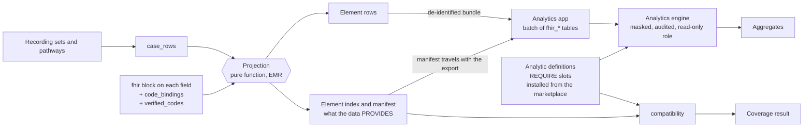

# Reference: Part II, design (sections 4 to 9)

*Part of the EMR Enhancer plan (v6, 20 Nov 2026). Give this file together with `plan-core.md`. Tick `[ ]` to `[x]` here as each task is done. If a task's Paste line names a section that is not in this file (for example "section 9" or "7.1"), the section map in `plan-core.md` says which file holds it.*

# Part II: Design

## 4. The approach: patient journey and four composable domains

*This is the owner's model. It sets the direction for everything below; the rest of the plan follows it. The status of each change is in 4.8.*

### 4.1 The idea in one paragraph
A patient moves through a journey: register, record, summarise, order, analyse. Registration is built into the software. The other four steps are **composable**: each is content that a user picks, mixes and installs, like the forms are today. The user **starts with Recording**, because the recorded data drives everything after it. Summary, Orders and Analytics are then offered, checked and shown against the chosen recording, and the user can also start from an order set or an analytic and work backwards.

### 4.2 The journey and what is fixed or composable

| Step | Approach | Fixed (hard-coded) part | Composable part |
|---|---|---|---|
| 1. Registration | Built in, by default | MRN, duplicate check, merge, one open encounter per bed, national id handling | none |
| 2. Recording | **Composable (anchor)** | version pinning, row rules, entered-in-error, audit | pathways, sets and templates, from the marketplace |
| 3. Summary | **Composable** | alert evaluation and acknowledgement | summary layouts; a default summary is derived from the recording |
| 4. Orders | **Composable, plus a small engine** | order status rules, roles, audit | order sets and catalogs |
| 5. Analytics | **Composable, in the Analytics app only** | the engine, masking of small counts, audit (all in the Analytics app) | analytics definitions, from the marketplace, installed in the Analytics app |

Always fixed, in every step: sign and amend notes, rule approval, alert acknowledgement, audit log, permissions, login, conflict handling, the "Not for clinical use" banner. These enforce safety. Composable content can change what is shown, never what is enforced.

### 4.3 Four composability domains
1. **Recording.** Pathways, sets and templates that capture patient data. This is what exists today. It is the anchor.
2. **Summary.** How the recorded data is brought together for a quick view. Default: each applied set gives its own card (latest value, age, count) from its own definition, so a new pathway needs no summary work. A summary layout only reorders or overrides.
3. **Orders.** Two parts. (a) Order sets: a list of what can be ordered, entered freely like a recording, with free-text instructions and no dose logic. (b) An order **engine**: statuses, which changes are allowed, whether a reason is required, who may do it. The engine is declared as data but enforced by the server. Other records refer to an order by its id. No other system is connected (FHIR is export only).
4. **Analytics.** (Lives only in the Analytics app, section 2. Detail in 7; built on FHIR elements, 6.) Closed kinds of analysis (for example count, distribution, time series, sum by key, time to event, data completeness) declared as data and run on the server with small-count masking. A definition never contains a free expression, a threshold or a target.

### 4.4 One contract: provides and requires
- A **recording** states what it **provides**: its fields, each with a structural role (the closed list of seven in 6.4) and, when a verified code is attached, a concept. Provides is **derived** from the set and its `fhir` blocks and `code_bindings`; nobody types it.
- A **summary, order set or analytic** states what it **requires**, as slots. It never names a set id.
- The software compares them and produces a **coverage result** per slot: met, partly met or unmet. It also shows the other direction: recording fields that nothing uses.
- Matching compares role, type and unit. It never converts units. A person can also bind a slot to a field by hand, and that choice is saved.
- Every match shows its basis ("matched on: number, mL") so a person can judge it.

### 4.5 The cross-matching marketplace
The marketplace for all four domains shares one index of what each item provides or requires. It works in both directions, with the recording as the main starting point.

1. **Pick a recording.** The marketplace lists:
   - every compatible **summary** layout,
   - every compatible **order set** (free choice, like recordings),
   - (EMR app: summaries and order sets only. Compatible **analytics** are shown in the Analytics app, from the elements manifest of an export; see section 2.)
   and for each one shows what is **covered** and what is **not covered**.
2. **Pick an order set or summary first (EMR), or an analytic (Analytics app).** It lists the recordings or data that can feed it, with the same covered and not-covered view.
3. **Pick several items.** The result can be read two ways:
   - **AND:** only items whose needs are all met by the selection.
   - **OR:** items with at least one need met, with the unmet needs flagged.
   The screen also shows **what remains**: slots still unmet and recording fields nothing uses.
4. **Go back and forth.** The user can change any selection and the other lists update.

"Covered" means the data is compatible. It never means the care was adequate. Wording on screen follows the same rule as the ward board: data as recorded, no judgement.

### 4.6 Two kinds of matching, built in this order
1. **Structural** (first). Role, type and unit, such as "a number with a unit and a time". Safe and checkable. The view blocks in Phase V already declare this.
2. **Concept** (later, optional). "A fever trend needs body temperature." The shared name is the **verified code already attached to the field** (`code_bindings`), so no new governed vocabulary is needed (6.4). Built only after the structural layer works.

### 4.7 Risks to design for
- **Vocabulary drift.** The list of roles must stay short and closed. A new role needs an informatician's approval.
- **False matches.** Same role, different meaning. Reduced by showing the match basis and allowing a manual binding.
- **Coverage read as quality.** Prevented by wording and a test.
- **Version drift.** Matches record the versions they were made against and are re-checked on update. A view that cannot match its set hides that part with a plain note and never shows a wrong number (fail visible, not silent).
- **A changed field breaks its users.** A "who uses this field?" check on set save warns before a field is removed or retyped.
- **Too many selections at once.** Start with one recording and one list per domain.
- **Analytics privacy.** Masking lives in the engine, not in any package.
- **Orders carry real risk.** The order engine is the first place where data needs enforcement. It stays small and goes behind a review gate.

### 4.8 What changed in the plan, and its status
- **Phase V (current):** the view vocabulary, I/O slice first. Stays, and gains the hand-named spots found in the audit (HbA1c due badge, dailygrid targets, BP pairing, default pins, sliding-scale echo, inline seed copy). *Unchanged.*
- **Capability contract = Phase F (F0 to F3).** Role vocabulary (6.4), element index, pure `compatibility()` with a coverage report, tests with made-up sets. No screen. *Written in v3.*
- **Matching marketplace = Phase M.** Provides and requires in the signed index, matching in the browser, then picker, reverse, AND/OR and manual binding. *Written in v3.*
- **Domains, in order:** Summary (Phase S), then Orders (Phase O: set plus engine), then Analytics (Phase A, closed kinds, server-run, masked). Phase A (now in the Analytics repo) replaces the 38a tasks; Phase O replaces the client-only status change of 48b1; the rest of Phase 7 continues after them. *Written in v3.*
- **Review gates:** after the I/O slice (V4), after F3, and before Orders (15.3).
- **Resolved by v3 (proposals; confirm in section 13):** the first list of roles (6.4, decision 24); who approves new roles (decision 25); how a manual binding is stored (decision 26); Summary layouts (decision 27).

## 5. Role first: every element starts with its access

**Rule.** Before an implementer builds or installs any element (a recording form, a summary layout, an order set, an analytic, a view pathway), the first decision is **who may do what with it**. Nothing is built until its access is written down. The server enforces it; the screen only mirrors it.

### 5.1 Access actions (a short, closed list)

| Action | Meaning |
|---|---|
| `view` | see its data or its output |
| `enter` | add rows or values |
| `amend` | correct a row (own or others', stated per element) |
| `approve` | approve, verify, enable or sign what it contains |
| `configure` | edit its definition, install it, switch it on or off |
| `export` | take its data out of the system (CSV, FHIR, de-identified) |

Roles are the existing five: viewer, nurse, doctor, informatician, admin. A new role is a decision, not a side effect.

### 5.2 What each domain must declare

| Domain | Typical questions the implementer answers first |
|---|---|
| Recording | who enters, who amends, who sees; may a nurse enter before a doctor has applied it? |
| Summary | who sees it; does it show anything beyond what the viewer may see in the recording? |
| Orders | who places, who changes status, who discontinues, who administers |
| Analytics | enforced in the **Analytics app** with its own roles (decision 30): who sees aggregates, who sees patient lists, who installs, who exports. The EMR only decides who may export data to it (`analytics.export`). |
| View pathways | who may switch them on (decision 11) |

### 5.3 How it works
- Each element carries an `access` block: for each action, the list of roles. Roles are taken only from the role table in `permissions.js`.
- **Default deny.** A new element with no `access` block is refused by lint. Existing seed sets get a block that reproduces today's behaviour exactly, so nothing changes silently.
- **Narrow, never widen.** An element can only restrict what a role already has in `permissions.js`. It cannot give a viewer the right to enter.
- **Every route checks it** on the server, together with the normal version check and audit row. Hidden buttons are only a mirror.
- **Matching respects access.** The marketplace only offers a viewer analytics and summaries that the viewer's role may see for the selected recording.
- **Marketplace packages carry a suggested `access`.** At install the admin sees it, confirms or narrows it, and the install uses the narrowest result. A package role that does not exist locally is refused.
- **Changing access is audited** (who, before, after) and, for reviewed content, creates a new version.
- **Tested as a matrix:** every element, every action, every role, generated from the data, like the existing role-by-route test.

### 5.4 Open questions (see decisions 18 to 20)
- Today roles are global. There is no restriction by ward or team. Is that enough?
- Who may change an element's access: admin only, or also informatician?
- Does analytics need its own role (for example analyst) that sees aggregates only and no patients?

"Perfect" cannot be promised in advance. What the plan can promise is that access is explicit, default-deny, enforced on the server and covered by a generated test for every element.

## 6. The FHIR spine: recording to FHIR elements to analytics

*Owner's rule: analytics is built on FHIR elements and on nothing else. The same rule already runs the sister project (VibeRounds Clinical Analytics, github.com/avi33tbtt/VibeRounds-Clinical-Analytics-App), which reads only `fhir_*` tables. This section makes the EMR side match it.*

### 6.1 The rule in one line
An analytic never reads a set id, a field id or a case row. It reads **element rows**: one recorded value described in FHIR terms. Exactly one piece of code knows both worlds, the **projection** (6.5). Everything before it is recording and lives in the EMR. Everything after it is analytics and lives in the Analytics app; the export is the only bridge (section 2).



### 6.2 Words used from here on (one meaning each)

| Word | Meaning in this project |
|---|---|
| **Element** | A field of a set that is bound to FHIR: a resource, a value type, a unit, and optionally a verified code. The unit of everything below. |
| **Element key** | Text that identifies an element for matching: `Resource.path \| role \| unit \| system:code` (see 6.4). |
| **Element row** | One recorded value of one element: patient, encounter, time, key, value, status. Produced by the projection. Never stored by hand. |
| **Provides** | What a recording offers: its list of element keys. Derived from the set, never typed by hand. |
| **Requires** | What a summary, order set or analytic needs: a list of **slots**. A slot is a wished-for element key with parts left open (for example any code, unit mL). |
| **Coverage** | A *definition-level* check, before any patient data exists: does recording A provide what analytic B requires? met, partly met, unmet. Lives in the marketplace and on set save. |
| **Readiness** | A *data-level* check, after data exists: is the data actually filled in, coded and dated enough for this analytic to return something? Modelled on the "Analytics readiness" screen of the analytics app. |
| **Projection** | The pure function `projectCase(...)` that turns case rows into element rows. |
| **Reference list** | Clinical lists an analytic may need that must never sit in its definition: first-line drugs, risky pairs, abnormal limits, goals. See 6.8. |

Coverage and readiness are different questions. Coverage says "this recording *can* feed this analytic". Readiness says "this ward's data *does* feed it today". Both are shown, never merged into one score, and neither is a statement about quality of care.

### 6.3 What already exists in the repo, and what is missing

*Checked on the public repo clone (commit `eacd1bd`). I read code and migrations; I did not run `npm test`.*

| Piece | Where | State |
|---|---|---|
| Field to FHIR binding | `fhir:{resource, valueType}` on a field in `element-sets.js` (for example `temp`, `io_volume`) | exists on numeric fields; absent on time, select and text fields |
| Verified codes, field bindings | tables `verified_codes (system, code, display)` and `code_bindings (set_id, field_id, system, code, display)` in `001_core.sql` | exists; nothing is pre-filled (rule: a person adds a code verified in the official browser) |
| Recorded values | `case_rows (case_id, set_id, group_id, row jsonb, row_time, status, entered_by)`; `status` is `active` or `entered_in_error` | exists; `row` is `{fieldId: value}` as typed |
| Who and when | `cases.patient_id`, `cases.encounter_id`, `patients.mergedInto` | exists |
| Export to FHIR | `buildBundle` in `enhancer.html` | exists; client side, identified export for one case |
| Role of a field (time, number, category...) | nothing | **missing**: derived from `field.type` in F2 |
| Unit as UCUM | `unit` is a display string (`mL`, `°C`) | **missing**: matching compares the string as typed, never converts |
| A way to list "what does this recording provide?" | nothing | **missing**: F2 |
| Diagnoses as an element | only `diagnosis:{text, snomed}` on the case seed | **missing**: no `Condition` recording set (see decision 28) |
| Procedures | no set | **missing** (analytics 12 cannot run until one exists) |
| Registration demographics as elements | `patients` table and encounters exist | **to check** in F0: which of gender, birth date, race, ethnicity are captured |

### 6.4 Roles and the element key

A **role** says what kind of value a field holds, in terms matching can compare. The list is **short and closed**; a new role needs an informatician's proposal and an admin's approval (decision 25). First list, each tied to a FHIR type so the meaning is not invented here:

| Role | FHIR type | Set field type it comes from | Matching compares |
|---|---|---|---|
| `time` | dateTime / effectiveDateTime | `datetime` | role only |
| `quantity` | Quantity | `number` (with or without `unit`) | role + unit string (unitless is `-`) |
| `category` | CodeableConcept | `select` | role (+ option list, shown, not required) |
| `status` | code | `select` flagged as status in the view block | role |
| `text` | string | `text` | role |
| `actor` | Reference(Practitioner) | session user | role |
| `link` | Reference | text holding another row's id (decision 14) | role |

**Element key** format, one line, human readable:

```text
Observation.value | quantity | mL  | -                      (I/O volume, no code attached)
Observation.value | quantity | Cel | <system>:<verified>    (a temperature with a verified code)
```

Two levels of matching, built in this order (this is 4.6, now concrete):
1. **Structural.** Compare resource, role and unit. Works with zero codes. This is what ships first.
2. **Concept.** Also compare `system:code`. This needs no new governed list: the concept is the **verified code already attached through `code_bindings`**. A facility that has attached a verified code gets concept matching on that field; one that has not still gets structural matching plus manual binding. No code is ever filled in by the software.

**Coding is a free choice (Phase P).** A field may carry several codings (any code system, a local system, or none), so the key's last part becomes a list of `system:code` pairs; with none it is `-`. Matching on a code system is optional: a slot says `codeSystem: any` unless an author asks for one.

Rules that keep matching honest: no unit conversion; every match shows its basis ("matched on: quantity, mL"); a same-role-different-unit pair is shown as "unit differs" with a manual bind button; a manual bind is stored locally and audited (decision 26).

### 6.5 The projection (the one place both worlds meet)

`projectCase(caseRows, sets, bindings)` is a **pure function** in a root file `elements.js` (browser and Node, same pattern as `views.js`). Rules:

1. One element row per active row per bound field. Rows with `status = entered_in_error` are skipped.
2. Time comes from the row's `row_time`. If it is null the element row is kept with no time and counted by the completeness analytic; it still counts for V1/V2, not for V4.
3. Value as recorded. Units are never converted, doses are never parsed, free text stays text.
4. A code appears on an element row only if `code_bindings` holds it for that field. Unverified codes never appear.
5. Patients are resolved through `mergedInto` by the caller; the function receives the final patient id.
6. Viewing and projecting write nothing (rule E6).

Element row shape:

```json
{"patientId":"<uuid>","encounterId":"<uuid>","caseId":"<uuid>","rowId":"<uuid>",
 "resource":"Observation","role":"quantity","unit":"mL","system":null,"code":null,
 "valueNumber":250,"valueText":null,"time":"2026-11-20T08:30:00Z","status":"active",
 "source":{"setId":"care.intake_output","setVersion":2,"fieldId":"io_volume"}}
```

`source` is kept only so a person can trace a number back and so a "who uses this field?" check works. **No analytic definition may read `source`** (rule E9).

*Why a pure function first and not a SQL view:* case rows are `jsonb` keyed by field id, and the field list lives in set definitions, so a generic SQL view has to know the sets. A pure function is testable with made-up sets (rule E3). The function is the single source of truth for the export (F7); the EMR keeps no analytics table.

### 6.6 How element rows reach the analytics (one route)

The EMR does not run analytics. It **exports**; the Analytics app **imports and analyses**.

| Step | Where | What |
|---|---|---|
| 1 | EMR | `projectCase` makes element rows (6.5) |
| 2 | EMR | the export route (F7) writes a de-identified FHIR R4 bundle and an **elements manifest**: the element keys present, with counts, and no set or field ids |
| 3 | Analytics app | imports the bundle as a batch through `POST /api/import-fhir` (import password and data-use confirmation stay); stores the manifest with the batch |
| 4 | Analytics app | installed analytic definitions are checked against the manifest (coverage) and the data profile (readiness), then run on the scoped views |

Same batch name on re-export updates by resource id, so the export gives each element row a stable id. Whether the export is **pushed** by an admin or **pulled** by the Analytics app on a schedule is decision 33 (default: pushed by an admin, because it keeps the EMR free of outbound calls).

**Which app does what, so they do not blur:**

| | EMR Enhancer | VibeRounds Clinical Analytics |
|---|---|---|
| Purpose | recording at the bed, summary, orders, export | all analytics and research |
| Analytics engine, definitions, masking | **none** | all |
| Free SQL, AI-written queries, knowledge graph | none | yes, behind a SELECT-only role and a query guard |
| Marketplace items it installs | recording, pathway, view, summary, order set | analytic definitions |
| Roles | viewer, nurse, doctor, informatician, admin | viewer, analyst, admin (decision 30) |
| Input | live case rows | imported FHIR bundles in batches |

**Where EMR element rows land in the analytics app's tables:**

| EMR element source | FHIR resource | Analytics app table | Notes |
|---|---|---|---|
| vitals, labs, I/O, any numeric result | Observation | `fhir_observation` | code needed for V2/V4 |
| diagnoses (new set, decision 28) | Condition | `fhir_diagnosis` | |
| medication orders | MedicationRequest | `fhir_medication` | order text is free text, so V1 only until a code is attached |
| allergies | AllergyIntolerance | `fhir_allergy` | |
| ADT, schedule | Encounter | `fhir_encounter` | |
| procedures (no set yet) | Procedure | `fhir_procedure` | |
| MAR, non-medication orders | MedicationAdministration, ServiceRequest | **no table** | not exported to analytics at first (decision 29) |

*One honest limit:* I read the Analytics app's README, not the code of `analytics.js`. Task AA0 is a no-code assessment of what the engine really assumes before anything is added to it.

### 6.7 Modes and readiness, in terms of what a recording carries

The analytics app has five modes. In EMR terms, a mode is simply "what must an element carry?":

| Mode | Element must carry | If a recording lacks it |
|---|---|---|
| V1 text | text value | still usable; weakest |
| V2 codes | a verified code (`code_bindings`) | the element is invisible to V2; coverage shows "needs a code" |
| V3 enriched | V2, plus approved enrichment for uncoded text | enrichment is done in the analytics app (strings coded once, a person approves) |
| V4 codes + time | verified code and a time | rows with no `row_time` are flagged by the completeness analytic |
| V5 enriched + time | V3 plus time | enrichment adds codes, never dates |

So a recording author can see, before any patient is entered: "this form supports V1 and V4 for temperature; I/O volume is V1 only until a code is attached." That is the practical payoff of putting FHIR elements first.

### 6.8 Reference lists: where clinical lists may live

Many of the 14 analytics need a clinical list: first-line drugs for a condition, risky drug pairs, chronic-condition lists, abnormal lab limits, control goals (the Disease module uses HbA1c 7 and systolic BP 140 as goals). The EMR plan forbids these in definitions (rule E4, and 4.3: no threshold or target). Three classes resolve the clash:

| Class | What | Where it lives | Example |
|---|---|---|---|
| 1. Definition | slots, kind, grouping, access | the package; reviewed; hash-pinned | "count patients per code of this slot, by year" |
| 2. Run parameter | a number or choice typed when running | not stored in any package; echoed on the result and in the audit row | "goal: [typed], look-back: 12 months" |
| 3. Reference list | a clinical list with a named owner | local only; created by a person, approved by an informatician (two reviewers if it holds limits); arrives `enabled:false` if it ever comes in a package | first-line drug list, risky pairs |

This is the same pattern the analytics app already uses for `concept_overrides` (reviewer decision, then data-derived value, then built-in dictionary) and the same "needs local enable" step as marketplace rules (46c5). **First wave of analytics uses only class 1 and class 2**, so nothing in a package can carry a clinical judgement.

### 6.9 Privacy and access, where each rule lives

| Rule | Where it lives |
|---|---|
| Small groups hidden (under 5 patients, `PATHWAY_MIN_CELL`) | Analytics app, server side, already built |
| SELECT-only database role for every analytic | Analytics app (`db-readonly.sql`), already built |
| Patient lists audited as PHI reads | Analytics app, already built; new definition lists follow it (AA10) |
| Who may install or run a definition | Analytics app roles (decision 30) and the definition's `access` block |
| De-identification of the export (no name, MRN, phone, national id; pseudonymous ids; dates as days since encounter start, decision 22) | **EMR** export route (F7), audited as `analytics.export` with the filter used |
| Who may export | EMR, doctor and admin (action `analytics.export`) |
| Import lock and data-use confirmation | Analytics app, already built |

The EMR therefore carries **one** analytics-related permission, `analytics.export`.

## 7. Analytics as a composable domain, in detail

### 7.1 What an analytic definition is
*(Installed and run in the Analytics app only.)* A small JSON document: a **kind** from a closed list, **slots** it requires, how to group and window, who may use it. It contains no query text, no expression, no threshold, no target, no drug or code list.

```json
{"setId":"analytic.vitals_completeness","kind":"analytic","contexts":["analytics"],"version":1,
 "title":"Data completeness of a numeric recording",
 "analyticKind":"completeness",
 "requires":[
   {"slot":"value","resource":"Observation","role":"quantity","unit":"any"},
   {"slot":"when","role":"time","sameRowAs":"value"}],
 "groupBy":["encounter.ward","month"],
 "params":[{"name":"months","type":"integer","min":1,"max":36,"default":6}],
 "modes":["v1","v2","v4"],
 "output":{"table":true,"chart":"bars"},
 "access":{"view":["analyst","admin"],"configure":["admin"]},
 "rules":[]}
```

Things the validator (AA1) refuses: a key named `sql`, `where`, `expr`, `eval`, `function`, `threshold`, `target`, `limit`, `band`, `dose`; a slot that names a set id or field id; a missing `access` block; a `requires` slot with an unknown role; more than one `analyticKind`.

### 7.2 The closed list of analytic kinds
The first six are in your plan (4.3). Two more are needed to cover the existing 14 analytics and are marked "propose" (adding a kind needs a pure function, a test with a made-up set, a validator entry and a line in the docs, rule E3).

| Kind | Answers | Source in the analytics app |
|---|---|---|
| `count` | how many patients or rows per group | prevalence, utilisation, volumes |
| `distribution` | spread across categories or bands of one slot | demographic distributions |
| `timeseries` | a measure per month or year | yearly trends |
| `sumByKey` | plain sum of a quantity per key and window (the I/O idea, at ward level) | volume per type |
| `timeToEvent` | days from event A to event B, with "within N days" shares | diagnosis to first prescription, readmission |
| `completeness` | share of rows filled, coded, dated | Data quality and completeness |
| `summaryStats` (propose) | mean, median, IQR of a quantity; no "abnormal" without a class 3 list | Lab and vital summary |
| `pairs` (propose) | two slots occurring together, or B within N days after A | Comorbidity patterns, co-prescription |

### 7.3 The 14 existing analytics, mapped

Taken from the analytics app's README table. "Reference" says which class from 6.8 the analytic needs beyond its definition. **Wave 1 = needs nothing beyond class 1 and 2**, so it can ship as a marketplace package with no clinical list in it.

| # | Analytic | Kind(s) | Slots required | Reference needed | Wave |
|---|---|---|---|---|---|
| 14 | Data quality and completeness | `completeness` | any element and its time | none | **1 (first)** |
| 1 | Demographic distributions | `distribution` | registration gender and birth date; optional Condition code | none (age bands are display bands typed as a param) | **1** |
| 7 | Encounter utilisation | `count`, `timeseries` | Encounter class, period | none | **1** |
| 12 | Procedure volume | `count`, `timeseries` | Procedure code, time | none; needs a Procedure recording set | **1** (after set exists) |
| 2 | Condition prevalence and incidence | `count`, `timeseries` | Condition code, onset | none; needs a Condition set | **1** (after set exists) |
| 3 | Medication utilisation | `count`, `timeseries` | MedicationRequest code, time | none; V1 only until orders carry codes | **1** |
| 4 | Lab and vital summary | `summaryStats`, `timeseries` | Observation quantity, code, time | % abnormal needs class 3 | 1 (without % abnormal) |
| 5 | Comorbidity patterns | `pairs` | two Condition slots | none | 2 |
| 11 | Allergy profile and conflicts | `count`, `pairs` | AllergyIntolerance code, severity | conflicts need class 3 | 2 |
| 8 | Chronic disease control | `summaryStats` | Observation, time | goal as class 2 param or class 3 list | 2 |
| 9 | Preventive screening and care gaps | `count`, `timeToEvent` | Procedure, interval | interval as class 2 param | 2 |
| 6 | Treatment patterns | `timeToEvent` | Condition, MedicationRequest | first-line list, class 3 | 3 |
| 10 | Polypharmacy and risky pairs | `pairs` | MedicationRequest codes | risky-pair list, class 3 | 3 |
| 13 | Multimorbidity burden | `count`, `distribution` | Condition codes | chronic list, class 3 | 3 |

The richer analytics of the analytics app (Disease module, Inpatient trajectory, Kaplan-Meier, care pathways, knowledge graph) stay there. They need free-form logic or reference data that closed kinds cannot hold. The bridge (Route 1) is how a researcher uses them on EMR data.

### 7.4 One run, step by step (in the Analytics app)
1. A user whose role is in the definition's `access.view` picks the definition and a **scope** (population or batch, cohort, date range; the analytics app's existing scope rules).
2. The app computes **coverage** from the batch's elements manifest and **readiness** from the data profile, and shows both before running.
3. The app runs the kind's function over the scoped views on the read-only connection.
4. Groups under the minimum are hidden.
5. The result carries: scope used, definition version, parameters typed, the mode that ran, readiness counts (rows uncoded or undated), the "as of" time of the export, and a plain "data as recorded, no judgement" line.
6. One audit row is written (who, definition id and version, scope, params; never results or patient data). A patient list is a separate action with its own audit row.

## 8. Summary and Orders, in detail

### 8.1 Summary (derived by default)
Every applied recording gets a **card** with no layout work. The card is produced from the set's elements by role:

| Role of the main field | Card shows |
|---|---|
| `quantity` | latest value, unit, age of the reading, count in the last window |
| `category` or `status` | latest value and its age |
| `text` | latest entry, shortened, with its time |
| groups with a `time` and a `statusboard` | count per status group |

A **summary layout** (a data document, `contexts:['summary']`) only does three things: orders the cards, hides cards, or overrides a card's window. It requires slots, never set ids. A layout whose slot is unmet hides that part with a plain note, never a wrong number (fail visible, 4.7). Whether layouts are marketplace items or built in is decision 27; default: derived cards built in, layouts as marketplace items later.

### 8.2 Orders: a set plus a small engine
- The **order set** is an ordinary recording (`care.orders`, 48a1) with free text. It is the only place order content lives.
- The **engine** is a data block next to the set that says which status changes are allowed, which need a reason and who may do them. The **server enforces it**; the screen only mirrors it (this is what 4.3 means by "declared as data, enforced by the server").

```json
{"engine":{"statusField":"ord_status",
  "transitions":[
   {"from":"Draft","to":"Active","roles":["doctor","admin"]},
   {"from":"Active","to":"Completed","roles":["doctor","nurse","admin"]},
   {"from":"Draft","to":"Discontinued","roles":["doctor","admin"],"reasonField":"ord_reason","reasonRequired":true},
   {"from":"Active","to":"Discontinued","roles":["doctor","admin"],"reasonField":"ord_reason","reasonRequired":true}],
  "never":["delete","reopenFrom:Discontinued"]}}
```

Rules: a change that is not listed is refused with 422 and a plain sentence; a refused change writes nothing; an allowed change uses the normal row patch (version sent, 409 on conflict, one audit row in the same transaction); a discontinued row is kept. The role lists can only narrow what `access` already allows. Doses stay free text and are never calculated or summed. This replaces the client-only `actions` idea in 48b1 for the status change itself; `actions` stays as the button layer that calls the engine.

## 9. The design in short

Three layers. Only the third is new.

| Layer | What it is | Status |
|---|---|---|
| Sets | Fields, repeat groups, units (`care.vitals`, `care.intake_output`) | unchanged |
| View blocks | Optional declarative blocks inside a set: how its rows are shown | `view.type` flowsheet / fever / dailygrid exist; new optional keys added in Phase V and 7 |
| EMR view pathways | A pathway (`kind:'pathway'`, `contexts:['emr']`) with a `surface` (where it appears) and optional `sections` (what it lists) | new |

**View block keys (all refer to field ids declared in the same set; none holds a dose, threshold, band or rule):**

| Key | Does | First used by |
|---|---|---|
| `summary:[{type:'sumBy', timeField, keyField, valueField, windowsHours, label}]` | plain sum of entered rows per key in a window; never compared to anything | I/O (V4) |
| `board:{show:'latest'}` | what a ward-board cell shows (default latest value and its age) | V5 |
| `banner:{chipField}` | active (not entered-in-error) values as a chip in the patient banner | allergies (49) |
| `statusboard:{statusField, groups:[{label, values}]}` | read-only grouping of rows by status | orders (48) |
| `actions:[{label, field, to, reasonField?, reasonRequired?}]` | one-click row patch of one field, through the existing row route | orders (48) |
| `crosscheck:{against:{setId, field}, textField, message}` | non-blocking note when two typed texts match | MAR (49) |
| `drives:{...}` | informational only, see decision 15 | ADT (50) |

**Surface types (closed list; adding one means a generic renderer plus a test):**

| Surface | Where | Sections / content |
|---|---|---|
| `case_tab` | an extra tab in a patient's chart | `sections[]` (see below) |
| `patients_columns` | columns on the Patients ward board | members, or `columnsFrom:'pinned'` |
| `patients_panel` | a panel on the Patients screen | one member set with an `upcoming` view |
| `banner_chips` | chips in the patient banner | members with a `banner` block |
| `export_section` | a sub-view in Export | sections for the charge summary |

**Section types for `case_tab`:** `narrative`, `activePathways`, `latestValues` (scope applied), `ackedAlerts` (hours), `newRows` (since `lastHandover`), `setTable` (a member set as a table), `statusboard`, `linkedgrid` (MAR).

**Worked examples (data only, no clinical values):**

```json
{"setId":"care.intake_output", "view":{"type":"flowsheet","timeField":"io_time",
 "summary":[{"type":"sumBy","timeField":"io_time","keyField":"io_type","valueField":"io_volume",
             "windowsHours":[8,12,24],"label":"sum of entered rows"}]}}

{"setId":"pathway.emr.ward_board","kind":"pathway","contexts":["emr"],"members":[],"rules":[],
 "surface":{"type":"patients_columns","columnsFrom":"pinned"}}

{"setId":"pathway.emr.handover","kind":"pathway","contexts":["emr"],"members":[],"rules":[],
 "surface":{"type":"case_tab","id":"ho","label":"Handover","print":true},
 "sections":[{"type":"narrative"},{"type":"activePathways"},{"type":"latestValues","scope":"applied"},
             {"type":"ackedAlerts","hours":24},{"type":"newRows","since":"lastHandover"}]}
```

**Engine rules (the "nothing hand-written" test):**

- **E1.** Code (`enhancer.html`, `store.js`, `api.js`) never names a clinical set id, field id or option text. Only seed data and tests do.
- **E2.** Every screen is a registered view, section or surface type plus data.
- **E3.** A new type needs: one pure function, a test that uses a **made-up set** (proves it is generic), a validator entry, one line in `VIEWS.md`.
- **E4.** View data holds ids, labels and display windows only. No doses, thresholds, bands or rules. Pathways stay `rules:[]` in seed.
- **E5.** View pathways are ordinary content: versioned, tiered, forkable, read-only when from the marketplace.
- **E6.** Viewing writes nothing. Writes use the existing row routes with the existing permissions, versions (409) and audit.
- **E8.** Every element (set, view pathway, order set, analytic) starts with an `access` block (section 5). No block, no seed, no install.
- **E9.** The EMR contains no analytics (section 2). Analytic definitions, engine and screens live only in the Analytics app. Definitions read the data only through slots (resource, role, unit, optional code), never a set id or field id; `source` on an element row is for tracing, never for logic. `elements.js` names no seed ids. Guarded by F8 in the EMR and by AA14 in the Analytics app.
- **E7.** The fixed frame stays fixed: patient banner, Summary, Flowsheets, Notes, Pathway, Alerts, Export, Settings and Tools. Safety-critical screens (alerts, notes signing, audit) are not data-driven.
