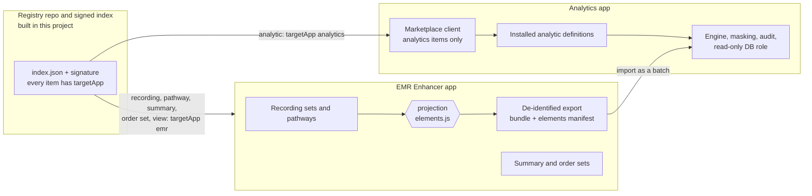

# Reference: Part I, direction (sections 1 to 3)

*Part of the EMR Enhancer plan (v6, 20 Nov 2026). Give this file together with `plan-core.md`. Tick `[ ]` to `[x]` here as each task is done. If a task's Paste line names a section that is not in this file (for example "section 9" or "7.1"), the section map in `plan-core.md` says which file holds it.*

# Part I: Direction

## 1. Reason and idea

**What went wrong.** The plan said every screen should come from the same engine: element sets (data) plus pathways (bundles of sets), like the disease pathways (DKA, snakebite, fever). Phase 5 chunks 37c and 37d then built the ward screens by hand: the I/O sum is code that names `care.intake_output`, `io_time`, `io_type` and `io_volume`; the ward board and the Handover tab are fixed screens with a fixed list of sections. Phase 7 (orders, MAR, allergies, ADT, charge summary) was about to repeat this with view types called `orders` and `mar` and special logic per component.

**What you want.** No hand-written clinical screens. The EMR views (ward board, handover, orders, MAR, allergies, schedule, I/O sum) are themselves **pathways**: seed content in the registry, versioned, forkable, tiered, installable from the marketplace, exactly like a disease pathway. The code only knows a small, generic vocabulary (how to show a latest value, a sum, a status board, a list of sections). The data says which set and which fields.

**The fix, in order.**
1. **Phase V (first):** define the vocabulary, validate it, build a generic renderer registry, then re-home what is already built (I/O sum, ward board, handover) as pathway data with identical output. Add a test that fails if hand-named sets or fields creep back into code.
2. Finish the rest of Phase 5 as planned.
3. Phase 6 gets two small additions (lint and tests for view data).
4. Phase 7 is rewritten so orders, MAR, allergies, ADT and charge summary are seed sets and view pathways plus a few generic view types, not special screens.

**Why this is better, not only tidier.** One mechanism to secure and test. Facilities can change a ward board or handover layout by editing data (a local draft pathway) with no new release. Marketplace packages can carry whole EMR layouts. A new ward screen costs one data file and, at most, one small generic renderer with a test.

## 2. Separation rule: two apps, one registry

*Owner's decision, 20 Nov 2026. It overrides anything below that says otherwise.*

**All analytics run in the Analytics app (VibeRounds Clinical Analytics). The EMR app contains no analytics engine, no analytic definitions and no analytics screens.** The marketplace is built in this project (the registry repo and the signed index) and serves **both** apps, but each app fetches and installs only its own kind of content.

| | EMR Enhancer | Analytics app | Registry (this project) |
|---|---|---|---|
| Does | record, summarise, order, export | all analytics, cohorts, research tools | host and sign packages |
| Fetches from the marketplace | recording, pathway, view, summary layout, order set | **analytic definitions** (and later, reference-list templates) | n/a |
| Never has | analytic engine, analytic definitions, `analytics.run`, `element_rows` table, masking code | recording forms, patient charting | patient data |
| Owns the element contract | yes (`elements.js`, projection, element index) | uses it through the **elements manifest** that travels with each export | stores `provides` / `requires` in the index |

**How the pieces meet**
1. The EMR projects case rows to element rows and exports a **de-identified FHIR bundle plus an elements manifest** (the list of element keys the data contains, no set or field ids). One route, one audited action (`analytics.export`).
2. The Analytics app imports the bundle as a **batch** through its existing import route (locked by the import password and the data-use confirmation, as today). Exporting again into the same batch name updates records by resource id, so the export uses stable ids per row.
3. The Analytics app fetches the signed index from the registry, verifies the signature with the pinned public key, and lists only items with `targetApp: "analytics"`. Install recomputes the hash, lints, and stores the definition read-only.
4. **Coverage** (definition vs what the data can provide) and **readiness** (definition vs what the data actually holds) are both computed in the Analytics app, from the manifest and from its existing data profile.
5. The EMR app lists and installs only `targetApp: "emr"` items. An analytic package offered to the EMR is refused by lint and by the install route, and the reverse.

**Why this is good for the project**
- The EMR server stays small: fewer routes, fewer actions, nothing that runs heavy queries next to the ward's charting.
- Analytics already has what a governed analytics system needs there: a SELECT-only database role, small-cell hiding (5 patients), audit with tamper evidence, import locks, readiness checks, the five modes.
- A research user and a ward nurse never share a screen or a role table.
- One registry and one signing key; two small clients.

**What this removes from the earlier plan (all later text follows it)**
- The in-app engine (old Route 2), the `element_rows` table, `analytics.run` and `analytics.patients` in the EMR, and masking code in the EMR are **not built**.
- Tasks 38a0 to 38a4, 38a5, 38b1, 38b2, 38b5 are not built in the EMR (the Analytics app has masking and patient-list audit already). 38b3 and 38b4 (de-identified exports) become F7.
- The hand-named `ana()` in `enhancer.html` is **retired** (task F9), which empties the V8a allow-list.
- Phase A is now a phase **in the Analytics repo** (section "PHASE A").

**Still open, see decisions 30 to 33:** roles in the Analytics app, whether the EMR shows any analytics information, whether the existing 14 analytics move into packages, and whether the export is pushed or pulled.

## 3. The final outcome: a complete EMR and a GitHub marketplace of composable items

### 3.1 The goal in one paragraph
Three things exist and work together. (1) A **complete EMR**: registration, recording, summary, orders, allergies, MAR, ADT, charge summary, handover, ward board, with login, roles, audit and conflict handling, built the way Parts II and IV describe. (2) A **GitHub registry** (the marketplace) holding signed, versioned, composable items for recording, summary, orders and analytics. (3) The **Analytics app**, which fetches analytic items from that registry and analyses data exported from the EMR. Nothing clinical is hard-coded in either app; all clinical content arrives as data. Both apps are built as **engines** that run content, the Analytics engine already exists and the EMR engine is the plan (3.7).

### 3.2 Definition of done (the final gate)

| # | The outcome is true when... | Checked by |
|---|---|---|
| 1 | A fresh install of the EMR, with an empty database, runs the whole patient journey on **synthetic data** with no hand-named clinical code left (guard tests pass) | V8, F8, Z8 |
| 2 | Every screen after login is a registered type plus data; the fixed frame is exactly the one in rule E7 | V8, manual review |
| 3 | Every element in both apps has an `access` block and the generated access matrix passes for all five EMR roles | R6, AA14 |
| 4 | The registry repo publishes a signed `index.json`; a changed byte, a bad signature, or a wrong `targetApp` is refused by both apps | 46a1c, AA3, AA4, Z7 |
| 5 | The first library (3.3) is installable: EMR items in the EMR, analytic items in the Analytics app, each with its coverage shown | Z6, Z7 |
| 6 | An export from the EMR imports into the Analytics app and the wave 1 analytics run on it, with small groups hidden and one audit row per run | F7, AA6, Z8 |
| 7 | A backup restores onto a clean database in both apps | 41b3 |
| 8 | The "Not for clinical use" banner is still there. Removing it needs the named-clinician sign-off in GOLIVE.md, not a release | 41c2 |
| 9 | The ten synthetic demo patients (Phase D) load on a fresh database and in Demo mode, exercise every domain, export to the Analytics app, and give the results `demo-expected.json` predicts | D5, D7 |
| 10 | A form author can pick any mix of SNOMED CT, LOINC, ICD, own local codes or no code per field; a form with no codes records, exports and shows coverage without error; a profile label is shown only with its checked-on date and never as "compliant" | P3, P12, P13 |

### 3.3 The first library (what the marketplace launches with)
Data only. No doses, thresholds, bands, rules or pre-filled codes in any item.

| Domain | Items in the first release | Installed in |
|---|---|---|
| Recording | vitals, intake/output, HbA1c monitoring, sliding-scale record, daily insulin grid, basic EMR template, the DKA, snakebite and fever pathways | EMR |
| EMR views | ward board, handover, MAR, schedule, charge summary | EMR |
| Orders and related sets | orders set with its engine block, allergies, MAR, ADT/schedule | EMR |
| Summary | derived cards are built in; first optional layouts | EMR |
| Analytics (wave 1, 7.3) | data completeness, demographic distributions, encounter utilisation, procedure volume, condition prevalence, medication utilisation, lab and vital summary (no abnormal share) | Analytics app |

Waves 2 and 3 of analytics (7.3) follow only when reference lists (class 3) exist and have named reviewers.

**Not part of the library:** the ten demo patients (Phase D). They are data, live in each repo's own demo files, and are never published as packages.

### 3.4 What "composable" means for an outside author
Someone who is not you can write a recording set, an order set, a summary layout or an analytic definition as one JSON package, run the lint locally, open a pull request to the registry, get it reviewed, and have it appear in the right app's marketplace with a "verified by peer review, not regulatory approval" label. Authors never need to touch app code. That is the test of the whole design.

### 3.5 What is not yet proven (read this before calling it solid)
- **It is a plan, not a system.** The repo has none of Phases V, R, F, A, M, S, O or Z yet (section 11, item 6). Nothing here has been run.
- **Closed vocabularies are the bet.** The role list, the analytic kinds and the view types must stay small and still be enough. The first real packages will test that; expect to revise the lists.
- **Matching can mislead.** A "covered" result means compatible data, not the right clinical meaning. The wording rule and manual binding reduce this; real users will still misread it.
- **Peer review needs people.** "Reviewer is never the author" and "two reviewers for rules" cannot be met by one developer. Until a second named reviewer exists, nothing can honestly be labelled marketplace-verified.
- **Two apps keep two copies of shared code** (`compatibility()`, `package-lint.js`). CI diff checks reduce drift but must exist from day one.
- **Regulation.** Health-data law, medical-device-software rules and terminology licences (SNOMED CT, LOINC) apply where this runs. Section 40c5 only lists what to confirm.
- **Scale and performance** of the projection, the export and the engine on real volumes are untested.
- **"Any system, any speciality" is a hypothesis.** It holds only while a small, closed set of view types is enough. Obstetrics partograms, oncology cycle grids, ICU device data and radiology reports will stress it; expect to add types.
- **Specialty content is data, new view types are code.** Informaticians can write templates alone; a developer must be available for the occasional new generic type (pure function, made-up-set test, validator entry). Clinical content also needs a clinician reviewer.
- **Layering has no merge rule yet.** Profile, disease template and local edit are layers; if two disagree (a required code versus "no code allowed"), the plan does not say which wins. Decision 43 must be settled before Phase P is built.
- **Customisation versus safety.** Every local edit is a place where verified content can drift. The tier labels (marketplace-verified, local-reviewed, local-draft) are what keep that visible; they must stay prominent.
- **Speed is untested.** Authoring a template as data should be fast; nothing has been measured, including projection, export and matching on real volumes.
- **Analytics sees SNOMED CT and LOINC only for now** (decision 42). Other codings are stored and exported but counted as uncoded there.
- **Early value is limited by the banner.** Until a named clinician signs off (GOLIVE.md), the "Not for clinical use" banner stays, so early use is training, demos, research on synthetic data and pilots.
- **Prior art exists.** openEHR archetypes, FHIR Questionnaires and CDS Hooks each cover part of this. The claim is the combination in one small app, not any single idea.

### 3.6 Why this could matter (the paradigm shift, if it works)

Most EMRs hard-code clinical content into screens, so every new specialty, disease pathway or national profile needs a software release, a vendor contract and months of waiting. This design flips that: the software is a small, stable engine, and clinical content is **data** that qualified people can write, review, sign, share and install.

What that would change, if the first build proves it:
- **Speed.** A new disease template is a reviewed data file, not a development project. An outbreak pathway could go from idea to installed in days.
- **Who builds the EMR.** Clinicians and informaticians author the content. Developers maintain the engine and add the occasional generic view type.
- **Sharing.** A pathway written in one hospital can be installed in another with its version, reviewer and hash visible: app-store logic for clinical content.
- **Standards as layers.** A national profile, a verified disease template and a local customisation are layers of the same mechanism, each labelled with what was checked (never "compliant", decision 41).
- **Analytics from day one.** Analytics reads the same element structure the recording uses, so data is analysable without later clean-up.
- **Reach and cost.** A small server and open content can serve a rural clinic and a large hospital with different data, which matters most where heavyweight EMRs are unaffordable.
- **Extensibility by experts.** Specialty depth (obstetrics, oncology and others) can be added later, one reviewed template at a time, at the pace reviewers allow, without touching the core.

**This is a vision, not a result.** Read it together with 3.5. The first real proof is Gate 1 (the I/O sum, ward board and handover become pure data), followed by one real specialty template built entirely as data (for example obstetrics). If that needs no new view types, the central claim has real evidence; if it needs one or two, the design still holds and you have learned where the vocabulary ends.

### 3.7 The core power: an EMR engine, built the way the analytics engine was

*Owner's framing, 20 Nov 2026. Checked against the public README of VibeRounds Clinical Analytics (19 commits at the time of reading); I read the README, not the code.*

**The idea in one paragraph.** The Analytics app is not a pile of fixed reports. It is an **engine** (`analytics.js`) that runs a catalogue of analytics in five modes over scoped data, with the safeguards built into the engine itself: a SELECT-only database role, small groups hidden on the server, an append-only audit log with a hash chain, import locks, and a readiness check that says what the data can support. The EMR Enhancer is meant to be the same kind of thing for care: a small, stable **EMR engine** (view types, element projection, access, audit, orders engine) that runs **content** (sets, pathways, summary layouts, order sets, profiles) which people write as data. In both apps the engine enforces safety and the content carries the clinical meaning.

**Why that helps clinicians and informaticians work together, at scale and at speed.**

| What the Analytics app already does | The same pattern in the EMR engine |
|---|---|
| An analytic is a definition run by one engine, so adding one does not mean a new screen | A recording, summary, order set or pathway is data run by generic renderers (Phase V, rule E1 to E3) |
| AI only **proposes** codes; a person approves, edits or rejects; source codes always win; the AI's own pick is kept so agreement can be measured | AI drafts of forms and rules stay drafts; a clinician or informatician approves; tiers show who reviewed what (Phase 6, section 44) |
| A readiness check says what the data can feed before anything is run | Coverage (definition level) and readiness (data level) in sections 6.2 and 7.4 |
| A deterministic synthetic generator makes the same data from the same seed | Phase D demo patients, same idea |
| Tamper-evident audit, roles table, one place for permissions | Phase R access blocks, `permissions.js`, audit rows in the same transaction |
| Reviewer decisions kept apart from derived values and the built-in dictionary | Class 3 reference lists (6.8) |

The division of work this gives:
- **Clinicians** say what must be recorded and shown, and review wording and content.
- **Informaticians** turn that into sets, pathways and profiles as data, lint them, and submit them for review.
- **Developers** keep the engine small, add a generic type only when data cannot express a need, and keep the guard tests green.
- **Nobody** has to wait for a release to change a form, a ward board or a handover layout, and every change is versioned, tiered and audited.

**Why this could scale.** Adding the tenth specialty costs the same kind of work as adding the second: content, lint, review. The engine does not grow with the content. The registry and the signed index let one reviewed item reach many sites.

**What this does not prove (read with 3.5).**
- The Analytics app is built and documented; the EMR engine is a plan with nothing built. "More powerful" is a claim about what the design can do, not about what exists.
- The two engines have different risk. Analytics reads exported, de-identified data. The EMR engine sits at the bedside, writes clinical records and carries orders, so its tests, access rules and review gates have to be stricter, not equal.
- Speed and scale are untested in both apps on real volumes (the Analytics README itself says a full smoke run takes minutes on 400 patients and import is about 25 seconds per 1,000 synthetic patients).
- Collaboration at scale needs people: a named clinician reviewer and an informatician reviewer who is not the author. One developer cannot satisfy that.

**Patterns worth copying from the Analytics app as they come up** (not new tasks; use them when writing the matching task): propose then review then approve with the proposer's pick kept; "source wins over enriched"; a "check everything" readiness job with plain reasons for each blocked cell; `--selftest` files that need no database; a cache key that includes the version of every input.
